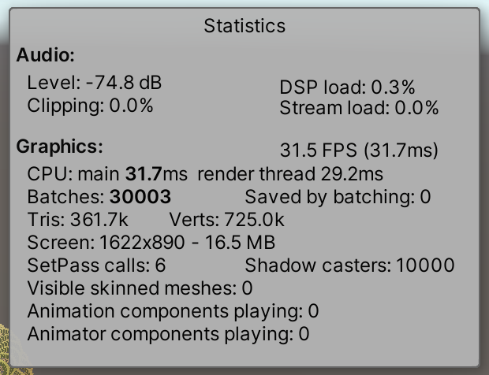
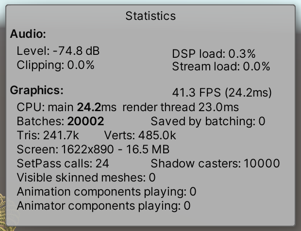
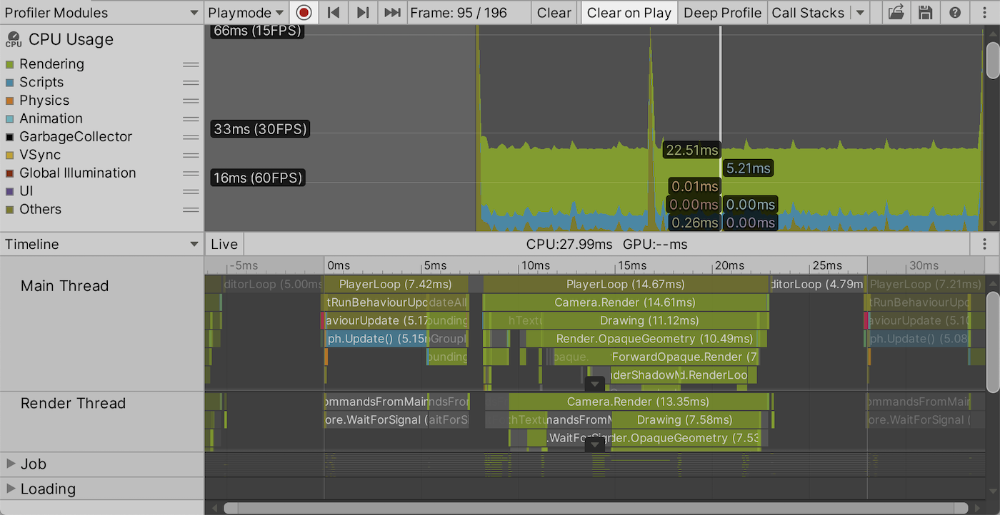

# Unity性能优化

Reference:
- *[Measuring Performance](https://catlikecoding.com/unity/tutorials/basics/measuring-performance/)*

## 性能检测

### Statics 窗口

在 Game 窗口的右上角可以打开 Statics 小窗，他不是很详细，但是很简单和方便。

---

在 BRP 下的示例：



> [!NOTE] Graphics
> - CPU 耗时：31.7ms
> - GPU 耗时：29.2ms
> - 帧率：31.5fps (31.7ms)

渲染一帧的耗时是二者取低，即受 CPU 耗时影响。但实际上忽略了 CPU 和显示画面所花时间，实际帧率要更低。

> [!NOTE] Graphics
> - Batches: 30003
> - Saved by batching: 0
> - SetPass calls: 6

示例中仅有一个方向光，渲染的目标为多个正方体，共有10000个点，所以看来每个点都渲染了3次。一次在深度通道，一次为阴影投射，一次为最终图形。

---

在 URP 下，渲染速度有显著提升。如下图所示，批处理次数降低为 BRP 的$\frac{2}{3}$。在 URP 中，少了一个 pass：从灯光视角渲染一遍，只写深度生成 shadow map -> 主渲染 pass，采样 shadow map 来判断阴影。



有两种技术可以提升渲染效率：

1. Dynamic Batching：将 mesh 的多个小顶点合并成一个大 mesh，再一次性提交给 GPU
2. GPU Instancing：把实例数据（矩阵等）打包发给 GPU，以让 GPU 在单次 dc 中重复渲染使用同个 material 的 mesh。

**然而 dynamic batching 因为无法作用与 shadow map，所以在 urp 中效果不如 gpu instancing。** 在 material 资产中可以勾选 `Enable GPU Instancing` 来启用 GPU 实例化。

> [!TIP]
> 现在 Unity 更推荐用 SRP Batcher（URP 默认开启），它比两者都更现代，对材质兼容性要求也更高一些。它的核心是：让相同 Shader 变体的物体之间，CPU 几乎不用重复设置材质属性（把数据留在 GPU 上），从而大幅降低每个 Draw Call 的 CPU 开销。

### Frame Debugger

Statics 窗口只能告知结果而不能告知原因，对于渲染过程的细节可以通过 Frame Debugger 查看。启用 Frame Debugger 会暂停你的游戏。

### Profiler

使用 Profiler 获取更多关于 CPU 的细节。



CPU 使用情况的默认底部视图是时间线（Timeline）。它可视化了一帧中各个部分分别花费了多少时间。可以看到，每一帧都从 PlayerLoop 开始，而它大部分时间都花在调用 RunBehaviourUpdate 上。你可以选中时间线上的某个区块，查看它的完整名称以及持续的毫秒数。

在最初的玩家循环段之后，会出现一小段 EditorLoop，然后是另一段玩家循环，负责这一帧的渲染部分——也就是 CPU 告诉 GPU 该做什么。这些工作会分配到主线程（main thread）、渲染线程（render thread）以及几个 Job 工作线程上。

渲染部分结束后（如果使用的是 URP，此时渲染线程可能还在忙碌），会再出现一段编辑器循环，之后下一帧就开始了。线程有时看起来会跨越帧边界，这是因为 Unity 可以在渲染线程还没完成的时候，就先在主线程上启动下一帧的更新循环，从而利用并行性。

如果你对线程的精确时间不感兴趣，可以通过左侧的下拉列表，把 Timeline 视图切换成 Hierarchy 视图。Hierarchy 会把相同的数据以可排序的列表形式显示出来。这个视图能更方便地看出哪些部分最耗时，以及内存分配发生在哪里。

---

Profiler 清楚地表明，编辑器给我们的应用增加了大量额外开销。因此，在应用独立运行时进行性能分析会有用得多。为此，我们需要构建（Build）应用，并且专门为调试而构建。可以在 Build Settings 窗口中配置构建方式，通过 File / Build Settings... 打开。然后勾选 Development Build 和 Autoconnect Profiler 选项。等 Player 完全启动后，再切回 Unity 看 Profiler。

如果没自动连上：
1. 打开 Profiler 窗口
2. 点左上角的 Target Selection（下拉菜单）
3. 手动选你的 Player

还是不行就再 Build and Run 一次，或者关掉多余的 Editor 实例。

### 游戏内的帧率显示

有时我们只想获得帧率的信息，有时游戏在 Editor 之外运行。此时我们需要自己实现一个小窗口来显示帧率。

```cs
[SerializeField]
TextMeshProUGUI display;

[SerializeField, Range(0.1f, 2f)]
float sampleDuration = 1f;  // 采样时间

int frames;
float duration;

void Update () {
    float frameDuration = Time.unscaledDeltaTime;
    frames += 1;
    duration += frameDuration;
    
    if (frameDuration < bestDuration) {
    	  bestDuration = frameDuration;
    }
    if (frameDuration > worstDuration) {
    	  worstDuration = frameDuration;
    }

    if (duration >= sampleDuration) {
        
        // 更新帧率显示
    		display.SetText(
    			"FPS\n{0:0}\n{1:0}\n{2:0}",
    			1f / bestDuration,
    			frames / duration,
    			1f / worstDuration
    		);

        // 重置计数器
    		frames = 0;
    		duration = 0f;
    		bestDuration = float.MaxValue;
    		worstDuration = 0f;
		}
}
```
