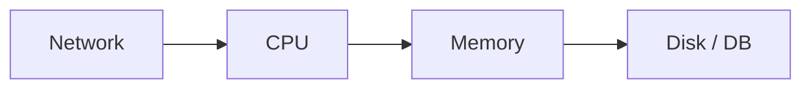
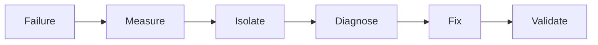
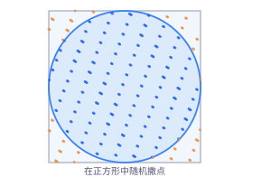
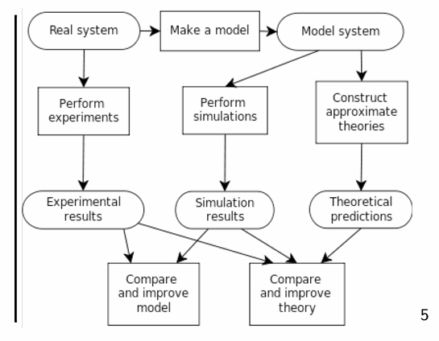
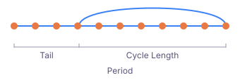
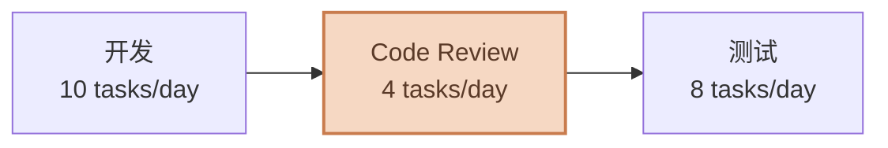
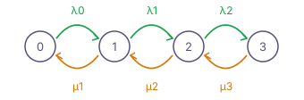
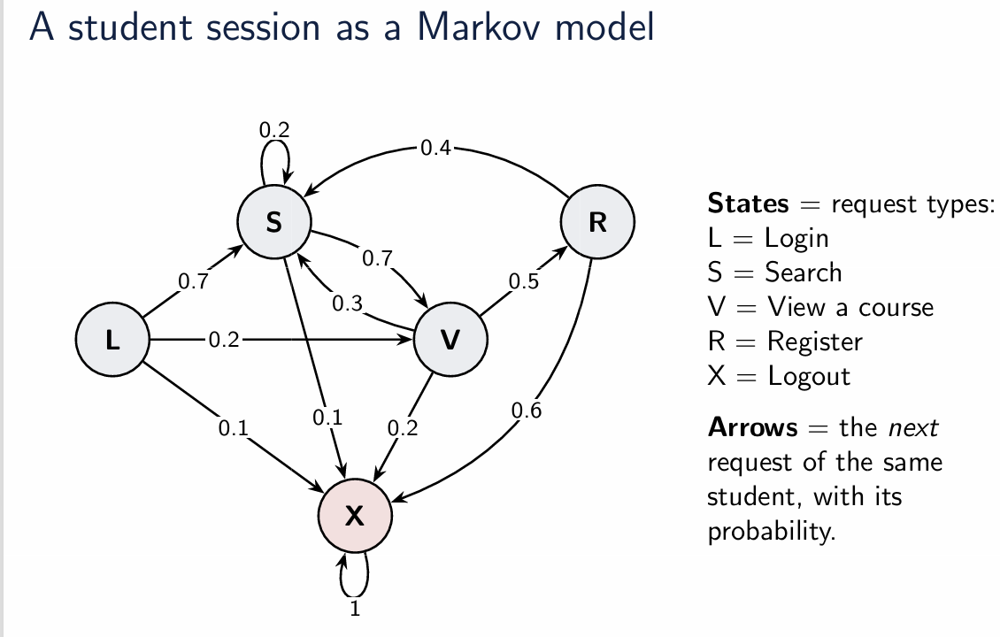

# 北工大计算计系统性能

课程目标：

1. 如何发现性能问题？
	- Identify performance bottlenecks：识别性能瓶颈
	- Determine the optimal value of a parameter：确定参数的最优值
	- Predict the performance of future workloads：预测未来工作负载下的性能
2. 如何通过数学分析性能？
	- Queueing Theory（排队论）：研究请求到达、等待和接受服务的过程
	- Linear Regression（线性回归）：利用已有数据分析变量之间的关系，并进行预测
3. 如何评价一个系统？
	- Measurement（测量）
	- Simulation（模拟）
	- Analytical Modeling（解析建模）

## 什么是 Performance？

Performance（性能）并不只是指系统运行得有多快，而是指系统在特定工作负载、资源和配置下表现得有多好。

| 组成部分                  | 含义    | 例子                       |
| --------------------- | ----- | ------------------------ |
| Workload              | 工作负载  | 10,000 名用户观看视频、搜索请求、视频上传 |
| Resources             | 可用资源  | 应用服务器、数据库、网络带宽、缓存        |
| Parameters / Settings | 参数与配置 | 服务器数量、视频码率、缓存策略、负载均衡     |
| KPIs                  | 性能指标  | 响应时间、吞吐量、视频启动延迟、可用性      |

- **Response Time（响应时间）** 是系统从收到请求到完成响应所需要的时间。例如，用户点击播放视频后，系统需要多长时间才能开始播放。
- **Throughput（吞吐量）** 是单位时间内系统能够处理的工作量。例如，每秒能够处理多少个请求，常用 requests/s 表示。

这两个指标所衡量的维度各不并不相同，不能仅凭一个指标判断系统性能好坏。

---

性能分析的终极目标： to obtain or provide the highest performance at the lowest cost.

（以最低的成本获得尽可能高的性能）

不过，Performance 和 Cost 的含义需要取决于具体系统和使用场景（Context），并且往往需要通过多个指标来衡量（Multiple Metrics）。例如：

|文件大小|LTE 下载时间|WiFi 下载时间|
|---|---|---|
|3 MB|0.7 s|0.1 s|
|10 MB|1.8 s|2.1 s|
|30 MB|6.1 s|24.3 s|

在下载不同大小的文件时，LTE 和 WiFi 的速度表现不同，我们直接无法判断谁的性能更高，如果比较**平均值**的话，也不足以判断谁在实际情况中表现更出色。因此，分析系统性能时，所处的情境总是至关重要。
#### How You Should See the Problem

1. System（系统）
	- Hardware（硬件）, Software（软件）...

2. Evaluation Techniques（评估技术）
	- Measurement：测量
	- Simulation：模拟
	- Analytical Modeling：解析建模

3. Metrics（性能指标）
	- Metrics 是用于量化系统性能的标准

4. Workload（工作负载）
	- The requests made by the users of the system 即系统用户发出的请求

5. Parameters（参数）
	- System Parameters（系统参数）和 Workload Parameters（工作负载参数）

| 要素                     | 例子                                        |
| ---------------------- | ----------------------------------------- |
| System                 | LTE and WiFi communication infrastructure |
| Evaluation Techniques  | Real-time measurements                    |
| Parameters and Factors | File size                                 |
| Metrics                | File downloading speed                    |
| Workload               | Downloading files                         |

## 性能的判断

那么在什么情况下，我们可以说一个系统的性能更优？在下面这个例子中，各有优劣，信息不足以判断：

| 指标                  | System A       | System B        |
| ------------------- | -------------- | --------------- |
| Response Time（响应时间） | 80 ms          | 120 ms          |
| Throughput（吞吐量）     | 100 requests/s | 1000 requests/s |

> [!INFO]
> 脱离 workload，讨论性能没有意义。

**让我们假设，100 名学生在 09:00 同时访问选课系统。** 

请求经过 Web Server，CPU/Memory 和 Database，最后返回响应。需要研究的问题是：每个请求需要多久？系统能处理多少请求？如果变成 1000 名学生会怎样？哪个组件会成为瓶颈？

性能研究包含五个要素：

|要素|网站例子|
|---|---|
|System（系统）|Web Server + Database|
|Workload（工作负载）|100 requests/s|
|Metrics（指标）|响应时间、吞吐量|
|Factors（影响因素）|CPU 核数、用户数、缓存大小|
|Evaluation Method（评估方法）|测量、模拟、建模|

### 三种性能指标

#### Metric 1: Response Time

响应时间 = 请求完成时间 − 请求到达时间

响应时间通常越短越好。
$$R=t_{\text{completion}}-t_{\text{arrival}}$$
#### Metric 2: Throughput

吞吐量：单位时间内完成的请求数量。

吞吐量不一定越高越好，还需要考虑 Latency（延迟）、Error Rate（错误率）、Energy Consumption（能耗）。

$$X=\frac{\text{Completed Requests}}{\text{Time}}$$

|Latency（延迟）|Throughput（吞吐量）|
|---|---|
|单个请求需要多久？|单位时间完成多少工作？|
|ms/request|requests/s|
|网页加载、数据库查询、网络 RTT|每秒交易数、数据包数、每小时任务数|

> [!Info]
> RTT（Round-Trip Time）指数据往返一次所需的时间

#### Metric 3: Utilisation

资源利用率：资源处于忙碌状态的时间占总观察时间的比例。
$$U=\frac{\text{Resource Busy Time}}{\text{Observation Time}}$$

例如 CPU 在 60 秒内忙碌了 54 秒：$U=\frac{54}{60}=90\%$

100% 的利用率理想吗？**通常不是**。例如，在某些情况下，CPU 越接近满载，新请求越容易排队，等待时间会急剧增加。

### 饱和、长尾延迟与性能瓶颈

Saturation（饱和）指系统接近或达到处理能力上限。超过饱和点之后：

- 输入的工作负载继续增加
- 吞吐量几乎不再增长
- 请求队列越来越长
- 响应时间增加：workload 增加，响应时间通常会先缓慢上升，随后在接近系统容量上限时急剧上升。原因是请求到达时，系统资源可能仍在处理之前的任务，新请求需要等待，这被称为 Queueing Region（排队区域）

**平均值可能具有误导性，还应考虑数据分布**，考虑下面例子：

|指标|Server A|Server B|
|---|---|---|
|Mean（平均值）|100 ms|110 ms|
|p95|700 ms|160 ms|
|p99|4.2 s|220 ms|

A 的平均响应时间更好，但 B 的长尾延迟明显更低。

- 长尾延迟（Tail Latency）：系统中绝大多数请求响应很快，但有少数请求的响应时间特别长
- Percentiles：百分位数
	- p50：50% 的请求响应时间不超过这个值
	- p95：95% 的请求响应时间不超过这个值
	- p99：99% 的请求响应时间不超过这个值

性能瓶颈可能出现在：

- CPU Saturation：CPU 饱和
- Memory Pressure：内存压力
- Disk I/O：磁盘读写
- Network Bandwidth：网络带宽
- Lock Contention：（多线程/进程）锁竞争
- Database Connection Pool：数据库连接池
	- 预先维护的一组数据库连接。如果连接全部被占用，新请求可能需要等待空闲连接。
- External Service：外部服务

一个网站运行缓慢，测量结果如下：

| 资源      | Utilisation |
| ------- | ----------- |
| CPU     | 22%         |
| Memory  | 48%         |
| Disk    | 35%         |
| Network | 97%         |

网络利用率已经达到 97%，很可能是当前瓶颈，需要提升 Network Capacity（网络容量）。

### Workload 与实验设计

Workload 描述系统接收到的请求，包括：

- Number of users：用户数量
- Requests per second：每秒请求数
- Request sizes：请求大小
- GET/POST ratio：GET 与 POST 请求比例
- Arrival pattern：请求到达模式
- Session duration：会话持续时间
- Think time：用户两次操作之间的思考时间
- File sizes：文件大小

其中， $\lambda$ 表示 Request Arrival Rate（请求到达率）。例如 $\lambda=100$ requests/s，表示平均每秒有 100 个请求到达系统。

Benchmark（基准测试） 是通过标准化任务评价系统性能的方法。进行公平比较时，必须明确测试条件。

#### Real vs Synthetic Workloads

|Real Workload（真实负载）|Synthetic Workload（合成负载）|
|---|---|
|来自真实用户行为|实验中人为生成|
|真实、有代表性|可重复、可控制|
|难以重复|容易扩展规模|
|可能涉及隐私数据|可能与真实情况不符|

例如，真实网站访问日志属于 Real Workload；使用工具模拟 10,000 名用户访问网站属于 Synthetic Workload。

---
#### System Parameters vs Workload Parameters

|System Parameters（系统参数）|Workload Parameters（负载参数）|
|---|---|
|CPU cores（核心数）|Arrival rate（请求到达率）|
|RAM（内存）|Request size（请求大小）|
|Cache size（缓存大小）|User population（用户数量）|
|Thread pool size（线程池大小）|Read/write ratio（读写比例）|
|Network link capacity（网络链路容量）|Burstiness（突发性）|
|Scheduling algorithm（调度算法）|Session duration（会话时长）|

Burstiness 指请求在短时间内突然集中到达的程度。例如，抢课系统在开放选课的一瞬间迎来大量请求。

#### Factors and Levels

在实验中：

- Factor（因素）：我们主动改变的参数
- Level（水平）：该因素可以取的具体值

例如，我们研究 CPU 核心数对性能的影响，CPU cores 就是 Factor，2、4、8 就是三个 Levels。

↓ 前四项是系统因素，Request rate 属于工作负载因素。

|Factor|Levels|
|---|---|
|CPU cores|2、4、8|
|RAM|4、8、16 GB|
|Worker threads|8、32、128|
|Cache|Off、On|
|Request rate|10、100、1000 req/s|

如果多个 factor 在同一测试中被改变，不一定能判断性能改善。例如下面的测试中，不能认为能认为增加 CPU 核心数改善了性能：

|               | Test 1 | Test 2 |
| ------------- | ------ | ------ |
| CPU cores     | 2      | 8      |
| Users         | 50     | 500    |
| Cache         | Off    | On     |
| Response time | 220 ms | 180 ms |

这涉及实验中的 Confounding（混杂因素）。需要控制变量·。

### Performance Evaluation Methods

三种性能评估方法：

1. Analytical Modelling（解析建模）
2. Simulation（模拟）
3. Measurement（测量）

#### Analytical Modelling

建立数学模型分析系统，例如 Queueing Model（排队模型）。

优点：

- Fast：快速
- Inexpensive：成本低
- Provides insight：帮助理解系统行为
- 系统尚未建成也可以分析

缺点：

- 需要作出假设（Assumptions）
- 通常会简化现实情况
- 可能忽略具体实现细节
    
例如，用数学公式预测服务器在不同请求到达率下的平均响应时间。

#### Simulation

创建一个能够执行的系统模型，模拟系统运行。

相关的工具包括：

- ns-3
- OMNeT++
- Custom Discrete-event Simulation（自定义离散事件模拟）
- Network / Cloud Simulators（网络或云计算模拟器）

优点是不需要真实系统、可以探索大量参数组合、实验条件可控。缺陷是模拟器本身仍然是模型，模拟结果不一定完全符合现实。

#### Measurement

直接测量真实系统的性能。

例如测量：

- Execution time：执行时间
- CPU utilisation：CPU 利用率
- Memory use：内存使用量
- Network throughput：网络吞吐量
- Disk I/O：磁盘读写
- Energy consumption：能耗
    
挑战：

- Noise：测量噪声或干扰
- Background processes：后台进程
- Reproducibility：实验能否复现
- 必须有可运行的系统

优点是能直接观察真实系统，能够反映实际实现带来的影响。

#### 选择合适的方法

| 场景                | 合适的方法                         |
| ----------------- | ----------------------------- |
| 设计一款尚未制造的处理器      | Analytical Model 或 Simulation |
| 测量已经部署的 UCD 网站的延迟 | Measurement                   |
| 探索 10,000 种网络配置   | Simulation                    |

实际研究中可以组合三种方法：

1. 先使用 Analytical Modelling 确定值得研究的参数范围
2. 再通过 Simulation 详细研究不同配置
3. 最后尽可能使用 Measurement 验证模型

> [!TIP]
> Until validated, a model is still a model.

### 性能三角

能够同时将所有目标优化到最好吗？通常不能，需要 Trade-offs（权衡）。例如，增加服务器数量可以降低延迟，却可能增加成本和能耗。

系统设计需要权衡三个方面，根据应用场景选择合适的权衡方案：

- Performance：性能
- Cost：成本
- Energy：能耗

 ::: details Case: Study

三辆 Waymo 无人驾驶出租车僵持不动，堵塞交通。

1. Step 1: Define the Right KPIs - 确定正确的关键绩效指标（KPIs）

用户和城市实际遭遇了什么问题？

|Mission KPIs（任务指标）|Safety and Experience KPIs（安全与体验指标）|
|---|---|
|Trip completion rate：行程完成率|Near-collision events：险些碰撞的次数|
|Average journey delay：平均行程延误|Emergency braking events：紧急刹车次数|
|Time spent stuck：被困时间|Number of horns received：被鸣笛次数|
|Deadlocks per 1000 trips：每千次行程的死锁次数|Passenger discomfort events：乘客不适事件|

2. Step 2: Find the Bottleneck

每个阶段都可能出现瓶颈：

- Perception（感知）：错误识别场景。
- Prediction（预测）：无法准确推测其他车辆的行为。
- Planning（规划）：规划算法过于保守。
- Control（控制）：车辆执行动作过慢。
- Fleet Coordination（车队协调）：多辆无人驾驶车无法有效协商。

3. Step 3: Where Is the Problem?

同样是无人驾驶车辆被困住，可能有完全不同的原因。先定位出问题的层级，再进行优化。

4. Step 4: Isolate the Failure - 隔离故障

四种测试方向：
1. Test the Perception Pipeline（测试感知流程）
	- Replay recorded sensor data：重放记录的传感器数据
	- Compare against ground truth：与真实标注结果比较
	- Check missed / false detections：检查漏检和误检
2. Test Prediction and Planning（测试预测和规划）
	- 提供完全正确的物体位置
	- 重放相同的交通场景
	- 比较预测轨迹与实际轨迹
3. Test System Latency（测试系统延迟）
	- 记录每个处理阶段的时间，检查 CPU/GPU、内存、I/O 和 V2V 网络延迟
4. Test Action and Coordination（测试动作与协调）
	- 注入已知控制命令
	- 测量刹车与转向响应
	- 重放多车辆相遇场景Burstiness 指请求在短时间内突然集中到达的程度。例如，抢课系统在开放选课的一瞬间迎来大量请求。
:::
	
> [!TIP]
> Performance engineering is diagnosis before optimisation.

### 完整流程

具体步骤：

1. 观察真实故障
2. 选择有意义的 KPIs
3. 将系统划分为多个阶段（例如：信息获取 -> 决策阶段 -> 执行阶段）
4. 独立测量各阶段性能
5. 修改一个怀疑存在问题的组件
6. 重新运行相同 Workload
7. 检查实际 KPI 是否改善

## Evaluation Technique: Simulation

Simulation 是**中间方案**：比解析公式真实，又不需要承担真实测试的危险。

|比较标准|Analytical|Simulation|Measurement|
|---|---|---|---|
|适用阶段|任何阶段|任何阶段|原型完成后|
|所需时间|少|中等|不定|
|主要工具|分析人员|程序|测量设备|
|准确性|低|中等|不定|
|权衡分析|容易|中等|困难|
|成本|低|中等|高|
|结果说服力|低|中等|高|

什么时候使用 Simulation？

- 真实系统尚未建成
- 真实测试太贵、罕见或危险
- 需要研究公式无法覆盖的延迟、Bug 和 Edge Cases（边缘情况）
- 需要快速重复运行大量场景

> [!INFO] 例外情况
> 构建准确模拟器本身可能非常耗时

Good Tips for Evaluation:

- 组合使用不同技术：先通过解析模型缩小研究范围，再使用模拟详细分析。
- 警惕违反直觉的结果（Counterintuitive Results）。
- **模拟结果必须经过验证，不能因为代码成功运行，就认为模拟结果正确。**

> [!INFO]
> Simulation（模拟）和 Measurement（测量）虽然都能提供非常真实的数字，但一个是基于模型的预测结果，另一个是对真实世界的实际观察结果。因此，要保持对怀疑 Simulation 的数据，直到得到经验证（validated）。

### 三种 Simulation Strategy

#### Monte Carlo Simulation（蒙特卡洛模拟）

**定义：** 通过大量独立随机采样，估计概率，而不直接求解。

- 每次试验相互独立
- 不需要模拟时钟（记录时间），也不在试验之间保留状态

例如，估算 π：

随机向正方形中撒点，统计落在内切圆中的比例为：

$$\frac{\text{圆内点数}}{\text{总点数}}\approx\frac{\pi}{4}$$

采样次数越多，估计值通常越稳定。对应到实际应用中，就是不断改变场景。

#### Trace-Driven Simulation

**定义：** 使用真实系统记录的事件序列作为模拟输入，而不是随机生成输入。

Trace 指按时间顺序记录的真实事件。

- 优点：
	- 真实性较高
	- 方便验证
	- 工作负载更贴近真实情况
	- 随机性较少
- 缺点：数据复杂且有限；只能代表记录时的场景

需要注意的是，Trace 是原始事件记录；Statistics（统计数据）是从 Trace 中计算出来的结果。例如：

- Trace：每次请求到达和完成的具体时间
- Statistics：平均响应时间、每秒请求数量

#### Discrete-Event Simulation

**定义：** 系统状态只在特定事件发生时改变，模拟时钟直接跳到下一个事件。

> [!TIP]
> 几乎所有计算机系统都是事件驱动的，这使其成为本课程性能评估的主要模拟方法。

离散事件模拟的运行循环：

1. Initialise State：初始化系统状态
2. Advance Clock to Next Event：将模拟时钟推进到下一个事件
3. Execute Event：执行事件，更新系统状态
4. 重复以上过程，直到模拟结束
5. Generate Report：生成报告

为什么按照事件顺序推进，而不是每毫秒模拟一次时钟？

|Time-driven（时间驱动）|Event-driven（事件驱动）|
|---|---|
|固定时间步长|直接跳到下一个事件|
|实现简单|不浪费空闲时间的计算|
|大量时间没有事件发生，仍需检查|适合事件比较稀疏的系统|

### Validation vs Verification

只有模型合理、实现也正确，结果才值得信任。

- Validation（模型有效性验证）：检查模型的假设是否合理、是否符合现实
	
	例如，假设服务器的请求按照 Poisson Process（泊松过程）到达

	但现实中，每天下午 5 点都会突然出现大量请求，那么这种假设可能不适合该系统

- Verification（模型实现正确性验证）：检查代码是否正确实现了模型规定的行为

#### 避免 bugs 的方法 - Validation 层

|检查内容|检查方法|
|---|---|
|Assumptions（假设）|Expert Intuition（专家经验）|
|Input Distributions（输入分布）|Real-system Measurements（真实系统测量）|
|Output Conclusions（输出结论）|Theoretical Results（理论结果）|

#### 避免 bugs 的方法 - Verification 层

如何确保代码正确？

- Top-down Design：自顶向下设计
- Modular, Unit-tested Code：模块化代码和单元测试
- Assertions on Invariants：对始终应成立的条件设置断言
- Structured Walk-throughs：结构化代码检查
- Simplified Test Cases：使用简化测试案例

### 模拟中的四种常见错误

即使模拟器通过了 Validation 和 Verification，错误地处理或解释输出数据，依然可能得到误导性结论。

#### 1. Too Much Detail（过多细节）

为了研究雨天汽车能否及时刹车，有必要模拟每一滴雨水撞击 LiDAR 的过程吗？为了研究雨天汽车能否及时刹车，有必要模拟每一滴雨水撞击 LiDAR 的过程吗？

**只添加会对结果产生影响的细节**，更多的代码不代表更准确的结果，反而可能导致错误。

#### 2. Transient Bias（瞬态偏差）

假设模拟 200 辆出租车服务一座城市。模拟开始时，所有车辆都停在同一个停车场。这会导致： 模拟刚开始时，很多乘客离停车场很远；乘客平均等待时间异常长；运行一段时间后，车辆逐渐分散到全城，等待时间才趋于稳定。最初这段不稳定时期称为 **Transient（瞬态阶段）**。

有几种解决 Transient 的方法：

- Long Runs：延长模拟时间。简单但浪费计算资源，也难以确定多长才够
- Proper Initialisation：合理初始化。例如让出租车一开始就分散在城市中
- **Batch Means**：将长时间模拟划分为多个批次，计算每批的平均值，可以舍弃异常段
- Truncation / Initial-data Deletion：删除最初一段存在偏差的数据
- Moving-average Knee-detection：通过移动平均观察曲线何时趋于平稳
#### 3.Too-Short Simulations（模拟时间太短）

短时间内数据可能具有较大的随机波动。模拟需要运行多久，取决于 Desired Accuracy（期望的精度）和 Variance （结果的方差，即数据波动程度）。

> [!TIP]
> Mistake 2 瞬态偏差和 Mistake 3 模拟时间太短其实是同一个问题的两个方面，需要同时解决。先去除存在偏差的初始阶段，然后确保后续模拟运行足够长的时间，才能获得精确的结果。

#### 4. Bad Random Numbers（随机数质量差）

模拟通常需要使用 Pseudorandom Number Generator（PRNG，伪随机数生成器）。如果随机数生成器质量差，可能出现：-Short Period（短周期）随机序列过早重复；某些位的随机性不足。

所以老师建议，使用 well-known 的随机数生成器，而不是自己实现。

### 实际应用

Measurement，Simulation 和 Analytical Modelling 可以并行使用，最后比较各自结果，并根据比较结果改进模型或理论。

Popular Simulators for Software Evaluation:
- CARLA：自动驾驶
- MATLAB：数值与统计建模
- CloudSim：云数据中心
- NS-3：计算机网络

## Random Number Generation（随机数生成）

模拟需要产生符合指定概率分布的随机变量，例如：

- Normal Distribution：正态分布
- Exponential Distribution：指数分布

将纯粹的随机数转化为想要的分布：

1. Random Number Generation：生成服从均匀分布（Uniform Distribution）的随机数，通常在 0～1 之间
2. Random Variate Generation：将均匀随机数转换为符合目标分布的随机变量取值

### PDF 和 CDF

- PDF（Probability Density Function，概率密度函数）：描述连续随机变量的概率如何分布
- CDF（Cumulative Distribution Function，累积分布函数）：表示随机变量不大于某个值的概率
$$F(x)=P(X\le x)=\int_{-\infty}^{x}f(t)\,dt$$
### Pseudo-Random Number（伪随机数）

计算机通常使用 Recurrence Relation（递推关系）生成随机数：

$$x_n=f(x_{n-1},x_{n-2},\ldots)$$
例如： $x_n=(5x_{n-1}+1)\bmod16$。这种取模的形式会将数字限制到 $[0, 16)$ 这个区间內，并且数字会从10开始不断重复。把结果除以 16，就能将它们映射到 $[0,1)$ 区间。

伪随机数的特点：

- Deterministic（确定性）：相同初始值总会产生相同序列
- Reproducibility（可复现性）：方便重复模拟实验
- Statistical Randomness（统计随机性）：序列应通过随机性统计检验，看不出明显规律

伪随机数并不是真正的随机数，因为其序列完全由初始值决定。实际应用中，需要数学分析和统计测试来确认它是否足够接近随机。

> [!TIP]
> 一些数学家相信 π、e 等无理数的小数展开是 truely random。

某些随机数生成器，最开始一段序列不会重复，之后才进入循环。

- Tail（尾部）：进入循环前的序列
- Cycle Length（循环长度）：重复循环包含多少个数字
- Period（周期）：这里指从初始位置到首次重复状态的长度，即图中的 Tail + Cycle Length

平常所说的 PRNG 周期也常直接指 Cycle Length。

### Linear Congruential Generator（线性同余生成器）

LCG 的基本公式：现代常见的一种形式是 Mixed Linear Congruential Generator（混合线性同余生成器），类似 ↓

$$\boxed{x_n=(ax_{n-1}+b)\bmod m}$$

- a：Multiplier（乘数）
- b：Increment（增量）
- m：Modulus（模数）
- $x_0$：Seed（随机种子）

不同的 $a,b,m$ 会影响序列的周期和随机性。

理想情况下，我们希望：

- Long Cycle：循环长度较长
- Short Tail：进入循环前的尾部较短
- 尽量减少生成随机数的计算开销

### Autocorrelation（自相关）

Autocorrelation 用来衡量同一个序列中，相隔一定距离的两个数值之间的相关性。

自相关系数通常介于 -1 到 1：

- 接近 1：较强正相关
- 接近 -1：较强负相关
- 接近 0：线性相关性较弱

::: details 公式示例

滞后 $k$ 阶自相关公式为：

$$r_k=\frac{\sum_{i=1}^{N-k}(Y_i-\bar Y)(Y_{i+k}-\bar Y)} {\sum_{i=1}^{N}(Y_i-\bar Y)^2}$$

$k$ 表示两个数据之间相隔多少个位置。

:::

即使两个 LCG 都具有满周期，也不代表它们的随机性一样好。例如：

|                 | Generator 1 | Generator 2 |
| --------------- | ----------- | ----------- |
| 乘数 \(a\)        | $2^{34}+1$  | $2^{18}+1$  |
| 增量 \(b\)        | 1           | 1           |
| Autocorrelation | 0.25        | $2^{-18}$   |

第二个生成器的自相关更接近 0，因此在这个指标上更好。

### Full-period LCG

Full-period Generator（满周期生成器）：对于混合 LCG，周期达到模数 $m$。

达到满周期的三个条件（假设 $b\ne0$）：

1. m 和 b 互质 relatively prime（指两个整数的最大公约数为 1，have no common factors）
2.  m 的每个质因数都必须能整除 $a-1$ （every prime factor of m divides a − 1）
3. 如果 m 是 4 的倍数，那么 $a-1$ 也必须是 4 的倍数（if 4 divides m, then 4 divides a − 1.）
    

一个容易记忆的充分条件是：

$$m=2^k,\qquad a=4c+1,\qquad b\text{ 为奇数}$$

此时满足上述条件，可以得到满周期。另外，使用 $m=2^k$ 通常可以提高模运算效率。

实际应用中，建议先用较大的模数 m 生成序列，再通过算术方法缩小范围。如果直接使用很小的 m，随机数序列可能很快重复。

### Multiplicative LCG（乘法型线性同余生成器）

乘法型 LCG 与之前的 Mixed LCG 的区别，就是去掉了加法项 b。

$$\boxed{x_n=ax_{n-1}\bmod m}$$

- Mixed LCG：包含乘法和加法
- Multiplicative LCG：只有乘法，因此计算更简单

乘法型 LCG 分为两类：
1. $m=2^k$
2. $m\ne2^k$
#### **Multiplicative LCG with** $m=2^k$

当模数为 $2^k$ 时，模运算可以通过截取二进制低 $k$ 位（truncation）实现，因此计算效率很高。

但它有一个缺点：无法达到长度为 m 的满周期。最大可能周期：

$$\boxed{2^{k-2}}$$

达到这个最大周期需要满足：

- Seed（初始种子）$x_0$ 是奇数

### **Multiplicative LCG with** $m\ne2^k$

为了避免周期过短，当模数不是 2 的幂时，可以考虑让 m 为质数 （Prime Modulus 质数模数）。例如取 $m=31$。

如果乘数 $a$ 是模 31 的 Primitive Root（原根），可以获得长度为 $m-1=30$ 的周期。对于质数模数 $m$，如果 $a^1,a^2,\ldots,a^{m-1}$ 对 $m$ 取模后，恰好遍历所有 1 到 $m-1$ 的非零余数，那么 $a$ 就是模 $m$ 的原根。

### Randomness Test

目的：检查随机数生成器是否产生了足够随机的序列。

PPT 列出的检验方法：
- Goodness of Fit Test（拟合优度检验），如 Chi-square
- Autocorrelation（自相关检验）
- Ljung-Box Test
- Durbin-Watson Test
- Wald-Wolfowitz Test

#### Visual Randomness Tests

1. Histogram（直方图）：观察生成的数据是否符合期望的分布。正态分布呈钟形；均匀分布的各区间频数大致相等。
2. Q-Q Plot（分位数-分位数图）：比较样本分位数与理论分布分位数。如果数据符合目标分布，点通常会大致分布在一条直线附近。

#### Chi-square Goodness of Fit Test（卡方拟合优度检验）

**定义：** 比较实际观测频数（Observed Frequency）与理论期望频数（Expected Frequency），判断是否存在显著差异。

$${\chi^2=\sum_{i=1}^{k}\frac{(O_i-E_i)^2}{E_i}}$$

- $O_i$：Observed Frequency（观测频数）：某个数字实际数出来的次数
- $E_i$：Expected Frequency（期望频数）：按照概率，某数预计应该出现的次数
- $k$：分组数量
    
对于这类参数已预先确定的拟合优度检验，自由度（Degrees of Freedom）为：$df=k-1$。利用自由度和显著性水平（可以理解为一个容错值），在 Check table 上寻找对应的 Critical Value，若其大于 $\chi^2$，可以认为数据符合数据符合均匀分布。

### A good generator

long period, uniform (chi-square test), independent (low autocorrelation), fast.
## Introduction to Queuing Mode

一个基本的排队系统由以下部分组成：

- Input Source：输入源，产生需要处理的任务
	- Finite Population：有限的任务来源
	- Infinite Population：无限的任务来源
- Queue：队列，等待处理的任务
	- FCFS（First-Come First-Served）, FIFO（First-In First-Out）
	- Priority Queue（优先级队列）
- Service Mechanism：服务机制，实际处理任务的服务器
- Exiting Customers：处理完成并离开系统的任务

在解决问题时，可以采用 What-if Analysis（假设分析）：我们不用先寻找更优的设计，而是可以研究改变某个参数后，系统性能会如何变化。

---

服务器的排队结构：
- Multiple Servers, Single Queue：多个服务器，共用一个队列
- Multiple Servers, Multiple Queues：多个服务器，每个服务器拥有自己的队列

两种结构的核心区别就是：是否共享同一个 Queue。

---

Notation and Terminology（符号与术语）：

| 符号          | 含义                             |
| ----------- | ------------------------------ |
| $N(t)$      | 时间 t 时，系统中的 Customer 数量        |
| $P_k(t)$    | 时间 t 时，系统中恰好有 k 个 Customer 的概率 |
| $s$         | 并行服务器数量                        |
| $\lambda_k$ | 平均到达率，假设已有有 k 个 Customer       |
| $\mu_k$     | 平均离开率，假设已有有 k 个 Customer       |

- Arrival Rate（到达率，$\lambda$）：单位时间内，平均有多少任务进入
- Service Rate（服务率，$\mu$）：单位时间内，平均能完成多少任务

### Steady-State Analysis

Utilisation Factor 利用率公式：

$$\rho=\frac{\lambda}{s\mu}$$
- $\lambda$：任务到达率
- ${s\mu}$：服务器数与单个服务器服务率的乘积

其中 $\rho$ 就是 Utilisation Factor（利用率），也叫 Traffic Intensity（业务强度），表示任务到达速度与系统服务能力的比例。我们研究的这些稳态排队系统需要满足 $\rho<1$，分析 Steady-state Behaviour（稳态行为）会相对容易得多。

---

| 符号      | 含义                             |
| ------- | ------------------------------ |
| $\pi_k$ | 系统中恰好有 k 个 Customer 的概率        |
| $L$     | 平均 Customer 数量                 |
| $L_q$   | 平均 Customer 数量（不包括正在接受服务的）     |
| $W$     | Customer 在整个系统中的平均停留时间（包括服务时间） |
| $W_q$   | Customer 在队列中的平均等待时间（不包括服务时间）  |

Little's Law（利特尔定律）公式：
$$L=\lambda W$$

- $L$：一段时间系统中的平均任务数量
- $\lambda$：一段时间内平均任务到达率
- $W$：任务在系统中的平均停留时间

假设一家银行：平均每小时有 3 个客户到达，每个客户在系统中停留 2 小时，$L=3\times2=6$。

另外，还有一个对应的公式：
$$L_q=\lambda W_q$$

求解平均停留时间 $W$ ：

$$W=W_q+\frac{1}{\mu}$$

- $W$：总停留时间
- $W_q$：排队等待时间
- $1/\mu$：平均服务时间，即服务率的倒数

Little's Law 的优点：只有求 $L,L_q,W,W_q$ 知道一个，就能在相关参数已知的情况下求解剩下的。但前提是系统必须处于 Steady State（稳态）。

---

长期平均到达率需要与离开率保持一致，否则任务可能越积越多，系统难以保持稳定。一个解决思路是限制新的任务进入速度，使其与任务完成速度相匹配，这就是 WIP Limit （work in process，指已经进入系统，但尚未完成的任务）。建议在 Bottleneck 前设置 WIP Limit，例如：

Code Review 是瓶颈，因为它的处理能力最低。如果开发团队每天提交 10 个任务，但 Code Review 每天只能处理 4 个任务，那么任务就会不断堆积在 Code Review 前面。

- 横轴：Time
- 纵轴：WIP（正在处理或等待处理的任务数量）
- 蓝色区域：WIP
- 黄色区域：Waste（未充分利用的处理能力）
- WIP Limit：WIP 的上限
- Under-utilisation Limit：低于这个水平，系统可能出现资源利用不足

虽然需求并不稳定，但只要 WIP 保持在这两个 limit 之间，系统仍然可以表现为一个稳定系统，Little's Law 依然适用。

> [!TIP]
> WIP = $L$

### Birth and Death Processes

生灭过程是一种模型，之后涉及的所有排队模型都基于此。

在排队论中：

- Birth（出生）：一个 Customer 到达系统，系统中的人数增加 1
- Death（死亡）：一个 Customer 离开系统，系统中的人数减少 1

$$N(t)=\text{时间 }t\text{ 时系统中的 Customer 数量}$$
我们假设：

1. Arrival follows an Exponential Distribution（到达时间服从指数分布）

	当系统中有 k 个 Customer 时，下一个 Customer 的到达时间服从参数为 $\lambda_k$ 的指数分布。（可以理解为不随时间改变，但可能会受自身所处的状态影响）

2. Service completion follows an Exponential Distribution（服务完成时间服从指数分布）

	当系统中有 k 个 Customer 时，下一个服务完成事件的等待时间服从参数为 $\mu_k$ 的指数分布。

3. Independence（独立性）

	假设所有随机变量，包括到达间隔和服务时间，都相互独立。

---

图中的每个圆圈代表一个 State（状态），箭头表示状态转移。

- State 0：系统中有 0 个 Customer，当有一个 Customer 到达，从 State 0 转移到 State 1
- State 1：系统中有 1 个 Customer，...
- State 2：系统中有 2 个 Customer，...
- State 3：系统中有 3 个 Customer，当有一个 Customer 离开，从 State 3 转移到 State 2

符号：

- $\lambda_k$：系统处于 State k 时的到达率（单位时间内，平均发生多少次这样的状态转移）
- $\mu_k$：系统处于 State k 时的离开率

在稳态下，进入某个状态的期望速率，必须等于离开这个状态的期望速率，这样进入每个状态的概率才不随时间变化。但这不代表处在每个状态的概率都是相等的。

先定义：

$$\pi_k=P(\text{System is in State })k$$

1. 对于 state 1，满足：${\mu_1\pi_1=\lambda_0\pi_0}$
2. 对于 state2，满足：$\lambda_0\pi_0+\mu_2\pi_2 = \lambda_1\pi_1+\mu_1\pi_1$

对于任意 State k：

$${ \pi_k= \frac{\lambda_{k-1}\lambda_{k-2}\cdots\lambda_0} {\mu_k\mu_{k-1}\cdots\mu_1} \pi_0 }$$

$\pi_0$ 求解：所有可能状态的概率之和必须等于 1。

$$\sum_{k=0}^{\infty}\pi_k=1$$

因此我们可以计算出例如以下的式子：

$$\pi_1=2\pi_0$$
$$\pi_2=3\pi_0$$
$$pi_0+2\pi_0+3\pi_0=1$$

这一步叫 Normalization（归一化）。

---

1. . Expected Number of Customers in the System（系统平均人数）：

	$${L=\sum_{k=1}^{\infty}k\pi_k}$$

	计算系统中的平均 Customer 数量。为什么要乘以 k：因为每个状态的人数不同，我们需要根据各状态出现的概率计算加权平均值。

2. Expected Queue Length（平均排队人数）：

	$$L_q=\sum_{k=s+1}^{\infty}(k-s)\pi_k$$

	其中 $s$ 是服务器数量。

3. Expected Number of Customers in Service（平均服务人数）

$${L_s=L-L_q}$$
4. Effective Average Arrival Rate（有效平均到达率）

	$$\bar{\lambda}=\sum_{k=0}^{\infty}\lambda_k\pi_k$$

	
	这表示系统实际接纳 Customer 的平均到达率。为什么不直接使用 $\lambda$？因为某些系统可能有容量限制，$\lambda$ 描述的是外部有多少任务想要进入系统，不过前面的一些公式并忽略这个问题。修正后的 Little's Law 公式直接将 $\lambda$ 替换为 $\bar{\lambda}$ 即可。

5. System Efficiency（系统利用率）

$$E=\frac{L_s}{s}$$

### M/M/1 Queuing Model

Kendall's Notation（肯德尔排队模型记号）是一种简洁地描述 Queuing System（排队系统）特征的方法。有四个部分：

| 位置      | 含义    | 解释                     |
| ------- | ----- | ---------------------- |
| Arrival | 到达过程  | 客户以什么规律到达              |
| Service | 服务时间  | 完成一个客户的服务时间服从什么分布      |
| Servers | 服务台数量 | 有多少个并行服务人员或服务器         |
| Room    | 系统容量  | 系统最多容纳多少个客户（包括正在接受服务的） |
下面的排队系统的名词，每个字母和数字，都分别对应上面的位置。

两种排队系统：

- M/M/1：一个服务器，所有客户排在同一个队列中
- M/M/c：有 $c$ 个服务器，客户可以被分配到不同服务器

M/M/1 这三个字符分别代表：

|位置|含义|
|---|---|
|第一个 M|Arrival Process（到达过程）|
|第二个 M|Service Process（服务过程）|
|1|Number of Servers（服务器数量）|

其中：

$${R=W+S}$$

- $W$：Wait Time，排队等待时间
- $S$：Service Time，接受服务的时间
- $R$：Response Time，响应时间

引入：

$$\rho=\frac{\lambda}{\mu}$$

这是 Utilisation Factor（利用率因子），也叫 Traffic Intensity（业务强度）。它表示服务器的负载程度。例如：$\lambda=8,\quad \mu=10$，那么 $\rho=0.8=80\%$，意味着服务器平均有 80% 的时间处于忙碌状态。

> [!INFO]
> M/M/1 要满足 $\lambda<\mu$，否则系统无法保持稳态。

一般生灭过程的递归公式：

$$\pi_k= \frac{\lambda_{k-1}\cdots\lambda_0} {\mu_k\cdots\mu_1}\pi_0$$

现在 M/M/1 中，我们认为：

$$\lambda_k=\lambda,\quad \mu_k=\mu$$

所以：
$$\pi_k=\left(\frac{\lambda}{\mu}\right)^k\pi_0$$

由于 $\rho=\frac{\lambda}{\mu}$，因此：

$$\pi_k=\rho^k\pi_0$$
利用等比数列求和：

​$$\pi_0\frac{1}{1-\rho}=1$$

最终：$\pi_k=(1-\rho)\rho^k$

---

性能指标公式

1. 平均系统人数：

$$L=\frac{\lambda}{\mu-\lambda }$$
2. 平均排队人数：
$${L_q=\frac{\lambda^2}{\mu(\mu-\lambda)}} $$
3. 平均系统停留时间（Little's Law：$L=\lambda W$ 推导）：
$${W=\frac{1}{\mu-\lambda}}$$

4. 平均排队等待时间：
$$W_q=\frac{\lambda}{\mu(\mu-\lambda)}$$

::: details
一台 Network Gateway（网络网关）负责转发数据包。已知：

- 数据包平均到达率为 125 packets per second（pps）。
- 网关转发一个数据包平均需要 2 milliseconds。
- 假设系统符合 M/M/1 模型。
    

老师提出两个问题：

1. 如果网关只有 13 个 Buffer，缓冲区溢出的概率是多少？
	- 计算 P(N > 13)，中途推论得到 $P(N>B)=\rho^{B+1}$
2. 需要多少个 Buffer，才能让数据包丢失概率低于百万分之一？

:::

---

前面两道关于 Buffer Overflow 的计算结果都是近似值。因为我们使用的是 M/M/1 Queue（无限容量队列） 模型。但现实中的网络网关通常有固定数量的 Buffer，不可能无限存储数据包。因此，更严格的模型应该是：

${M/M/1/B}$

这里的 B 表示系统的最大容量。M/M/1/B 与 M/M/1 的主要区别是：

- M/M/1：理论上可以无限排队
- M/M/1/B：系统最多容纳 B 个任务，满员后拒绝新任务

模型不一定要完全复刻现实，但必须理解模型假设，以及这些假设会给结果带来什么影响。

### M/M/1/2 Queue

有时，最大的请求数量可能是固定。例如，一个修理工负责两台机器，那最坏情况也就是两台都坏了，请求数最大为2。这种情况下，$\lambda_k=\lambda,\quad \mu_k=\mu$ 会随着状态改变，不能再用 $\pi_k=(1-\rho)\rho^k$ 求解稳态概率 $\pi_k$ 了。

在上述情况中：

- State 0：两台机器都正常，所以有两台机器可能发生故障，到达率为 $2\lambda$
- State 1：只有一台机器正常，所以到达率为 $\lambda$
- State 2：两台都坏了，没有机器能够继续发生故障，到达率为 0

这就是 State-dependent Arrival Rate（状态相关的到达率）。

利用三个平衡方程：

$$\mu\pi_1=2\lambda\pi_0$$

$$2\lambda\pi_0+\mu\pi_2 =(\lambda+\mu)\pi_1 $$
$$\lambda\pi_1=\mu\pi_2
$$
另外还有：

$$\pi_0+\pi_1+\pi_2=1$$

再使用一般生灭过程的递归公式，可以求出稳态概率。

### M/M/s

现在将服务器数量扩展为 $s$。
h
M/M/s 的假设：

- Customer 按照 Poisson Process 到达，到达率为 $\lambda$
- 服务时间服从 Exponential Distribution（指数分布），服务率为 $\mu$
- 一共有 $s$ 个服务器
- 按照到达顺序接受服务
    
稳定条件：

$$\lambda<s\mu$$

注意，这里的 $s\mu$ 是所有服务器同时工作的总服务能力。

假设有 3 个服务器，每个服务器的服务率都是 $\mu$。

那么：

- State 1：只有一个服务器工作，离开率为 $\mu$
- State 2：两个服务器工作，离开率为 $2\mu$
- State 3：三个服务器工作，离开率为 $3\mu$
- State 4：虽然有四个客户，但只有三个服务器，所以离开率仍然为 $3\mu$
    
因此：

$${ \mu_n= \begin{cases} n\mu,&1\leq n\leq s\\ s\mu,&n\geq s \end{cases} }$$

### M/M/1/K——有限容量排队模型

与普通 M/M/1 最大的区别是：系统有容量上限 K。例如，一台机器可以处理一件零件，同时可以有三个零件 WIP，则 K = 4。状态只能是：$0,1,2,\ldots,K$。

当系统处于 State K 时，新任务不能进入。对于 $\rho\neq1$，有

$${\pi_0=\frac{1-\rho}{1-\rho^{K+1}}}$$
其他状态：

$$\pi_k=\pi_0\rho^k$$

$P_B$  Blocking Probability（阻塞概率）：

$${P_B=\pi_K}$$
$${\bar{\lambda}=\lambda(1-P_F)}$$
- $P_F$：Probability of Full，系统满载的概率，此处和 $P_B$ 相等。
### Realistic Problems（现实排队系统的问题）

|策略|全称 / 含义|
|---|---|
|FIFO|First In First Out，先来先服务|
|LIFO|Last In First Out，后进先出|
|Processor Sharing|多个任务共享处理器资源|
|Priority|优先级调度|
|Shortest Job First|优先处理预计耗时最短的任务|
|Shortest Remaining Processing Time|优先处理剩余执行时间最短的任务|
三种服务设施结构：

- Single Server：单服务器，只有一个服务窗口
- Parallel Servers：多个并行服务器，共同处理任务
- Tandem Queue：串联队列，任务需要经过多个服务阶段

在现实中还可能遇到：

1. Balking（拒绝排队）客户看到队伍太长，决定不加入队列。
2. Jockeying（换队）客户已经加入某个队列，但发现旁边的队伍更短，于是换到另一个队伍。
3. Reneging（中途放弃）客户已经加入队列，但等待太久，最终决定离开。

## Workload Selection and Characteristics（工作负载的选择与特征）

三种类型的工作负载：

1. Real Workload（真实工作负载）
	- 在系统正常运行期间观察到的工作负载
	- Non-repeatable：不可重复
    
2. Synthetic Workload（合成工作负载）

	- Approximation of real workload：对真实工作负载的近似模拟
	- Can be applied repeatedly in a controlled manner：可以在受控环境中重复执行
	- No large data files, no sensitive data：不需要真实的大型数据文件，也不涉及敏感数据
	- Easily modified and ported：容易修改和移植
	- Easily measured：容易测量
    
3. Test Workload（测试工作负载）
	
	- 任何用于性能研究的工作负载，都可以称为 Test Workload
	- 真实或合成工作负载

概念明晰：

- SUT（System Under Test）：被测试的系统。例如电脑
- CUS（Component Under Study）：被研究的组件。例如 CPU

选择的性能指标和工作负载应该反映整个被测试系统的性能，而不只是被研究的组件。

那一个工作负载，需要细节到什么程度？

1. Most frequent request（最常见的请求）：只关注出现频率最高的请求。
2. Frequency of request types（请求类型的频率）：记录各种请求出现的比例。
	-  Instruction Mix（指令组合）：SELECT：70%, INSERT：20%, UPDATE：10%
	- 对于 Context-sensitive Services（上下文敏感的服务），必须使用一组请求，因为上个请求会对下个请求有影响（ex：缓存）
3. Time-stamped sequence of requests（带时间戳的请求序列），也叫 Trace（跟踪记录）
	- 记录每个请求的具体内容和发生时间
	- 这种方式非常详细，但对于 Analytical Modeling（解析建模）来说可能过于复杂

对于资源需求的描述：

- Average Resource Demand：平均资源需求。例如在一段时间内平均执行时间
- Distribution of Resource Demands：资源需求的分布。例如在不同时间段对资源的不同需求

选择合适的工作负载：

- **Representativeness（代表性）**
	1. Arrival Rate（到达率）：应该与真实应用相同，或者保持比例关系
	2. Resource Demands（资源需求）：总资源需求应该与真实应用相同，或者保持比例关系
	3. Resource Usage Profile（资源使用特征）：资源消耗的数量以及使用顺序，在 Composite Workload（组合工作负载）中尤其重要

- **Timeliness（时效性）**：用户的使用习惯，获取的数据等，会随着时间发生变化。
- **Other Considerations（其他注意事项）**
	1. Load Level（负载水平）
		- Full Capacity：满负载，Best Case
		- Beyond Capacity：超过系统承载能力，Worst Case
		- Real Workload：真实工作负载，Average Case
	2. Impact of External Components（外部组件的影响）：选择的工作负载不要让外部组件成为瓶颈的
	3. Repeatability（可重复性）：能够重复执行测试，并获得波动较小的结果

### Workload Characterisation

Workload Characterisation（工作负载特征分析）的核心思想是：

1. 观察真实用户环境，提取工作负载的关键特征
2. 根据这些特征建立 Workload Model
3. 使用该模型反复进行性能测试

Workload Parameters（工作负载参数）取决于工作负载本身，而不是系统的测量量，可以用来描述用户提交的请求。主要有两类：

- Service Request：服务请求
- Resource Demands：资源需求

共有七种分析方法进行工作负载特征分析：

1. Averaging：求平均值
2. Specifying Dispersion：描述数据离散程度
3. Single-parameter Histograms：单参数直方图
4. Multiparameter Histograms：多参数直方图
5. Principal Components Analysis：主成分分析（PCA）：combine many parameters into a few.
6. Markov Models：马尔可夫模型
7. Clustering：聚类

#### Averaging

1. 算术平均值 mean（全加起来一除）
2. 中位数 Median 
3. 众数 Mode

#### Specifying Dispersion（描述离散程度）

1. Variance（方差）

$${s^2=\frac{1}{n-1}\sum_{i=1}^{n}(x_i-\bar{x})^2}$$
2. Standard Deviation（标准差）：方差开根
3. Coefficient of Variation（变异系数，C.O.V.）：表示标准差相对于平均值的大小。C.O.V. 越大，意味着相对波动越大。
$${C.O.V.=\frac{s}{\bar{x}}}$$
4. Interquartile Range（IQR）：四分位距，描述位于中间一半数据的范围。用前半数据的中位数前后半数据的中位数：
	$${IQR=Q_3-Q_1}$$

#### Single-Parameter Histogram（单参数直方图）

统计某个参数不同取值出现的相对频率。

具体步骤：

1. 将参数的完整取值范围划分成若干个区间（Buckets）
2. 统计每个区间内出现了多少次
3. 计算各区间的相对频率（%）

缺陷：

1. Much Data（数据量大）：只有当 Variance（方差）较大、平均值不足以描述数据时，才值得使用 SPH
2. Ignore Correlation（忽略相关性）：只关注分布，无法分析关系

#### Multiparameter Histogram（多参数直方图）

当多个参数之间存在显著相关性时，使用 MPH。相比 SPH，MPH 同时考虑多个参数之间的关系。

缺陷：

1. 超过两个参数的直方图很难进行可视化
2. 包含的信息太多，因此实际中不常使用

#### Weighted Sum of Parameters（参数加权求和）

将多个参数合并成一个数值，再根据这个数值对 Workload Components 进行分类。例如，根据 CPU 和 Memory 的需求，将程序分为 High 和 Low 两类：$y=0.7x_{\text{CPU}}+0.3x_{\text{Memory}}$。

公式：

$${y=\sum_{j=1}^{n}a_jx_j}$$

- $x_i$：某参数数值
- $a_j$：对应权重

假设我们设置阈值 50：$y\geq50$：High，$y<50$：Low，这样就完成了分类。

缺陷：选择合适的权重并不容易。

### Workload Characterisation: Markov Models and Clustering

先前的分析法中存在一定局限：Histogram 不保留请求顺序；Mean 会隐藏高资源消耗的请求。Markov Models 解决请求顺序的问题，Clustering 解决请求分类的问题。

#### Markov Models

请求顺序很重要，因为其会影响：Caches（缓存），Sessions（会话）顺序和导致 Bursts（突发流量）。马尔可夫模型（Markov Model）使用概率，描述用户发出的请求从一种类型转移到下一种请求类型的可能。

我们可以将这个图转化为一个矩阵（Transition Matrix）：$a_{ij}=P(\text{next is }j\mid\text{now is }i)$

| Now \ Next | L   | S   | V   | R   | X   |
| ---------- | --- | --- | --- | --- | --- |
| L          | 0   | 0.7 | 0.2 | 0   | 0.1 |
| S          | 0   | 0.2 | 0.7 | 0   | 0.1 |
| V          | 0   | 0.3 | 0   | 0.5 | 0.2 |
| R          | 0   | 0.4 | 0   | 0   | 0.6 |
| X          | 0   | 0   | 0   | 0   | 1   |

注意每一行的概率之和等于 1。

同时还有一个Initial State Distribution（初始状态分布），代表用户会话的初始状态，例如，如果 70% 的用户从 Login 开始，30% 的用户已经登录直接从 Search 开始，则 $\pi=(0.7,0.3,0,0,0)$。

> [!INFO] First-order Markov Model（一阶马尔可夫模型）
> 在一阶马尔可夫模型中，下一次请求只取决于当前请求，而不受更早请求的影响。这就是 Markov Model 的 Memoryless Property（无记忆性）。

那么，转移概率是怎么得到的？我们从从真实系统的 Log（日志）中统计连续出现的请求对，然后归一化。

##### How Likely Is a Session? 计算一段会话的概率 

以 $L\rightarrow S\rightarrow V\rightarrow R\rightarrow X$ 为例，将 初始状态概率 × 路径上所有转移概率：

$$P=\pi_La_{LS}a_{SV}a_{VR}a_{RX}$$

代入得 $P=0.7\times0.7\times0.7\times0.5\times0.6=0.1029$。

#####  Generate Sessions 生成虚拟用户的请求序列

一个简单的算法：

1. 根据 Initial State Distribution 随机选择初始状态；
2. 发送当前状态对应的请求；
3. 根据当前状态对应的转移概率，随机选择下一个状态；
4. 重复，直到进入 Logout。

成的序列长度可以不同。同一个模型也可以用于 Simulation，而不一定非要进行真实的 Load Test。

##### Properties of First-order Markov Models

| 性质               | 含义                    |
| ---------------- | --------------------- |
| Finite           | 状态数量有限                |
| Memoryless       | 下一状态只依赖当前状态           |
| Absorbing State  | 进入后无法离开的状态（例如 Logout） |
| Time Independent | 转移概率不随时间改变            |

Memoryless（无记忆性）：假设用户已经尝试注册课程两次且都失败了，第三次尝试成功与否可能受先前失败次数影响。如果我们只用 Register 作为一个状态，就无法表达这种历史信息。如果这种信息很重要，可以增加一个状态，例如 Register Failed。

> [!TIP]
> 其实之前的 Birth-Death Process，使用  State 代表系统中的请求数量时，就已经用到了 Markov Model。两者的未来状态都只依赖于当前状态。区别在于：
> - 排队模型：通过速率（Rates）描述连续时间内的状态变化。
> - 工作负载模型：通过概率（Probabilities）描述请求之间的状态变化。

#### Clustering

核心：将消耗相似的请求划分为一个类别，并用每个类别的平均资源需求和请求占比来描述它。

步骤：

1. Take a Sample：抽取样本（例如从100,000 中抽 300 个）
2. Select Workload Parameters：选择工作负载参数（例如 CPU Time）
3. Transform Parameters：必要时转换参数
	- 如果一个数字波动特别大，例如从 1kb - 50mb，可以用 $x'=\log(x)$ 处理下
4. Remove Outliers：移除异常值
	- 如果同类异常值经常出现且影响大，应该考虑保留，甚至单独划分类别
5. Scale Observations：标准化数据
	- 通过标准化解决部分参数因为单位，数值看起来过大的问题
	- 此处的 Standardisation（标准化），也称 Z-score Normalisation
6. Select a Distance Metric：选择距离度量
7. Select a Clustering Algorithm：选择聚类算法
8. Perform Clustering：执行聚类

第五步的标准化公式：
$${x'_{ik}=\frac{x_{ik}-\bar{x}_k}{s_k}}$$

- $x_{ik}$：第 i 个请求的第 k 个参数
- ${x}_k$：该参数的平均值
- $s_k$：该参数的标准差

第六步的距离度量公式：

1. Euclidean Distance（欧几里得距离，勾股）${d(x,y)=\sqrt{\sum_k(x_k-y_k)^2}}$
2. Manhattan Distance（曼哈顿距离）${d(x,y)=\sum_k|x_k-y_k|}$
3. Weighted Euclidean Distance（加权欧几里得距离），增加了权重 $w_k$

$${d(x,y)=\sqrt{\sum_k w_k(x_k-y_k)^2}}$$

##### 选择聚类算法

###### Hierarchical Clustering

Agglomerative Clustering 的思路是：一开始每个请求都是独立的一类，然后不断将最相似的类别合并。

步骤：

1. 初始时有 $n$ 个 Cluster，每个请求各自属于一类
2. 计算每个 Cluster 的 Centroid（质心）
3. 计算所有 Cluster 之间的距离
4. 找到距离最小的两个 Cluster，将它们合并
5. 重复以上步骤，直到所有请求合并成一个 Cluster

例如：

| 合并顺序/操作   | 两个 cluster 间的距离 |
| --------- | --------------- |
| A + B     | 2.24            |
| E + F     | 2.83            |
| C + D     | 3.16            |
| AB + CD   | 16.29           |
| ABCD + EF | 21.07           |

前三次合并的距离都很小，但从 3.16 突然跳到了 16.29，变化很大。因此可以选择在距离 3.16 和 16.29 之间切断 Dendrogram（谱系图/树状图），得到三个 Cluster。

---

如果一个 Cluster 里面有很多成员，究竟如何计算两个 Cluster 之间的距离？

1. Nearest Neighbour（最近邻），也叫 Single Linkage：取两个 Cluster 中距离最近的两个数据点，计算距离；但可能导致 Chain-like Clusters（链式聚类），即把一些实际上距离不够紧密的点连接起来。
2. Furthest Neighbour（最远邻）：取最远两个数据点的距离。
3. Centroid（质心距离）：计算两个 Cluster 的质心之间的距离。

---

除了 Bottom-up 式的Agglomerative（凝聚式），其实还有 Top-down Divisive（分裂式），后者一开始所有数据都属于同一个类，然后不断拆分，直到每个数据点独立成类。但 Hierarchical Clustering 有个通病：需要大量时间和内存，不适合特别大的数据集。 因此，对于完整的 100,000 条日志，建议使用 K-means。

###### K-means Clustering

核心思想：预先指定类别数量 K，然后不断调整每个类别的质心，将数据分配给最近的质心。

步骤：

1. 随机选择 K 个 Centroids
2. 将每个请求分配给距离最近的 Centroid
3. 重新计算每个 Cluster 的 Centroid（取成员的平均值）
4. 重复步骤 2 和 3，直到结果不再发生变化

相比前面介绍的 Hierarchical Clustering，K-means 每次迭代只需要计算每个请求到 K 个质心的距离，不需要维护所有请求之间的距离矩阵，因此适合大数据集。

---

但 K-means 也有自己的问题：结果可能受到初始 Centroids 的影响。例如，如果一开始选择的三个质心位置不合理，最终可能得到：

- 一个类被错误拆成两个类别
- 两个不同类别的请求被合并成一个类别

可以从不同的初始质心开始，多次运行 K-means，然后保留 Within-Cluster Sum of Squares（簇内平方和）最小的结果。Within-Cluster Sum of Squares，简称 WCSS，衡量的是每个数据点与自己所属 Cluster 的质心之间的平方距离总和。一般来说，WCSS 越小，簇内数据越紧密。

---

K-means 需要指定 K，但怎么提前知道应该分成几类？

Elbow Method（肘部法）：

1. 分别运行 $K=1,2,3,\ldots$ 的 K-means
2. 记录每个 K 对应的 WCSS
3. 绘制 K 与 WCSS 的关系图
4. 找到下降速度明显减缓的位置，也就是 Elbow

K 越大 classes 越多，模型会越准确，但测试也会更加复杂。

---

需要注意的是，选择分析的真实数据，也需要满足一定的需求。例如，进行学校选课日的性能测试时，不能直接使用普通日期的请求比例，而应该使用选课日的 Workload Mix，因为与平时相比此时注册请求可能大幅增加。最后也需要拿真实日志验证模型的准确性。

## Sample Data and Confidence Intervals

有时我们无法获得全部的数据，只能抽样调查。

符号：

1. Population Parameters（总体参数）

| 符号       | 含义                                  |
| -------- | ----------------------------------- |
| $\mu$    | Population Mean，总体均值                |
| $\sigma$ | Population Standard Deviation，总体标准差 |

2. Sample Statistics（样本统计量）

| 符号        | 含义                              |
| --------- | ------------------------------- |
| $\bar{x}$ | Sample Mean，样本均值                |
| $s$       | Sample Standard Deviation，样本标准差 |
| $n$       | Sample Size，样本数量                |

我们真正想获得的是 Population Mean，但实际通常只能获得 Sample Mean。

---

### 正态分布

虽然系统的响应时间通常不符合正态分布，但根据中值定理（细节就不说了），样本量足够大且各个数据不相互影响（独立）时，样本均值 $\bar{x}$ 的分布近似服从正态分布：

$${\bar{x}\sim N\left(\mu,\frac{\sigma}{\sqrt n}\right)}$$
举个例子，我抽 20000 个请求统计 response time，每 100 个请求作为一组计算均值，最后得到小组的均值是符合正态分布的，即使中间会有一两次超费时的请求，其影响也会被稀释。此时 $n = 100$ 而非 20000。

其中后面那个数等于 Standard Error（标准误差）：

$${SE=\frac{\sigma}{\sqrt n}}$$

Standard Error 用来衡量我们计算出来的平均值有多不稳定。样本量越大，SE 越小，样本均值就越稳定。实际计算中由于我们不知道 $\sigma$，通常会用每个子组的 $s$ 近似。

---

那样本量要多大？取决于两个因素：

- Accuracy（精确程度）：越希望接近正态分布，就需要越多的样本
- Shape of the Underlying Population（总体分布形状）：原始总体越接近正态分布，所需要的样本量就越少

现实中还存在双峰分布（Two separate peaks），这种情况需要更大的 n，才能让均值接近正态分布。

### Confidence Level（置信水平）

Confidence Interval（置信区间）指一个我们有较大把握认为真实总体均值 $\mu$ 所处的数值范围。

例如，我们通过计算得到样本均值 $\bar{x}=175\text{ ms}$，则对应的 95% 置信区间为$[175-9.8,\ 175+9.8]$，即：

$${[165.2,\ 184.8]\text{ ms}}$$

这里的 9.8 ms 叫做 Margin of Error（误差范围），在公式中会算得。

> [!TIP]
> 95% 的意思，严格来说，是 20 次测试中，有 19 次测试所得到的置信区间都会包含 $\mu$ ，而不是一个区间有 95% 的概率包含 $\mu$。

---

置信区间公式：
$${CI=\bar{x}\pm Z\frac{s}{\sqrt n}}$$

其中 $Z$ 为常数，需要查 Z 表得，例如 90% 置信区间为 1.645，95% 为 1.960。

---

Z-score（Z 分数）：表示某个数值距离均值有多少个标准差。

公式：

$${Z=\frac{\bar{x}-\mu}{\sigma/\sqrt n}}$$

例如，Z = 2 就表示样本均值距离总体均值约 2 个标准误差。

---

那我们如何知道一个指标是否满足要求？
- 假设我们要求平均 response time 低于 200ms，置信区间 ${[165.2,\ 184.8]\text{ ms}}$ 的上界也小于 200ms，我们认为，该系统是满足要求的
- 假设 Target = 180 ms，则需要进一步测算提高精度，或直接优化系统降低 response time

置信区间的价值:

1. 判断测量结果是否有意义：例如，平均响应时间是 175 ms，究竟能不能确定它低于 200 ms
2. 比较不同版本的性能。假设修改代码后，平均响应时间变成了 168 ms，这是否意味着新版本真的更快了？还是只是随机波动造成的？

置信区间的局限:

1. 95% 的置信区间中，仍然有 5% 不包含真实的  $\mu$
2. 置信区间描述的是 Mean，而不是 Individual Requests。例如仍有请求所花费的时间远远超过区间的上界

通常使用 90% 或 95% 的置信水平，但并不是越高越好。选择取决于：

- 如果判断错误的损失很大，应该使用较高的置信水平
- 如果判断错误的损失很小，可以接受较低的置信水平

> [!INFO]
> Confidence Level 越高，Confidence Interval 越宽。

如果希望增加精度，可以增加样本量。因为 $n$ 越大，Standard Error 越小和 Margin of Error 越小。例如如果希望 Margin of Error 减半，就需要将 $n$ 增加到原来的 4 倍。不过由于测量也需要时间，应尝试寻找能够满足精度要求的最小样本量（the smallest sample that gives the accuracy we need）。

置信区间只能帮助我们验证数据是否合理，但不能证明整个 Synthetic Workload 都是真实的。

