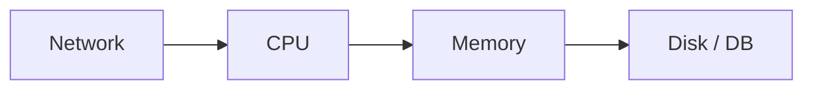

# 北工大计算计系统性能

课程目标：

1. 如何发现性能问题？
	- Identify performance bottlenecks：识别性能瓶颈
	- Determine the optimal value of a parameter：确定参数的最优值
	- Predict the performance of future workloads：预测未来工作负载下的性能
2. 如何通过数学分析性能？
	- Queueing Theory（排队论）：研究请求到达、等待和接受服务的过程
	- Linear Regression（线性回归）：利用已有数据分析变量之间的关系，并进行预测
3. 如何评价一个系统？
	- Measurement（测量）
	- Simulation（模拟）
	- Analytical Modeling（解析建模）

## 什么是 Performance？

Performance（性能）并不只是指系统运行得有多快，而是指系统在特定工作负载、资源和配置下表现得有多好。

| 组成部分                  | 含义    | 例子                       |
| --------------------- | ----- | ------------------------ |
| Workload              | 工作负载  | 10,000 名用户观看视频、搜索请求、视频上传 |
| Resources             | 可用资源  | 应用服务器、数据库、网络带宽、缓存        |
| Parameters / Settings | 参数与配置 | 服务器数量、视频码率、缓存策略、负载均衡     |
| KPIs                  | 性能指标  | 响应时间、吞吐量、视频启动延迟、可用性      |

- **Response Time（响应时间）** 是系统从收到请求到完成响应所需要的时间。例如，用户点击播放视频后，系统需要多长时间才能开始播放。
- **Throughput（吞吐量）** 是单位时间内系统能够处理的工作量。例如，每秒能够处理多少个请求，常用 requests/s 表示。

这两个指标所衡量的维度各不并不相同，不能仅凭一个指标判断系统性能好坏。

---

性能分析的终极目标： to obtain or provide the highest performance at the lowest cost.

（以最低的成本获得尽可能高的性能）

不过，Performance 和 Cost 的含义需要取决于具体系统和使用场景（Context），并且往往需要通过多个指标来衡量（Multiple Metrics）。例如：

|文件大小|LTE 下载时间|WiFi 下载时间|
|---|---|---|
|3 MB|0.7 s|0.1 s|
|10 MB|1.8 s|2.1 s|
|30 MB|6.1 s|24.3 s|

在下载不同大小的文件时，LTE 和 WiFi 的速度表现不同，我们直接无法判断谁的性能更高，如果比较**平均值**的话，也不足以判断谁在实际情况中表现更出色。因此，分析系统性能时，所处的情境总是至关重要。
#### How You Should See the Problem

1. System（系统）
	- Hardware（硬件）, Software（软件）...

2. Evaluation Techniques（评估技术）
	- Measurement：测量
	- Simulation：模拟
	- Analytical Modeling：解析建模

3. Metrics（性能指标）
	- Metrics 是用于量化系统性能的标准

4. Workload（工作负载）
	- The requests made by the users of the system 即系统用户发出的请求

5. Parameters（参数）
	- System Parameters（系统参数）和 Workload Parameters（工作负载参数）

| 要素                     | 例子                                        |
| ---------------------- | ----------------------------------------- |
| System                 | LTE and WiFi communication infrastructure |
| Evaluation Techniques  | Real-time measurements                    |
| Parameters and Factors | File size                                 |
| Metrics                | File downloading speed                    |
| Workload               | Downloading files                         |

## 性能的判断

那么在什么情况下，我们可以说一个系统的性能更优？在下面这个例子中，各有优劣，信息不足以判断：

| 指标                  | System A       | System B        |
| ------------------- | -------------- | --------------- |
| Response Time（响应时间） | 80 ms          | 120 ms          |
| Throughput（吞吐量）     | 100 requests/s | 1000 requests/s |

> [!INFO]
> 脱离 workload，讨论性能没有意义。

**让我们假设，100 名学生在 09:00 同时访问选课系统。** 

请求经过 Web Server，CPU/Memory 和 Database，最后返回响应。需要研究的问题是：每个请求需要多久？系统能处理多少请求？如果变成 1000 名学生会怎样？哪个组件会成为瓶颈？

性能研究包含五个要素：

|要素|网站例子|
|---|---|
|System（系统）|Web Server + Database|
|Workload（工作负载）|100 requests/s|
|Metrics（指标）|响应时间、吞吐量|
|Factors（影响因素）|CPU 核数、用户数、缓存大小|
|Evaluation Method（评估方法）|测量、模拟、建模|

### 三种性能指标

#### Metric 1: Response Time

响应时间 = 请求完成时间 − 请求到达时间

响应时间通常越短越好。
$$R=t_{\text{completion}}-t_{\text{arrival}}$$
#### Metric 2: Throughput

吞吐量：单位时间内完成的请求数量。

吞吐量不一定越高越好，还需要考虑 Latency（延迟）、Error Rate（错误率）、Energy Consumption（能耗）。

$$X=\frac{\text{Completed Requests}}{\text{Time}}$$

|Latency（延迟）|Throughput（吞吐量）|
|---|---|
|单个请求需要多久？|单位时间完成多少工作？|
|ms/request|requests/s|
|网页加载、数据库查询、网络 RTT|每秒交易数、数据包数、每小时任务数|

> [!Info]
> RTT（Round-Trip Time）指数据往返一次所需的时间

#### Metric 3: Utilisation

资源利用率：资源处于忙碌状态的时间占总观察时间的比例。
$$U=\frac{\text{Resource Busy Time}}{\text{Observation Time}}$$

例如 CPU 在 60 秒内忙碌了 54 秒：$U=\frac{54}{60}=90\%$

100% 的利用率理想吗？**通常不是**。例如，在某些情况下，CPU 越接近满载，新请求越容易排队，等待时间会急剧增加。

### 饱和、长尾延迟与性能瓶颈

Saturation（饱和）指系统接近或达到处理能力上限。超过饱和点之后：

- 输入的工作负载继续增加
- 吞吐量几乎不再增长
- 请求队列越来越长
- 响应时间增加：workload 增加，响应时间通常会先缓慢上升，随后在接近系统容量上限时急剧上升。原因是请求到达时，系统资源可能仍在处理之前的任务，新请求需要等待，这被称为 Queueing Region（排队区域）

**平均值可能具有误导性，还应考虑数据分布**，考虑下面例子：

|指标|Server A|Server B|
|---|---|---|
|Mean（平均值）|100 ms|110 ms|
|p95|700 ms|160 ms|
|p99|4.2 s|220 ms|

A 的平均响应时间更好，但 B 的长尾延迟明显更低。

- 长尾延迟（Tail Latency）：系统中绝大多数请求响应很快，但有少数请求的响应时间特别长
- Percentiles：百分位数
	- p50：50% 的请求响应时间不超过这个值
	- p95：95% 的请求响应时间不超过这个值
	- p99：99% 的请求响应时间不超过这个值

性能瓶颈可能出现在：

- CPU Saturation：CPU 饱和
- Memory Pressure：内存压力
- Disk I/O：磁盘读写
- Network Bandwidth：网络带宽
- Lock Contention：（多线程/进程）锁竞争
- Database Connection Pool：数据库连接池
	- 预先维护的一组数据库连接。如果连接全部被占用，新请求可能需要等待空闲连接。
- External Service：外部服务

一个网站运行缓慢，测量结果如下：

| 资源      | Utilisation |
| ------- | ----------- |
| CPU     | 22%         |
| Memory  | 48%         |
| Disk    | 35%         |
| Network | 97%         |

因为网络利用率已经达到 97%，很可能是当前瓶颈，需要提升 Network Capacity（网络容量）。

### Workload 与实验设计

Workload 描述系统接收到的请求，包括：

- Number of users：用户数量
- Requests per second：每秒请求数
- Request sizes：请求大小
- GET/POST ratio：GET 与 POST 请求比例
- Arrival pattern：请求到达模式
- Session duration：会话持续时间
- Think time：用户两次操作之间的思考时间
- File sizes：文件大小

其中， $\lambda$ 表示 Request Arrival Rate（请求到达率）。例如 $\lambda=100$ requests/s，表示平均每秒有 100 个请求到达系统。

Benchmark（基准测试） 是通过标准化任务评价系统性能的方法。进行公平比较时，必须明确测试条件。

#### Real vs Synthetic Workloads

|Real Workload（真实负载）|Synthetic Workload（合成负载）|
|---|---|
|来自真实用户行为|实验中人为生成|
|真实、有代表性|可重复、可控制|
|难以重复|容易扩展规模|
|可能涉及隐私数据|可能与真实情况不符|

例如，真实网站访问日志属于 Real Workload；使用工具模拟 10,000 名用户访问网站属于 Synthetic Workload。

---
#### System Parameters vs Workload Parameters

|System Parameters（系统参数）|Workload Parameters（负载参数）|
|---|---|
|CPU cores（核心数）|Arrival rate（请求到达率）|
|RAM（内存）|Request size（请求大小）|
|Cache size（缓存大小）|User population（用户数量）|
|Thread pool size（线程池大小）|Read/write ratio（读写比例）|
|Network link capacity（网络链路容量）|Burstiness（突发性）|
|Scheduling algorithm（调度算法）|Session duration（会话时长）|
Burstiness 指请求在短时间内突然集中到达的程度。例如，抢课系统在开放选课的一瞬间迎来大量请求。

#### Factors and Levels

在实验中：

- Factor（因素）：我们主动改变的参数
- Level（水平）：该因素可以取的具体值

例如，我们研究 CPU 核心数对性能的影响，CPU cores 就是 Factor，2、4、8 就是三个 Levels。

↓ 前四项是系统因素，Request rate 属于工作负载因素。

|Factor|Levels|
|---|---|
|CPU cores|2、4、8|
|RAM|4、8、16 GB|
|Worker threads|8、32、128|
|Cache|Off、On|
|Request rate|10、100、1000 req/s|

如果多个 factor 在同一测试中被改变，不一定能判断性能改善。例如下面的测试中，不能认为能认为增加 CPU 核心数改善了性能：

|               | Test 1 | Test 2 |
| ------------- | ------ | ------ |
| CPU cores     | 2      | 8      |
| Users         | 50     | 500    |
| Cache         | Off    | On     |
| Response time | 220 ms | 180 ms |

这涉及实验中的 Confounding（混杂因素）。需要控制变量·。

#### Performance Evaluation Methods

三种性能评估方法：

1. Analytical Modelling（解析建模）
2. Simulation（模拟）
3. Measurement（测量）