# 北工大设计模式


> A pattern is a solution to a problem in a context.

## UML - 类图

*Depicts the static structure of the system and shows the existence of classes and their relationships.*


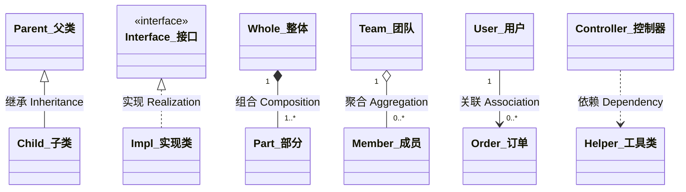


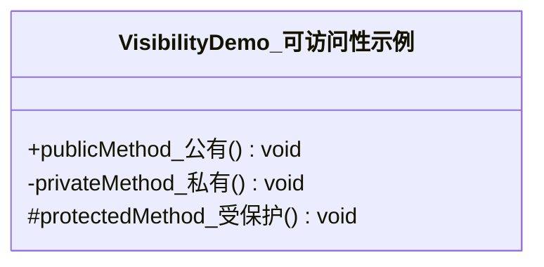

六种关系：

1. Association（关联）：最常见的关系，一个类与另一个类存在某种联系，例如持有成员变量
2. Aggregation（聚合）：表示整体与部分，部分可以脱离整体
3. Composition（组合）：整体与部分具有相同的生命周期，联系强于聚合
4. Dependency（依赖）：一个类使用另一个类（ex：方法参数），比 Association 联系临时
5. Generalization（泛化）：继承
6. Interface Realization（接口实现）

细分的关联形式：

- Bilateral Association（双向关联）：两个类互相持有对方的引用
- Singleton Relationship（单向关联）：一个类持有另一个类的引用（ex: TreeNode）
- Self Association（自关联）：一个类与自身建立关联

多重性关联表示两个类之间关联对象的数量关系：

| 表示     | 含义            |
| ------ | ------------- |
| `1..1` | 恰好一个          |
| `0..*` | 零个或多个         |
| `1..*` | 一个或多个         |
| `0..1` | 零个或一个         |
| `m..n` | 至少 m 个，最多 n 个 |

## Principle of OOP

- High Cohesion（高内聚）：一个类内部的功能围绕同一个职责
- Low Coupling（低耦合）：一个类的变化尽量不影响其他类
- Maintainability（可维护性）和 Reusability（可复用性）

| Principle                                 | Definition                                                                                                                   | Frequency |
| ----------------------------------------- | ---------------------------------------------------------------------------------------------------------------------------- | --------- |
| **SRP** (Single Responsibility Principle) | Every object should have a single responsibility, and that responsibility should be entirely encapsulated by the class.      | ★★★★☆     |
| **OCP** (Open-Closed Principle)           | Software entities should be open for extension, but closed for modification.                                                 | ★★★★★     |
| **LSP** (Liskov Substitution Principle)   | Functions that use pointers or references to base classes must be able to use objects of derived classes without knowing it. | ★★★★★     |
| **DIP** (Dependency Inversion Principle)  | Program to an interface, not an implementation.                                                                              | ★★★★★     |
| **ISP** (Interface Segregation Principle) | Clients should not be forced to depend upon interfaces that they do not use.                                                 | ★★★☆☆     |
| **CRP** (Composite Reuse Principle)       | Favor composition of objects over inheritance as a reuse mechanism.                                                          | ★★★★☆     |
| **LoD** (Law of Demeter)                  | Each software unit should have only limited knowledge of other units.                                                        | ★★★☆☆     |

DIP — Dependency Inversion Principle 的核心思想：

1. Program to an interface, not an implementation.
2. High-level modules should not depend upon low-level modules, both should depend upon abstractions.
3. Abstractions should not depend upon details, details should depend upon abstractions.

关于第二点，我们通过 `Work` 和 `Manager` 的例子来解释下。`Manager` 负责决定什么时候工作，`Worker` 负责真正执行工作。目前，`Manager` 直接持有 `Worker` 类型的成员变量。如果现在需要引入一个 `SuperWorker`，就需要修改 `Manager` 的代码。可 `Manager` 可能包含复杂的业务逻辑，为了加入一个新的底层工作者，我们竟必须修改整个管理类。为解决，我们可以创建一个 `IWoker` 接口，让 `Worker` 和  `SuperWorker` 都去实现他。


## INTRODUCTION

设计模式分按目标分类：

| Category        | 核心目的                                                                                  |
| --------------- | ------------------------------------------------------------------------------------- |
| Creational（创建型） | Used to create an object                                                              |
| Structural（结构型） | Used to organize multiple objects into an efficient one                               |
| Behavioral（行为型） | Describe interactions between classes and objects, and how to assign responsibilities |
|                 |                                                                                       |

按 Scope 分类：


|Scope|Creational|Structural|Behavioral|
|---|---|---|---|
|Class|Factory Method|Class Adapter|Interpreter、Template Method|
|Object|Abstract Factory、Builder、Prototype、Singleton|Object Adapter、Bridge、Composite、Decorator、Facade、Flyweight、Proxy|Chain of Responsibility、Command、Iterator、Mediator、Memento、Observer、State、Strategy、Visitor|

例如：

|Scope|Creational|Structural|Behavioral|
|---|---|---|---|
|Class|Factory Method|Class Adapter|Interpreter、Template Method|
|Object|Abstract Factory、Builder、Prototype、Singleton|Object Adapter、Bridge、Composite、Decorator、Facade、Flyweight、Proxy|Chain of Responsibility、Command、Iterator、Mediator、Memento、Observer、State、Strategy、Visitor|

## Simple Factory Pattern（简单工厂模式）


将对象创建逻辑集中到一个 Factory 中，客户端通过参数请求产品，并通过抽象接口使用产品。

1. Creates objects without exposing the instantiation logic to the client.（不向客户端暴露对象的实例化逻辑）
2. Refers to the created object through a common interface.（通过公共接口引用创建出来的对象）

> [!INFO]
> DIP（Dependency Inversion Principle），一定程度遵守 OCP 

Simple Factory Pattern 也被称为 Static Factory Method Pattern。

核心特征：

- 根据不同参数，返回不同类的实例
- 专门定义一个类负责创建其他类的实例
- 创建出来的实例通常具有共同的父类


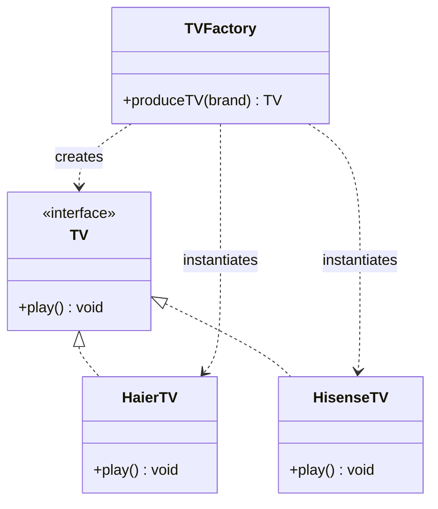


```java
interface TV {
    void play();
}

class HaierTV implements TV {
    public void play() {
        System.out.println("Haier TV");
    }
}

class HisenseTV implements TV {
    public void play() {
        System.out.println("Hisense TV");
    }
}

class TVFactory {
    public static TV produceTV(String brand) {
        switch (brand) {
            case "Haier":
                return new HaierTV();
            case "Hisense":
                return new HisenseTV();
            default:
                throw new IllegalArgumentException(
                    "Unknown brand: " + brand
                );
        }
    }
}

// Client
TV tv = TVFactory.produceTV("Haier");
tv.play();
```


| Advantages        | Disadvantages     |
| ----------------- | ----------------- |
| 解耦对象创建与使用         | Factory 职责过重      |
| Client 不需要知道具体产品类 | 工厂可能成为系统中的关键故障点   |
| Client 只需提供参数     | 新增产品需要修改工厂逻辑      |
| 配置文件可以提高灵活性       | 静态工厂方法不利于建立工厂继承体系 |

## Factory Method Pattern（工厂方法模式）

为了避免简单工厂的缺陷，工厂方法模式定义一个创建对象的接口，将具体实例化哪个类的决定权交给子类，在运行时完成对象创建。

简单来说，就是不再让一个工厂负责生产所有产品，而让每一种产品拥有自己的具体工厂。

1. Defines an interface for creating objects, but lets subclasses decide which class to instantiate. 定义创建对象的接口，但由子类决定实例化哪个类。
2. Refers to the newly created object through a common interface. 通过公共接口引用新创建的对象。

> [!INFO]
> DIP（Client 不再关心哪个工厂生产产品） 和 OCP


- Also known as Virtual Constructor（虚拟构造器） or Polymorphic Factory（多态工厂）
- Class Creational Pattern（类创建型模式）
- 是 Simple Factory Pattern 的抽象和扩展

| Role            | Responsibility                 |
| --------------- | ------------------------------ |
| Product         | 抽象产品，定义产品的公共接口                 |
| ConcreteProduct | 具体产品，实现 Product                |
| Factory         | 抽象工厂，定义创建 Product 的接口          |
| ConcreteFactory | 具体工厂，重写工厂方法，创建 ConcreteProduct |

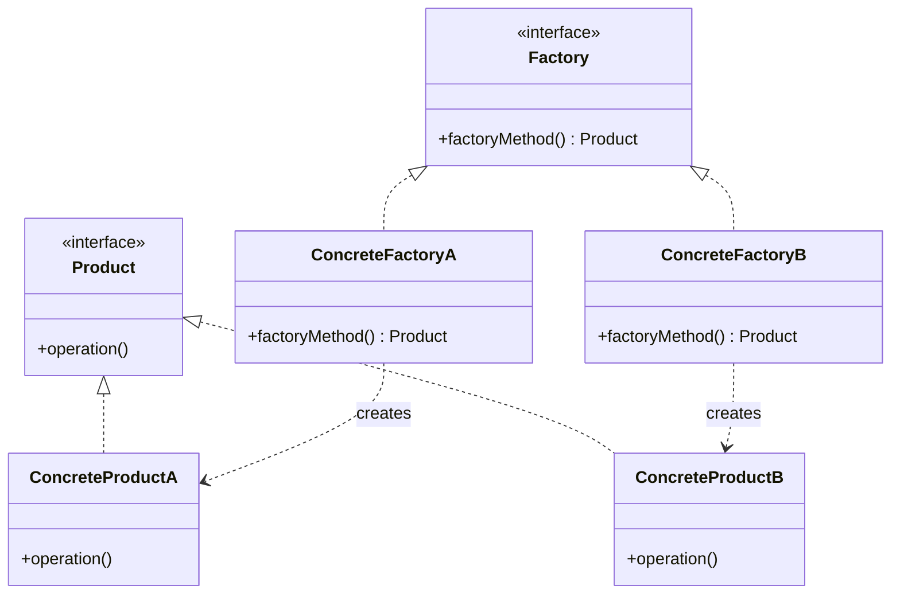


```java
interface TV {
    void play();
}

class HaierTV implements TV {
    public void play() {
        System.out.println("Haier TV");
    }
}

class HisenseTV implements TV {
    public void play() {
        System.out.println("Hisense TV");
    }
}

// =============================================

interface TVFactory {
    TV produceTV();
}

class HaierTVFactory implements TVFactory {
    public TV produceTV() {
        return new HaierTV();
    }
}

class HisenseTVFactory implements TVFactory {
    public TV produceTV() {
        return new HisenseTV();
    }
}

// =============================================

public class Client {
    public static void main(String[] args) {
        TVFactory factory = new HaierTVFactory();

        TV tv = factory.produceTV();
        tv.play();
    }
}
```

优化：
- Java Reflection（反射机制）
- Configuration File（配置文件）

| Advantages         | Disadvantages |
| ------------------ | ------------- |
| 隐藏具体产品的实例化细节       | 系统中的类数量成对增加   |
| 具体工厂独立决定创建哪种产品     | 增加系统复杂度和额外开销  |
| 新增产品时符合 OCP        | 增加抽象层，提高理解难度  |
| 降低 Client 与具体产品的耦合 |               |
应用场景：

1. When the client is unaware of the class of objects it needs. 客户端不知道自己需要的具体对象类名，只需要知道对应的工厂。

2. When the abstract factory class uses its subclasses to determine which object to create. 当抽象工厂需要通过子类来决定创建哪一种对象时。

## Abstract Factory Pattern（抽象工厂模式）

抽象工厂提供创建一组相关对象的接口，而不需要明确指定它们的具体类。

> [!Info]
> - OCP（Open-Closed Principle）：支持新增产品族，而不修改已有系统。
> - Object Creational Pattern（对象创建型模式）。

注意：Abstract Factory 并不是在所有维度上都遵守 OCP。后面会讲到它的局限。


| Role            | Responsibility      |
| --------------- | ------------------- |
| AbstractFactory | 声明创建不同类型产品的接口       |
| ConcreteFactory | 实现抽象工厂，创建同一产品族的具体产品 |
| AbstractProduct | 定义各类产品的公共接口         |
| ConcreteProduct | 实现具体产品              |

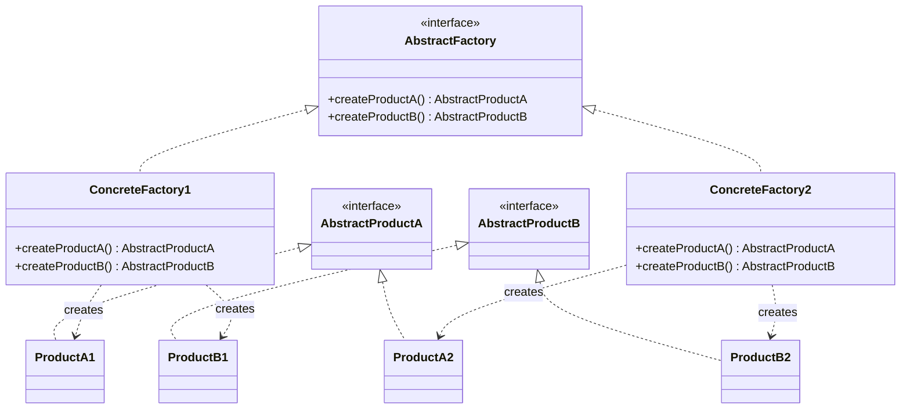


这里的对应关系是：

- ConcreteFactory1 创建 ProductA1 + ProductB1
- ConcreteFactory2 创建 ProductA2 + ProductB2

```java
// ===== Abstract Products =====
interface Television {
    void play();
}

interface AirConditioner {
    void changeTemperature();
}

// ===== Concrete Products =====
class HaierTelevision implements Television {
    public void play() {
        System.out.println("Haier TV");
    }
}

class TCLTelevision implements Television {
    public void play() {
        System.out.println("TCL TV");
    }
}

class HaierAirConditioner implements AirConditioner {
    public void changeTemperature() {
        System.out.println("Haier AC");
    }
}

class TCLAirConditioner implements AirConditioner {
    public void changeTemperature() {
        System.out.println("TCL AC");
    }
}

// ===== Abstract Factory =====
interface ApplianceFactory {
    Television produceTelevision();
    AirConditioner produceAirConditioner();
}

// ===== Concrete Factories =====
class HaierFactory implements ApplianceFactory {
    public Television produceTelevision() {
        return new HaierTelevision();
    }

    public AirConditioner produceAirConditioner() {
        return new HaierAirConditioner();
    }
}

class TCLFactory implements ApplianceFactory {
    public Television produceTelevision() {
        return new TCLTelevision();
    }

    public AirConditioner produceAirConditioner() {
        return new TCLAirConditioner();
    }
}

// ===== Client =====
public class Client {
    public static void main(String[] args) {
        ApplianceFactory factory = new HaierFactory();

        Television tv = factory.produceTelevision();
        AirConditioner ac = factory.produceAirConditioner();

        tv.play();
        ac.changeTemperature();
    }
}
```

- 新增 Product Family：符合 OCP
- 新增 Product Hierarchy：可能违反 OCP

对新增产品族开放，但对新增产品等级结构不够开放。

| Advantages                | Disadvantages |
| ------------------------- | ------------- |
| 隔离具体类的创建，Client 不需要了解具体实现 | 新增产品等级结构比较麻烦  |
| 保证同一产品族中的产品能够协调工作         | 需要修改抽象工厂及具体工厂 |
| 新增产品族比较方便，符合 OCP          | 可能违反 OCP      |

应用场景：

1. A system should not rely on the specifics of how product classes are created, composed, and expressed. 系统不应该依赖产品类具体如何创建、组合和表示。

2. There are more than one product families in the system, but only one product family is used each time. 系统中存在多个产品族，但每次只使用其中一个产品族。

3. Products belonging to the same product family will be used together, and this constraint must be reflected in the system's design. 同一产品族中的产品需要一起使用，这种约束应该体现在系统设计中。

4. Product hierarchies remain stable. 产品品等级结构保持稳定，系统设计完成后，不再增加或删除产品等级结构。

第四点尤其重要：如果产品种类经常变化，Abstract Factory 就可能导致大量工厂代码修改。

|        | Simple Factory | Factory Method | Abstract Factory |
| ------ | -------------- | -------------- | ---------------- |
| 工厂数量   | 一个             | 多个具体工厂         | 多个具体工厂           |
| 创建方式   | 参数决定产品         | 子类决定产品         | 工厂创建产品族          |
| 产品种类   | 通常一种产品等级       | 一种产品等级         | 多种产品等级           |
| 扩展产品族  | 修改工厂           | 新增工厂           | 新增工厂             |
| 扩展产品种类 | 修改工厂           | 视具体设计而定        | 修改抽象工厂及具体工厂      |

## Builder Pattern（建造者模式）

Builder 模式将对象的创建过程独立出来，让我们可以按照相同的构建步骤，组装出不同形式的对象。

- Client 不需要知道复杂对象的内部组件和组装方式
- 只需要知道需要使用哪种 Builder
- 不同 Builder 可以定义不同的创建过程
- 采用 Step-by-step（逐步构建）的方式创建复杂对象

> [!INFO]
> - OCP：通过新增 ConcreteBuilder 扩展不同的产品构造方式。
> - Object Creational Pattern（对象创建型模式）。

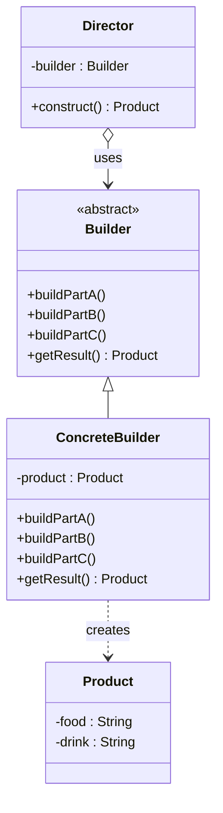


关系：

1. `Director` 持有 `Builder` 的引用，通过它调用构建步骤。
2. `ConcreteBuilder` 继承 `Builder`，实现具体的构建逻辑。
3. `ConcreteBuilder` 负责创建和组装 `Product`，最后通过 `getResult()` 返回产品。


```java
class Meal {
    private String food;
    private String drink;

    public void setFood(String food) {
        this.food = food;
    }

    public void setDrink(String drink) {
        this.drink = drink;
    }

    @Override
    public String toString() {
        return "Meal: " + food + " + " + drink;
    }
}

// ===== Builder =====
abstract class MealBuilder {
    protected Meal meal = new Meal();

    public abstract void buildFood();
    public abstract void buildDrink();

    public Meal getMeal() {
        return meal;
    }
}

// ===== ConcreteBuilder A =====
class SubMealBuilderA extends MealBuilder {
    public void buildFood() {
        meal.setFood("Burger");
    }

    public void buildDrink() {
        meal.setDrink("Coke");
    }
}

// ===== ConcreteBuilder B =====
class SubMealBuilderB extends MealBuilder {
    public void buildFood() {
        meal.setFood("Chicken Roll");
    }

    public void buildDrink() {
        meal.setDrink("Juice");
    }
}

// ===== Director =====
class KFCWaiter {
    private MealBuilder builder;

    public void setMealBuilder(MealBuilder builder) {
        this.builder = builder;
    }

    public Meal construct() {
        builder.buildFood();
        builder.buildDrink();
        return builder.getMeal();
    }
}

// ===== Client =====
public class Client {
    public static void main(String[] args) {
        KFCWaiter waiter = new KFCWaiter();

        // Choose a concrete builder
        waiter.setMealBuilder(new SubMealBuilderA());

        // Construct the product
        Meal meal = waiter.construct();

        System.out.println(meal);
    }
}
```

| Advantages                       | Disadvantages                      |
| -------------------------------- | ---------------------------------- |
| Client 不需要了解产品内部组成               | 产品通常需要有较多共同点，组件结构相似                |
| 分离产品本身与产品创建过程                    | 产品差异过大时不适合使用                       |
| 相同构建过程可以创建不同产品                   | 产品内部变化复杂时，可能需要大量 `ConcreteBuilder` |
| 容易替换或新增 `ConcreteBuilder`，符合 OCP | 增加系统规模、理解难度和运行成本                   |
| 可以更精细地控制产品构建过程                   |                                    |

适用情况：

1. Complex internal structure：产品具有复杂的内部结构。
2. Interdependent attributes：产品属性之间相互依赖，需要指定生成顺序。
3. Encapsulated construction process：通过 `Director` 封装构建过程，而不是让 `Builder` 或 `Client` 直接控制整个流程。
4. Different representations：希望隔离复杂对象的创建与使用，让相同的构建过程创建不同产品。

## Singleton Pattern（单例模式）

单例模式确保一个类在系统中只有一个实例，并提供一个全局访问入口，让系统中的其他对象都能访问它。

> [!INFO]
> - Category：Creational Pattern（创建型模式）
> - Scope：Object Pattern（对象模式）

1. Every class only has an instance in memory：内存中只有该类的一个实例
2. An instance must be created by this class：实例由类自身负责创建
3. An instance must be accessed by the whole system：整个系统都能通过统一入口访问该实例

Singleton 是 23 种 GoF 模式中结构最简单的之一，它甚至只有一个参与者：

|Role|Responsibility|
|---|---|
|Singleton|创建、保存唯一实例，并提供全局访问入口|

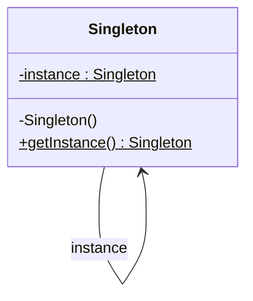

设计上：

- Private Constructor：禁止外部直接实例化。
- Static Private Instance：保存唯一实例。
- Static Public Factory Method：提供 `getInstance()`，返回唯一实例。

```java
public class Singleton {

    // Static private member variable
    private static Singleton instance = null;

    // Private constructor
    private Singleton() {
    }

    // Static public factory method
    public static Singleton getInstance() {
        if (instance == null) {
            instance = new Singleton();
        }

        return instance;
    }
}

// Client
public class Client {
    public static void main(String[] args) {
        Singleton s1 = Singleton.getInstance();
        Singleton s2 = Singleton.getInstance();

        System.out.println(s1 == s2); // true
    }
}
```


单例模式还能根据实例的创建时机，分为饿汉式和懒汉式：

1. Eager Singleton（饿汉式）：在类加载时就创建实例。

	```cs
	private static final EagerSingleton instance = new EagerSingleton();
	```

	- 提前创建实例
	- 实现简单
	- Java 类初始化机制保证线程安全
	- 即使没有使用实例，也会创建对象

2. Lazy Singleton（懒汉式）：第一次调用访问时才创建实例。

	```java
	public static LazySingleton getInstance() {
	    if (instance == null) {
	        instance = new LazySingleton();
	    }
	    return instance;
	}
	```

	- 延迟实例化（Lazy Initialization）
	- 节省不必要的初始化开销
	- 需要注意多线程并发访问问题


**Initialization on Demand Holder (IoDH)**：使用静态内部类实现 Singleton，被认为是 Java 中的最佳实践。

其核心是利用 Java 的类初始化机制，实现延迟初始化和线程安全

```java
public class Singleton {

    // Private constructor
    private Singleton() {
    }

    // Static inner class
    private static class HolderClass {
        private static final Singleton instance =
                new Singleton();
    }

    // Global access point
    public static Singleton getInstance() {
        return HolderClass.instance;
    }

    public static void main(String[] args) {
        Singleton s1 = Singleton.getInstance();
        Singleton s2 = Singleton.getInstance();

        System.out.println(s1 == s2); // true
    }
}
```


| Advantages                                            | Disadvantages              |
| ----------------------------------------------------- | -------------------------- |
| Provides controlled access to the unique instance     | Difficult to extend（缺乏抽象层） |
| Can conserve system resources and enhance performance | Singleton 可能承担过多职责         |
| 保证系统中只有一个共享实例                                         | 共享实例的状态可能受到垃圾回收等生命周期问题影响   |

## Prototype Pattern（原型模式）

使用已有对象作为原型，通过复制原型对象来创建新的对象，而不必了解对象具体的创建过程。

- Create new objects by copying existing prototype instances.
- Avoid exposing the details of the object creation process.

> [!INFO]
> - Category：Object Creational Pattern（对象创建型模式）。
> - OCP：存在局限。 为每个类提供 clone 方法可能需要修改已有类的源代码，从而违反 OCP。


原型模式最核心的机制是 `Clone`：

- Prototype：定义复制对象的接口
- ConcretePrototype：实现复制操作，返回自身的副本
- Client：持有 Prototype，通过调用 `clone()` 创建新对象

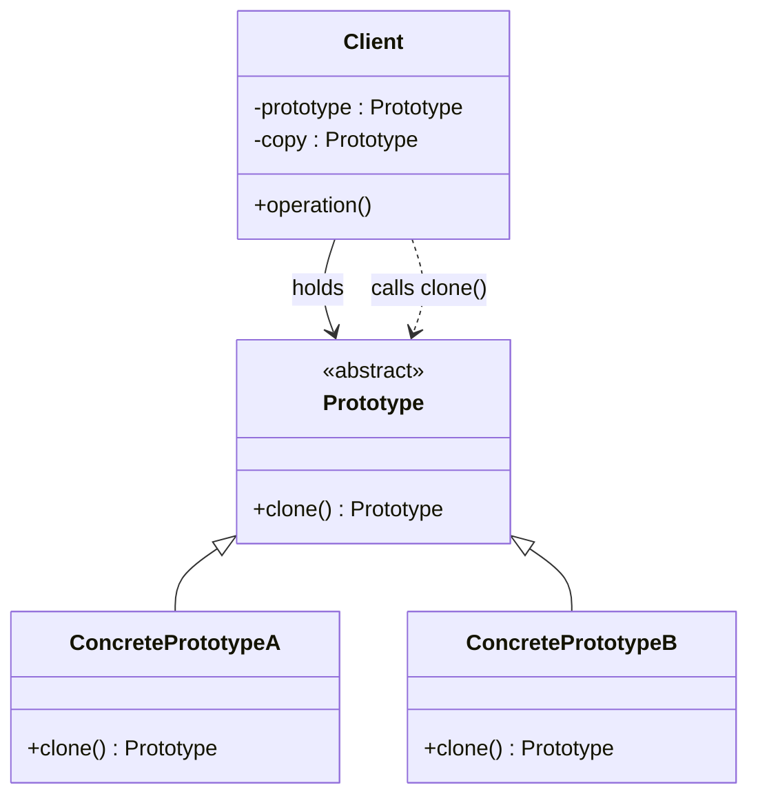

Java 中所有类都继承自 `java.lang.Object`，其中提供了 `clone()` 方法（浅克隆），可以用于复制对象。`Cloneable` 是一个 Marker Interface（标记接口），本身不定义任何方法，只用于表明该类支持克隆。

```java
public class PrototypeDemo implements Cloneable {

    @Override
    public Object clone() {
        try {
            return super.clone();
        } catch (CloneNotSupportedException exception) {
            throw new AssertionError(exception);
        }
    }
}
```

Java 中实现：

```java
import java.io.*;

// ===== Prototype =====
abstract class Prototype implements Cloneable {
    @Override
    public Prototype clone() {
        try {
            return (Prototype) super.clone();
        } catch (CloneNotSupportedException e) {
            throw new AssertionError(e);
        }
    }
}

// ===== Concrete Component =====
class Attachment implements Serializable {
    private String name;

    public Attachment(String name) {
        this.name = name;
    }

    public void setName(String name) {
        this.name = name;
    }

    @Override
    public String toString() {
        return name;
    }
}

// ===== ConcretePrototype =====
class Email extends Prototype implements Serializable {
    private String subject;
    private Attachment attachment;

    public Email(String subject, Attachment attachment) {
        this.subject = subject;
        this.attachment = attachment;
    }

    public Attachment getAttachment() {
        return attachment;
    }

    // Shallow Clone
    @Override
    public Email clone() {
        return (Email) super.clone();
    }

    // Deep Clone using Serialization
    public Email deepClone() {
        try {
            ByteArrayOutputStream output =
                    new ByteArrayOutputStream();

            ObjectOutputStream out =
                    new ObjectOutputStream(output);

            out.writeObject(this);
            out.close();

            ObjectInputStream in = new ObjectInputStream(
                    new ByteArrayInputStream(output.toByteArray())
            );

            return (Email) in.readObject();

        } catch (IOException | ClassNotFoundException e) {
            throw new RuntimeException(e);
        }
    }
}

// ===== Client =====
public class Client {
    public static void main(String[] args) {
        Email original = new Email(
                "Design Pattern",
                new Attachment("Lecture.pdf")
        );

        // Shallow Clone
        Email shallowCopy = original.clone();

        // Deep Clone
        Email deepCopy = original.deepClone();

        // Modify the attachment of shallow copy
        shallowCopy.getAttachment().setName("Modified.pdf");

        System.out.println(original.getAttachment());
        // Modified.pdf

        // Modify the attachment of deep copy
        deepCopy.getAttachment().setName("Deep.pdf");

        System.out.println(original.getAttachment());
        // Modified.pdf
    }
}

```

| Advantages                          | Disadvantages          |
| ----------------------------------- | ---------------------- |
| 简化对象创建，通过复制已有对象提高实例化效率              | 每个需要克隆的类都需要提供 clone 方法 |
| Good Extensibility                  | 修改已有类以增加克隆能力可能违反 OCP   |
| 不需要额外的 Factory Class，创建结构更简单        | Deep Clone 实现更加复杂      |
| Deep Clone 可以保存对象状态，便于复用和实现 Undo 操作 |                        |

适用场景：

1. When the cost of creating a new object is high. 创建新对象的成本较高，可以通过复制已有对象获得新实例。

2. When the system needs to save the state of objects, but the changes in the object's state are minimal. 系统需要保存对象状态，而且对象状态变化较少，适合通过克隆保留和复用对象状态。

## Adapter Pattern（适配器模式）


通过引入一个适配器，将已有类的接口转换为客户端所需要的接口，使原本接口不兼容的类能够一起工作。

| Role          | Responsibility             |
| ------------- | -------------------------- |
| Target（目标接口）  | 定义客户端所需要的接口                |
| Adaptee（被适配者） | 已有功能，但接口不兼容的类              |
| Adapter（适配器）  | 将 Adaptee 的接口转换为 Target 接口 |

---

Class Adapter：

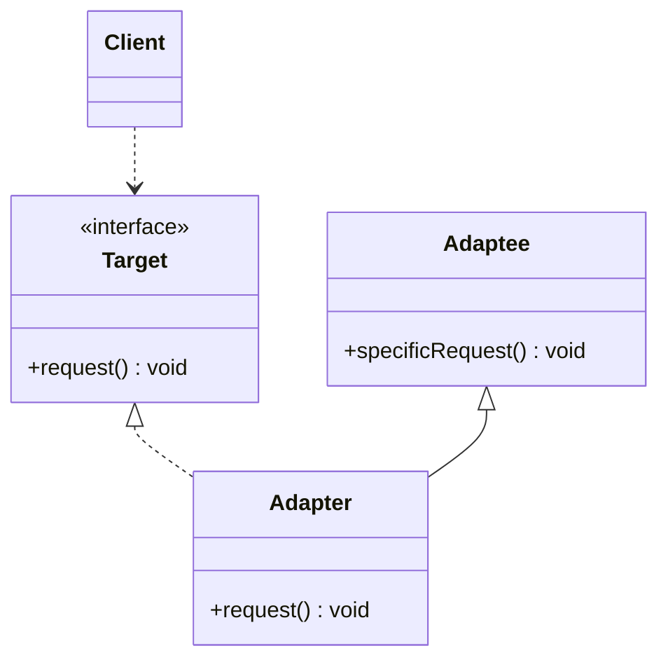

`Adapter` 继承 `Adaptee` 的功能，通过 `request()` 将客户端的调用转换为 `specificRequest()`：

```java
public class Adapter extends Adaptee implements Target {
    public void request() {
        super.specificRequest();
    }
}
```

---

Object Adapter：

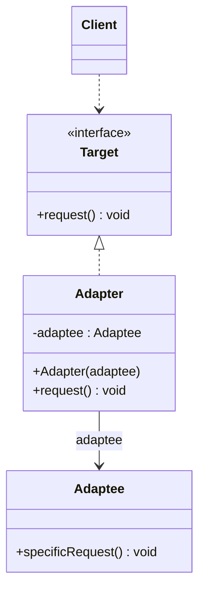

```java
public class Adapter extends Target { 
	private Adaptee adaptee; 
	
	public Adapter(Adaptee adaptee) { this.adaptee=adaptee; } 
	
	public void request() { adaptee.specificRequest(); } 
}
```

| Advantages                                | Disadvantages                         |
| ----------------------------------------- | ------------------------------------- |
| Decouples Target and Adaptee（解耦目标接口与被适配类） | Class Adapter 受单继承限制，无法同时继承多个 Adaptee |
| Enhances Reusability（提高复用性）               | Class Adapter 无法继承 final 类            |
| Flexibility and Extensibility（提高灵活性与可扩展性） | Java 中 Class Adapter 的 Target 必须是接口   |
| Class Adapter 便于重写 Adaptee 的方法            | Object Adapter 不便直接重写 Adaptee 的方法     |
| Object Adapter 可以适配 Adaptee 及其子类          |                                       |

适用场景：

1. 系统需要使用已有类，但其接口不符合系统要求，甚至无法获取该类的源代码。
2. 希望创建可复用的类，使其能够与多个接口不兼容的类协同工作，包括未来可能引入的类。

## Bridge Pattern （桥接模式）

将抽象部分与具体实现分离，使两者能够独立变化和扩展。

- Separate abstraction from implementation（分离抽象与实现）
- Replace inheritance with abstract association（使用抽象关联代替复杂的继承关系）
- Transform static inheritance relationships into dynamic object composition relationships（将静态继承关系转化为动态对象组合关系）

> [!INFO]
> - OCP：两个维度可以独立扩展。
> - Object Structural Pattern（对象结构型模式）

假设我们需要三种型号、五种颜色的笔。如果通过继承实现每一种型号与颜色的组合，就需要 `RedSmallPen`、`RedBigPen`、`BlueSmallPen` 等大量子类。而 Bridge 将两个变化维度（Dimensions of Variation）独立出来，通过组合获得不同型号和颜色的笔：

- 型号：SmallPen、MiddlePen、BigPen
- 颜色：Red、Green、Blue、White、Black

|Role|Responsibility|
|---|---|
|Abstraction|抽象部分，持有 Implementor 的引用|
|RefinedAbstraction|扩展 Abstraction，实现不同的高层功能|
|Implementor|定义实现部分的公共接口|
|ConcreteImplementor|提供具体实现|

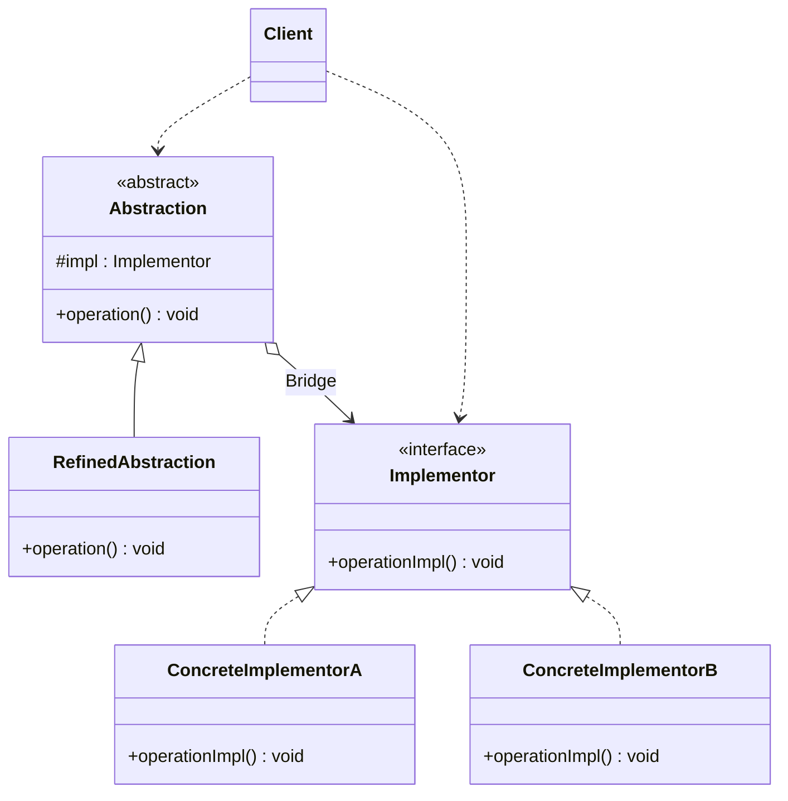

> [!TIP]
> 在 Bridge Pattern 中，Abstraction（抽象部分）指的是面向客户端的高层功能，而 Implementation（实现部分）指的是为这些功能提供具体实现的另一个变化维度。

```java
// ===== Implementor =====
interface Color {
    void bepaint(String penType, String name);
}

// ===== ConcreteImplementors =====
class Red implements Color {
    public void bepaint(String penType, String name) {
        System.out.println(penType + " draws red " + name);
    }
}

class Blue implements Color {
    public void bepaint(String penType, String name) {
        System.out.println(penType + " draws blue " + name);
    }
}

// ===== Abstraction =====
abstract class Pen {
    protected Color color;

    public void setColor(Color color) {
        this.color = color;
    }

    public abstract void draw(String name);
}

// ===== RefinedAbstractions =====
class SmallPen extends Pen {
    public void draw(String name) {
        color.bepaint("Small pen", name);
    }
}

class BigPen extends Pen {
    public void draw(String name) {
        color.bepaint("Big pen", name);
    }
}

// ===== Client =====
public class Client {
    public static void main(String[] args) {
        Pen pen = new SmallPen();

        pen.setColor(new Red());
        pen.draw("flower");

        // Change color at runtime
        pen.setColor(new Blue());
        pen.draw("flower");
    }
}
```

这个设计中，新增一种颜色只需要实现 `Color`，新增一种型号只需要继承 `Pen`。两边的扩展互不影响，因此符合 OCP。

| Advantages          | Disadvantages     |
| ------------------- | ----------------- |
| 分离抽象与具体实现           | 增加系统设计和理解难度       |
| 减少多层继承带来的大量子类       | 需要从设计之初考虑抽象层之间的关系 |
| 两个变化维度可以独立扩展，符合 OCP | 正确识别两个独立的变化维度并不容易 |

Applicability:

- 一个类存在两个或多个独立的变化维度，而且这些维度需要独立扩展。
- 希望避免复杂的继承关系，或者多层继承已经导致子类数量急剧增加。

## Composite Pattern（组合模式）

Compose objects into tree structures to represent part-whole hierarchies. Composite pattern lets clients treat individual objects (leaf object) and composition objects (container object) uniformly.

将对象组织成树形结构，以表示整体与部分之间的层级关系，使客户端能够以统一的方式操作单个对象和组合对象。

- Tree-structured organization（树形结构组织）
- Represent part-whole hierarchies（表示整体与部分的层级关系）
- Treat individual and composite objects uniformly（统一处理单个对象与组合对象）

> [!INFO]
> OCP：可以方便地新增叶子节点和容器节点类型，无须修改已有结构。

|Role|Responsibility|
|---|---|
|Component|抽象组件，定义统一的操作接口|
|Leaf|叶子组件，执行具体操作，不包含子组件|
|Composite|容器组件，保存子组件，并递归调用其操作|

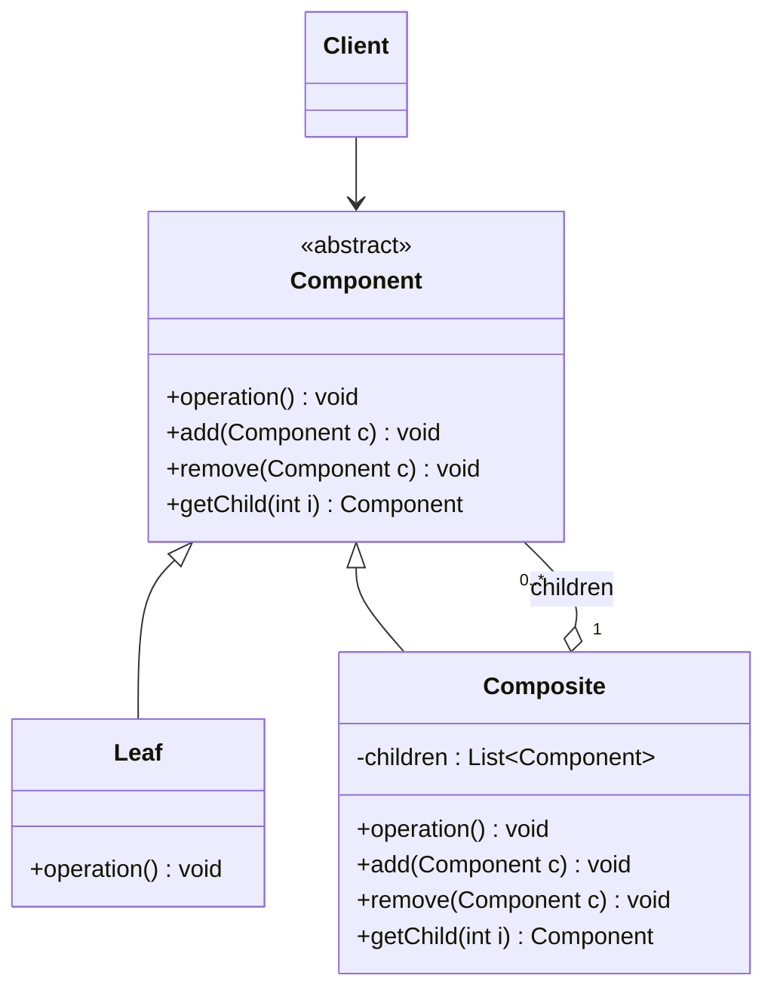

通过多态和递归，客户端只需要操作根节点，就可以对整棵树执行相应的操作：

```java
public void operation() {
    for (Component child : children) {
        child.operation();
    }
}
```

---

Transparent Composite Pattern（透明组合模式）将 `add()`、`remove()`、`getChild()` 等子组件管理方法统一声明在 Component 中。

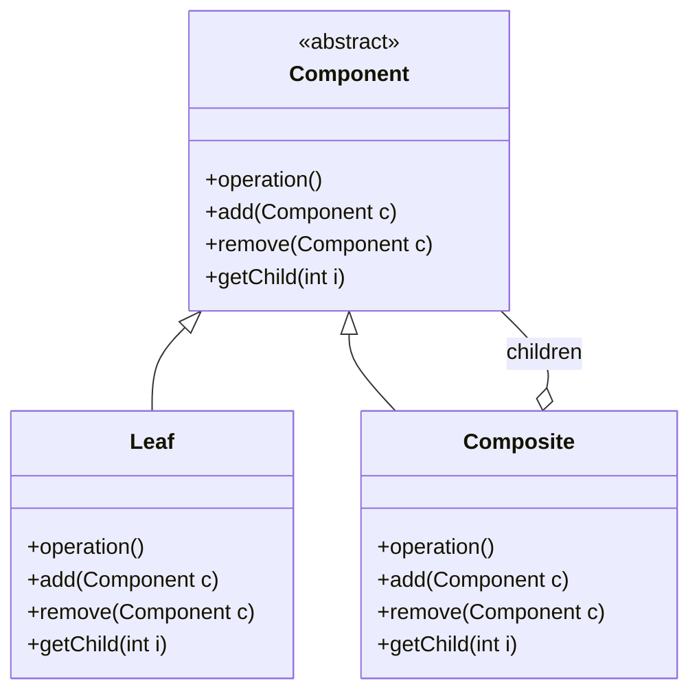

优点是 Client 可以完全统一地操作两种组件。缺点是 Leaf 本身不能包含子节点，却也暴露了 `add()` 和 `remove()` 等方法，因此可能出现无意义或非法的调用。

---

Secure Composite Pattern（安全组合模式）中 Component 只声明公共业务方法 `operation()`，将子组件管理方法放在 Composite 中。

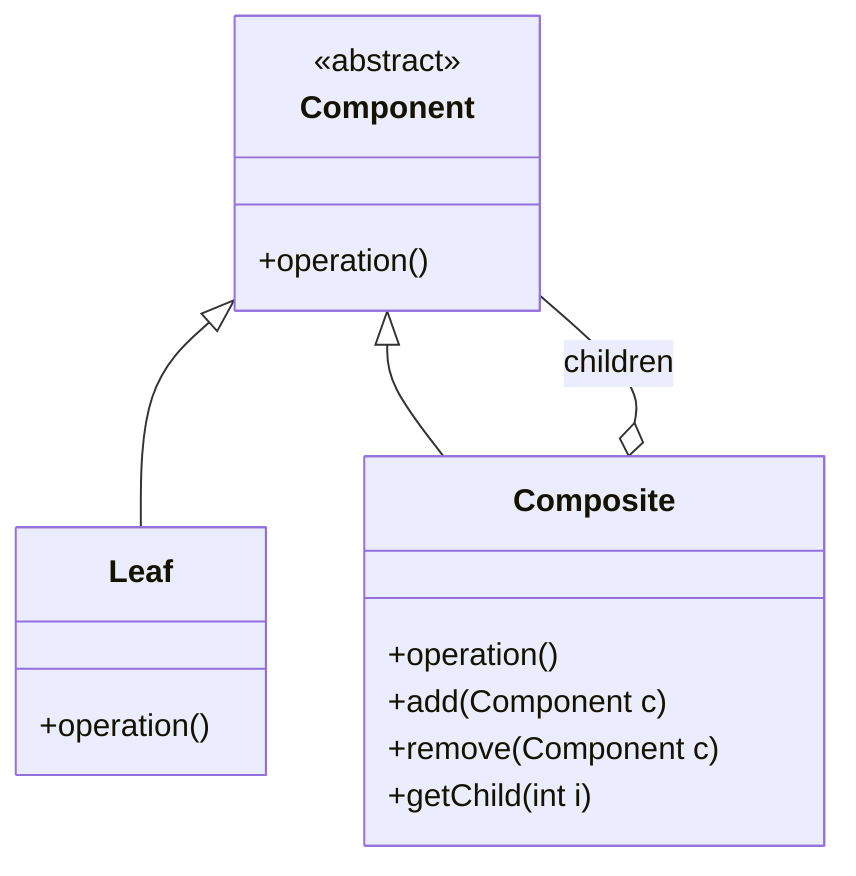

这样客户端就无法对 Leaf 调用 `add()` 等方法，增强了安全性；但牺牲了透明性，管理子节点时需要区分 Leaf 和 Composite。本质上是 Transparency 与 Safety 之间的取舍。

| Advantages            | Disadvantages    |
| --------------------- | ---------------- |
| 清晰地表示对象之间的层级关系        | 难以限制容器中允许包含的组件类型 |
| 统一操作单个对象与组合对象，简化客户端代码 |                  |
| 方便新增容器组件和叶子组件，符合 OCP  |                  |
| 灵活地实现面向对象的树形结构        |                  |

Applicability:

- 需要表示整体与部分的层级关系，并统一操作它们
- 系统需要处理树形结构（Tree Structure）
- 叶子组件和容器组件的类型并不固定，需要支持新增类型

## Decorator Pattern（装饰器模式）

在不修改原有对象的情况下，动态地为对象增加额外功能，比继承扩展功能更加灵活。

- Dynamically add additional responsibilities to an object（动态地为对象增加职责）
- Use object associations instead of class inheritance（使用对象关联代替通过继承扩展功能）
- 保留原有功能，同时增加新的功能
- 可以对同一个对象进行多层装饰（Multiple Decorators）

> [!INFO]
> - OCP：具体组件和具体装饰器可以独立扩展，无须修改已有代码。
> - Object Structural Pattern

|Role|Responsibility|
|---|---|
|Component|抽象组件，定义公共操作接口|
|ConcreteComponent|具体组件，提供原始功能|
|Decorator|抽象装饰器，持有 Component 的引用并转发调用|
|ConcreteDecorator|具体装饰器，在原始功能的基础上增加额外功能或状态|

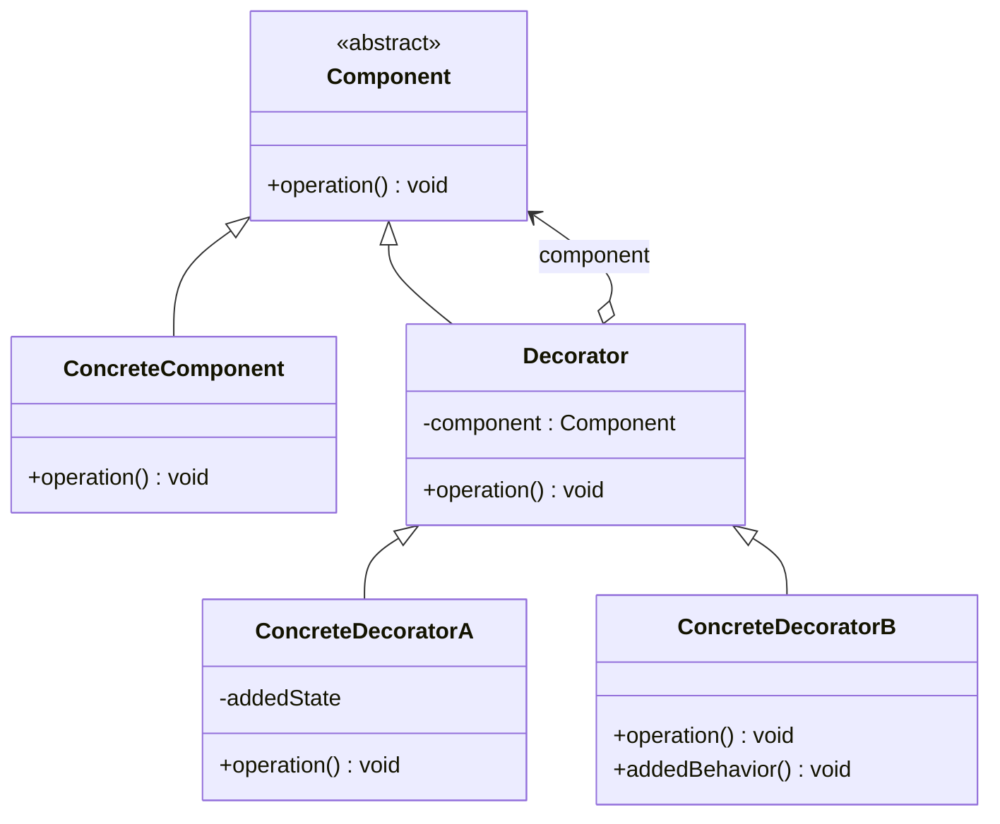


装饰器能够进行多层嵌套，因为：

- Is-A Component：Decorator 本身也是 Component，因此可以被其他装饰器继续包装。
- Has-A Component：Decorator 持有 Component 的引用，因此可以调用被装饰对象的原始功能。

添加额外功能：

|方式|实现|
|---|---|
|增强已有方法|重写 `operation()`，在调用原有方法的基础上执行额外逻辑|
|增加新的方法|在 ConcreteDecorator 中定义新的方法，例如 `say()`、`fly()`|

| Advantages                                          | Disadvantages     |
| --------------------------------------------------- | ----------------- |
| 相比继承更加灵活，避免子类数量急剧增加                                 | 产生大量小对象，增加资源消耗    |
| 支持在运行时动态扩展对象功能                                      | 可能影响程序性能          |
| 同一个对象可以使用多个装饰器                                      | 相比继承更容易出现错误       |
| ConcreteComponent 和 ConcreteDecorator 可以独立扩展，符合 OCP | 多层装饰增加调试难度，需要逐层排查 |

Applicability：

- 需要动态、透明地为单个对象增加职责，同时不影响其他对象。
- 希望在不影响其他对象的情况下扩展系统，或者继承不适合用于系统的扩展与维护。

## Facade Pattern（外观模式）

通过引入一个 Facade 对象，为多个子系统提供统一的访问入口，隐藏内部的复杂性，使子系统能更易于使用。

- Hide the complexities of the system（隐藏系统内部的复杂性）
- Provide a unified entry point（提供统一的访问入口）
- Simplify interactions between classes（简化类之间的交互）
- Reduce coupling between clients and subsystems（降低客户端与子系统之间的耦合）

> [!INFO]
> - LoD（Law of Demeter）
> - OCP：设计不当时，新增子系统需要修改 Facade，可能违反 OCP。

| Role      | Responsibility    |
| --------- | ----------------- |
| Facade    | 提供统一的高层接口，协调多个子系统 |
| SubSystem | 实现具体的业务功能         |

Subsystem 是一个广义概念，可以是一个类、一个功能模块、一个系统组件，甚至是一个完整的系统。

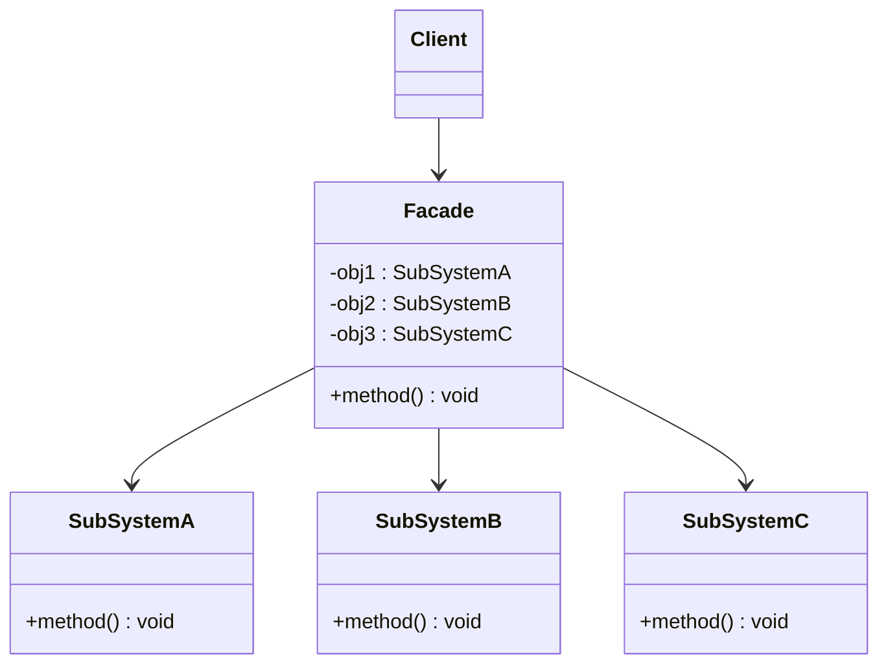


```cs
public class Facade {
	private SubSystemA obj1 = new();
	private SubSystemB obj2 = new();
	private SubSystemB obj3 = new();
	
	public void method() {
		obj1.method();
		obj2.method();
		obj3.method();
	}
}
```

核心就是将多个子系统的调用逻辑封装在 Facade 中，使客户端只需要执行一个高层操作。

| Advantages                       | Disadvantages                     |
| -------------------------------- | --------------------------------- |
| 隐藏子系统组件，减少客户端需要交互的对象数量           | 设计不当时，新增子系统需要修改 Facade 源代码，违反 OCP |
| 实现客户端与子系统之间的 Loose Coupling（松耦合） |                                   |
| 子系统发生变化时，可以通过调整 Facade 避免影响客户端   |                                   |
| 有助于隔离不同子系统的修改                    |                                   |

Applicability:

- 需要为一系列复杂的子系统提供简单的访问入口。
- 客户端与多个子系统之间存在大量依赖关系。
- 在分层架构（Layered Architecture）中，为每一层提供统一入口，通过 Facade 连接各层，从而降低层间耦合。

## Chain of Responsibility Pattern（职责链模式）

Avoid coupling the sender of a request to its receiver by giving more than one object a chance to handle the request. Chain the receiving objects and pass the request along the chain until an object handles it.

通过给予多个对象处理请求的机会，解除请求发送者与接收者之间的耦合。将这些处理对象组织成一条链，使请求沿链传递，直到被某个对象处理。

- Decouple the sender from the receiver（解耦请求发送者与接收者）
- Multiple objects have a chance to handle a request（多个对象都有机会处理请求）
- 请求沿职责链依次传递
- 实际处理请求的对象在运行时确定（Determined at Runtime）

> [!INFO]
> DIP：通过抽象 Handler 表示不同的处理者，具体处理者依赖抽象 Handler，而不是具体的后继处理者。

链上的每个对象可以选择：

1. Handle the request：处理请求
2. Pass it on：将请求传递给下一个处理者
3. Do both：处理请求后继续传递

请求最终没有被任何 Handler 处理，也是一种合法的情况。 职责链不保证所有请求一定得到处理。

| Role            | Responsibility               |
| --------------- | ---------------------------- |
| Handler         | 抽象处理者，定义请求处理接口，并持有后继处理者的引用   |
| ConcreteHandler | 具体处理者，判断自己是否能够处理请求，并决定是否继续传递 |
| Client          | 构建职责链，将请求发送给链上的第一个处理者        |

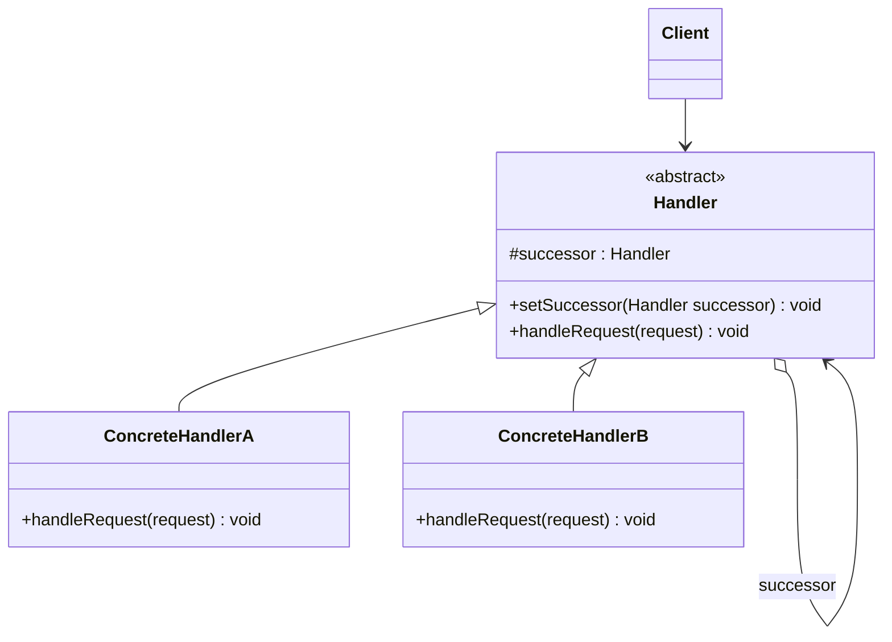

---

EXAMPLE:

不同级别的领导具有不同的批假权限：

| Handler        | 审批权限      |
| -------------- | --------- |
| Director       | 少于 3 天    |
| Manager        | 3 至 9 天   |
| GeneralManager | 10 至 29 天 |
| Reject         | 30 天及以上   |

```java
// ===== Request =====
class LeaveRequest {
    private final String leaveName;
    private final int leaveDays;

    public LeaveRequest(String leaveName, int leaveDays) {
        this.leaveName = leaveName;
        this.leaveDays = leaveDays;
    }

    public String getLeaveName() {
        return leaveName;
    }

    public int getLeaveDays() {
        return leaveDays;
    }
}

// ===== Handler =====
abstract class Leader {
    protected String name;
    protected Leader successor;

    public Leader(String name) {
        this.name = name;
    }

    public void setSuccessor(Leader successor) {
        this.successor = successor;
    }

    public abstract void handleRequest(LeaveRequest request);
}

// ===== ConcreteHandler: Director =====
class Director extends Leader {
    public Director(String name) {
        super(name);
    }

    @Override
    public void handleRequest(LeaveRequest request) {
        if (request.getLeaveDays() < 3) {
            System.out.println("Approved by Director: " + name);
        } else if (successor != null) {
            successor.handleRequest(request);
        }
    }
}

// ===== ConcreteHandler: Manager =====
class Manager extends Leader {
    public Manager(String name) {
        super(name);
    }

    @Override
    public void handleRequest(LeaveRequest request) {
        if (request.getLeaveDays() < 10) {
            System.out.println("Approved by Manager: " + name);
        } else if (successor != null) {
            successor.handleRequest(request);
        }
    }
}

// ===== ConcreteHandler: GeneralManager =====
class GeneralManager extends Leader {
    public GeneralManager(String name) {
        super(name);
    }

    @Override
    public void handleRequest(LeaveRequest request) {
        if (request.getLeaveDays() < 30) {
            System.out.println("Approved by GeneralManager: " + name);
        } else {
            System.out.println("Rejected");
        }
    }
}

// ===== Client =====
public class Client {
    public static void main(String[] args) {
        Leader director = new Director("Alice");
        Leader manager = new Manager("Bob");
        Leader generalManager = new GeneralManager("Charlie");

        // Construct the chain
        director.setSuccessor(manager);
        manager.setSuccessor(generalManager);

        // Submit requests
        director.handleRequest(new LeaveRequest("Tom", 2));
        director.handleRequest(new LeaveRequest("Tom", 7));
        director.handleRequest(new LeaveRequest("Tom", 15));
        director.handleRequest(new LeaveRequest("Tom", 40));
    }
}
```

---

| Advantages       | Disadvantages                            |
| ---------------- | ---------------------------------------- |
| 解耦请求发送者与实际处理者    | 如果 ConcreteHandler 忘记调用 successor，请求可能丢失 |
| 实际处理者可以在运行时确定    | 不保证请求一定得到处理                              |
| 可以动态配置职责链中的处理者   | 请求沿链传递可能产生额外的性能开销                        |
| 发送请求时无须明确指定最终接收者 | Request 可能要用在各种地方，需要细心设计 representations |

最根本的缺陷是由于请求转发逻辑由 ConcreteHandler 自己实现，开发者如果忘记编写 `successor.handleRequest(request)`，整条链就可能在此处中断。

Applicability:

- More than one object can handle a command：多个对象可以处理同一个请求
- The handler is not known in advance：无法提前确定实际处理者
- The handler should be determined automatically：需要自动确定处理者
- 需要向一组对象发送请求，而不明确指定接收者
- 需要动态配置能够处理请求的对象集合

## Command Pattern（命令模式）

Encapsulate a request as an object, thereby letting you parameterize clients with different requests, queue or log requests, and support undoable operations.

将请求封装为对象，使客户端能够使用不同的请求进行配置，并支持请求排队、日志记录和撤销操作。

- Encapsulate a request in an object（将请求封装为对象）
- Parameterize clients with different requests（通过传入不同的命令对象配置客户端的行为）
- Queue or log requests（将请求加入队列或记录请求）
- Support undoable operations（支持可撤销操作）
- Decouple senders and receivers（解耦请求的发送者与接收者）

Command Pattern 就是通过引入命令对象，将请求的发起与执行分离。

| Role            | Responsibility                           |
| --------------- | ---------------------------------------- |
| Command         | 抽象命令，声明 `execute()` 接口                   |
| ConcreteCommand | 具体命令，持有 Receiver 的引用，将请求转化为具体操作          |
| Invoker         | 调用者，负责触发命令                               |
| Receiver        | 接收者，负责执行实际业务逻辑                           |
| Client          | 创建 ConcreteCommand，配置 Receiver 和 Invoker |

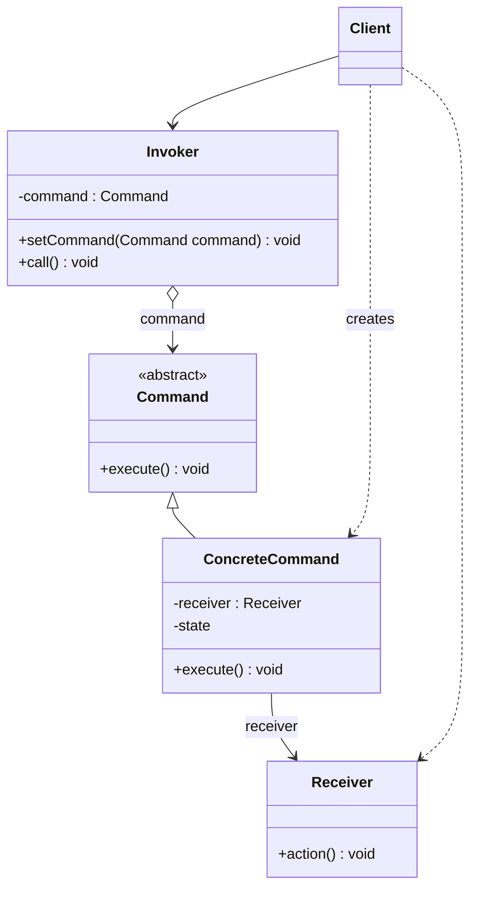

整个触发流程，Invoker 不知道 Receiver 的存在，也不需要知道命令的具体实现，只负责调用 `execute()`。ConcreteCommand 知道应该调用哪个 Receiver 的哪个方法。

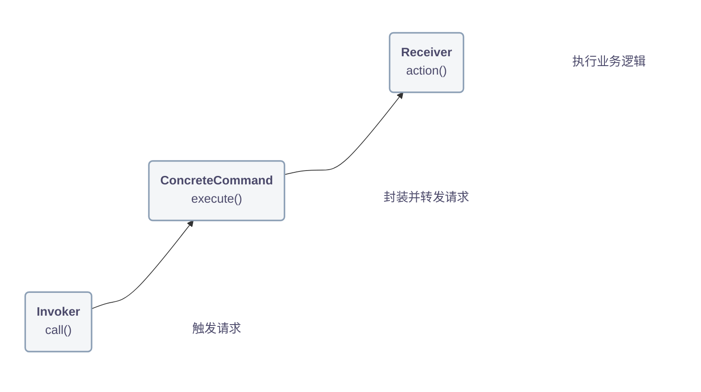
EXAMPLE:

```java
// ===== Receiver =====
class Television {
    public void open() {
        System.out.println("TV is on");
    }

    public void close() {
        System.out.println("TV is off");
    }

    public void changeChannel() {
        System.out.println("Channel changed");
    }
}

// ===== Command =====
abstract class AbstractCommand {
    public abstract void execute();
}

// ===== ConcreteCommands =====
class TVOpenCommand extends AbstractCommand {
    private final Television tv;

    public TVOpenCommand(Television tv) {
        this.tv = tv;
    }

    @Override
    public void execute() {
        tv.open();
    }
}

class TVCloseCommand extends AbstractCommand {
    private final Television tv;

    public TVCloseCommand(Television tv) {
        this.tv = tv;
    }

    @Override
    public void execute() {
        tv.close();
    }
}

class TVChangeCommand extends AbstractCommand {
    private final Television tv;

    public TVChangeCommand(Television tv) {
        this.tv = tv;
    }

    @Override
    public void execute() {
        tv.changeChannel();
    }
}

// ===== Invoker =====
class Controller {
    private final AbstractCommand openCommand;
    private final AbstractCommand closeCommand;
    private final AbstractCommand changeCommand;

    public Controller(
            AbstractCommand openCommand,
            AbstractCommand closeCommand,
            AbstractCommand changeCommand) {
        this.openCommand = openCommand;
        this.closeCommand = closeCommand;
        this.changeCommand = changeCommand;
    }

    public void open() {
        openCommand.execute();
    }

    public void close() {
        closeCommand.execute();
    }

    public void change() {
        changeCommand.execute();
    }
}

// ===== Client =====
public class Client {
    public static void main(String[] args) {
        Television tv = new Television();

        Controller controller = new Controller(
            new TVOpenCommand(tv),
            new TVCloseCommand(tv),
            new TVChangeCommand(tv)
        );

        controller.open();
        controller.change();
        controller.close();
    }
}
```

将请求对象化之后，请求本身就成为了可以传递、存储和管理的对象，而不再只是一次即时的方法调用，支持命令排队，记录日志和撤销。

| Advantages                                                 | Disadvantages            |
| ---------------------------------------------------------- | ------------------------ |
| 可以通过新增命令扩展系统，而不修改已有命令及通用调用逻辑                               | 每个独立命令可能需要一个对应的类，导致类数量增加 |
| 通过 Command 对象实现 Invoker 与 Receiver 之间的 Loose Coupling（松耦合） |                          |

Applicability:

- 需要根据不同的操作来配置对象的行为。
- 需要将请求加入队列，并在不同时间执行。
- 需要支持 Undoable Actions（可撤销操作）。
- 需要将多个基础操作（Primitive Operations）组织成高层操作（High-level Operations）。
- 需要解耦操作的发起者与实际执行者。

## Iterator Pattern（迭代器模式）

Provides a method to access an aggregate object without exposing its internal structure.

提供一种遍历聚合对象中各个元素的方法，而不暴露该对象的内部数据结构。

该模式又称 Cursor，

> [!INFO]
> - SRP：将数据存储和遍历两个职责分离。
> - OCP：方便新增聚合类和迭代器类，而无须修改已有代码。
> - Object Behavioral Pattern

Aggregate Object 原本具有两个职责：

| Responsibility  | 特征         |
| --------------- | ---------- |
| Storing data    | 基本职责       |
| Traversing data | 可变化、可分离的职责 |

Iterator Pattern 将遍历逻辑和遍历状态封装到独立的 Iterator 对象中，从而简化 Aggregate 的设计，符合 SRP。

| Role              | Responsibility     |
| ----------------- | ------------------ |
| Iterator          | 抽象迭代器，定义遍历操作       |
| ConcreteIterator  | 实现具体遍历逻辑，维护 Cursor |
| Aggregate         | 抽象聚合类，定义创建迭代器的接口   |
| ConcreteAggregate | 存储数据，创建对应的具体迭代器    |

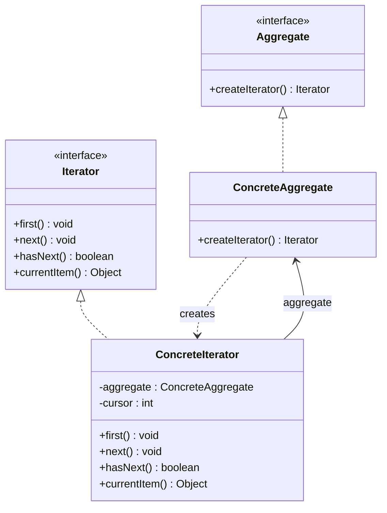

- ConcreteAggregate 负责创建与自身对应的 ConcreteIterator
- ConcreteIterator 持有 ConcreteAggregate 的引用，并维护自己的遍历位置（Cursor）

```java
public class ConcreteAggregate implements Aggregate { 

	//..
	
	public Iterator createIterator() { 
		return new ConcreteIterator(this); 
	}
}
```

| Advantages                         | Disadvantages                  |
| ---------------------------------- | ------------------------------ |
| 支持对同一个聚合对象进行多种方式的遍历                | 新增聚合类时可能需要新增对应的迭代器类，导致类数量成对增加  |
| 简化 Aggregate 类的设计                  | 增加系统复杂度                        |
| 方便新增 Aggregate 和 Iterator 类，符合 OCP | 抽象 Iterator 接口较难设计，需要考虑未来的扩展需求 |

## Strategy Pattern（策略模式）

Define a series of algorithms, encapsulate each one, and allow them to be interchangeable.

定义一组算法，将它们分别封装起来，使客户端能够根据需要灵活地替换所使用的算法。

- Encapsulate each algorithm independently（独立封装每种算法）
- Allow algorithms to be interchangeable（算法之间可以相互替换）
- Allow algorithms to vary independently from the clients that use them（算法的变化不影响使用它们的客户端）
- Provide a pluggable implementation scheme for algorithms（为算法提供可插拔的实现机制）

> [!INFO]
> OCP：可以灵活地新增或替换算法，而无须修改已有的算法调用逻辑。

|Role|Responsibility|
|---|---|
|Context（环境类）|持有 Strategy 的引用，将算法执行委托给 Strategy|
|Strategy（抽象策略类）|定义算法的公共接口|
|ConcreteStrategy（具体策略类）|实现具体算法|

```mermaid
classDiagram
    class Context {
        -strategy : Strategy
        +setStrategy(Strategy strategy) void
        +algorithm() void
    }

    class Strategy {
        <<interface>>
        +algorithm() void
    }

    class ConcreteStrategyA {
        +algorithm() void
    }

    class ConcreteStrategyB {
        +algorithm() void
    }

    Context o--> Strategy : strategy
    Strategy <|.. ConcreteStrategyA
    Strategy <|.. ConcreteStrategyB

```

| Advantages                       | Disadvantages                 |
| -------------------------------- | ----------------------------- |
| 支持灵活地新增和替换算法，符合 OCP              | Client 需要了解可用策略，并自行决定使用哪种策略   |
| 方便管理一组相关算法（Family of Algorithms） | 产生大量 ConcreteStrategy 类       |
| 提供一种替代继承的功能扩展方式                  | 基本结构下，一个 Context 同一时间只能使用一种策略 |
| 避免大量条件选择语句                       |                               |
| 不同 Context 可以复用相同的 Strategy      |                               |

Applicability:

- 系统需要在多个算法中动态选择一个
- 希望避免难以维护的大量条件选择语句（Conditional Selection Statements）
- 希望隐藏与算法相关的复杂数据结构及实现细节

## 只了解定义即可

1. Proxy Pattern（代理模式）：为一个对象提供代理，通过代理控制对原对象的访问。Client 不直接访问真实对象，而是通过 Proxy 间接访问。Proxy 可以在转发请求之前或之后进行额外处理。
2. Template Method Pattern（模板方法模式）：在父类中定义算法的整体执行流程，将部分步骤交给子类实现，但不改变整体流程。
3. Memento Pattern（备忘录模式）：在不破坏封装性的前提下，保存对象的内部状态，以便之后恢复到该状态。
4. Flyweight Pattern（享元模式）：通过共享对象中可复用的部分，减少大量细粒度对象带来的内存开销。这个模式在游戏开发中很常见。例如一个场景中有 10,000 棵同类型的树，没有必要让每棵树分别保存一份 Mesh, Texture 和 Material，而是可以共享这些数据，仅单独保存各自的位置、旋转等信息。
5. Interpreter Pattern（解释器模式）：为一种语言定义其文法的表示形式，并提供解释器来解释该语言中的语句。
6. Visitor Pattern（访问者模式）：将针对某种对象结构的操作封装到独立的 Visitor 中，使系统能够在不修改元素类的情况下增加新的操作。

|Pattern|Category|核心思想|关键词|
|---|---|---|---|
|Proxy|Structural|控制对原对象的访问|Access Control|
|Template Method|Behavioral|固定算法流程，允许子类改变部分步骤|Algorithm Skeleton|
|Memento|Behavioral|保存并恢复对象状态|Save & Restore|
|Flyweight|Structural|共享对象数据，降低内存消耗|Sharing|
|Interpreter|Behavioral|定义文法并解释语言中的语句|Grammar|
|Visitor|Behavioral|不修改元素类即可增加新的操作|New Operations|