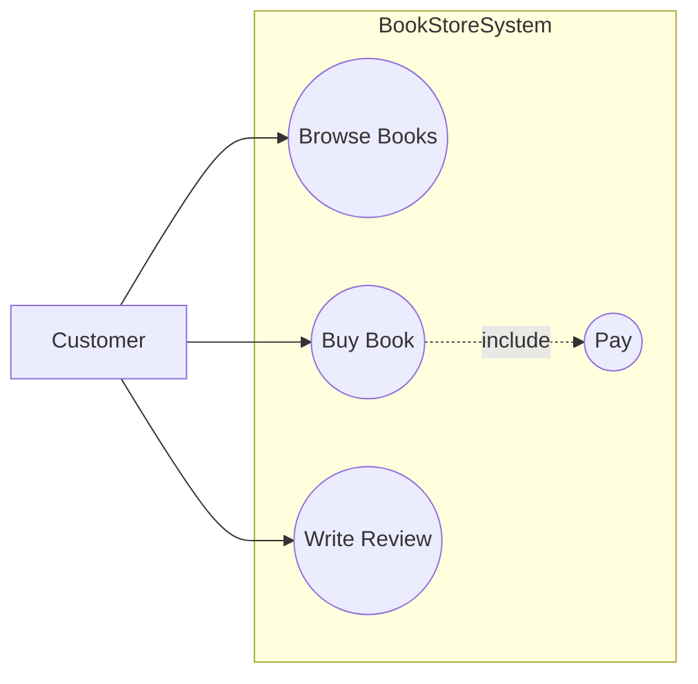
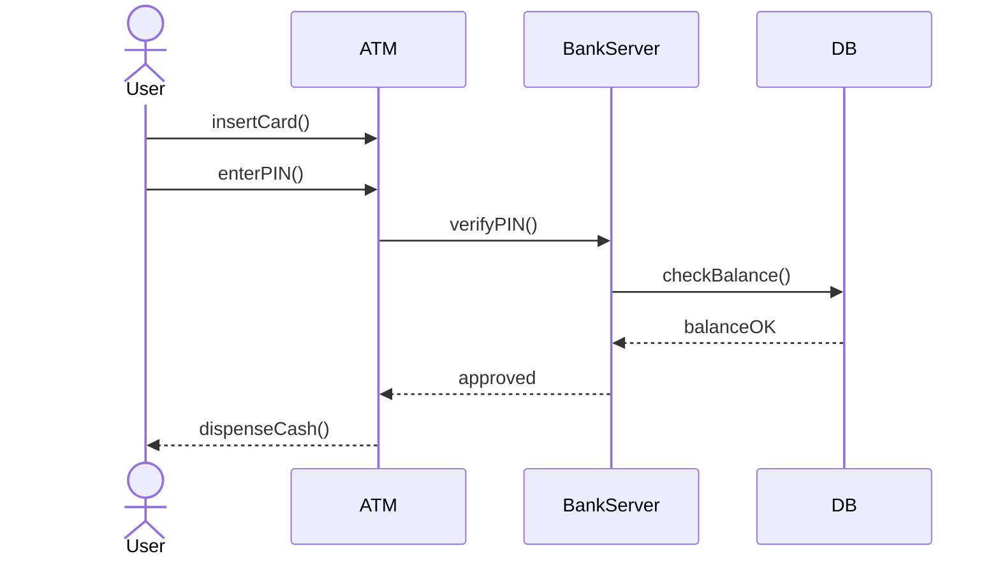
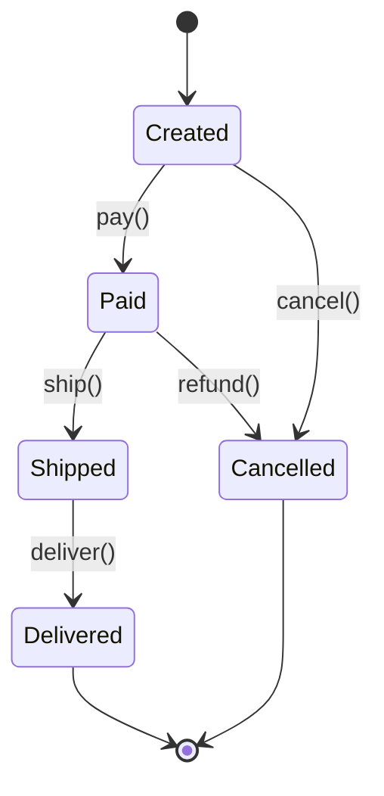
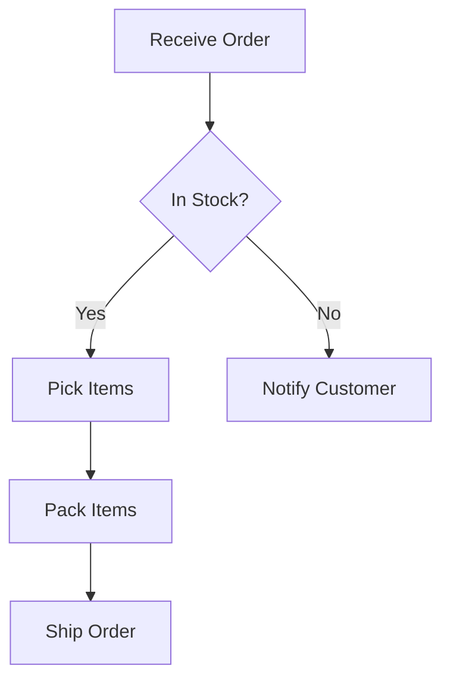
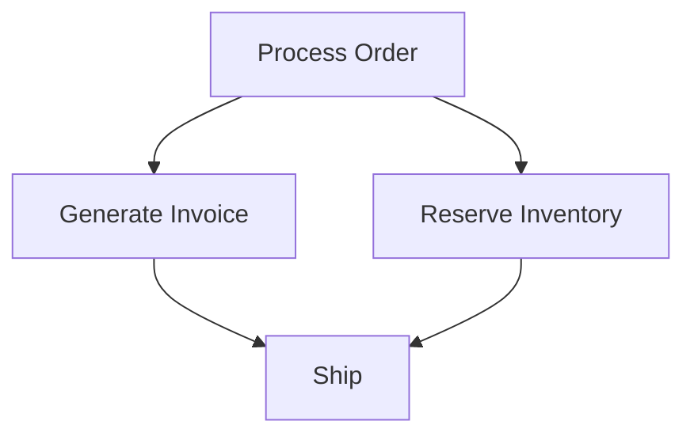

# 北工大软件架构

## Why Software Architecture - 产生动因

- **控制复杂性**：架构通过抽象降低理复杂系统的理解成本，帮助控制系统
- **利益相关者沟通**：架构是用户、开发者、管理者、客户之间的通用语言
- **早期设计决策**：架构选择约束所有下游实现，是后期最难修改的部分
- **架构知识重用**：MVC、微服务、管道 - 过滤器等模式沉淀了数十年的集体经验
- **降低风险**：合理的架构能在繁重编码开始前，识别并缓解技术风险

好的架构能：

- 降低维护成本
- 降低风险
- 方便多人协作
- 提高复用
- 提高系统质量

并且架构方面的错误在后期修复成本极高。

## 架构定义的演进

> [!TIP] 考试重点

所有软件架构（SA）定义都认可组件（components）和关系（relationships）这两个核心概念。它们的区别在于，是否要把下面的内容也纳入其中：

- 设计理由（rationale）
- 演化原则（evolution principles）
- 可见属性（visible properties）
- 形式化约束（formal constraints）

SA 起源于不同的学术与工程领域，造就了其定义的多样性，但它们都认同——软件架构 = 对系统最高层次的抽象，用来定义：

- 系统组件
- 组件之间的关系
- 指导系统设计的原则

## 组件，连接器和约束

- 组件：基本构建块（building blocks）
- 连接器：组件之间的交互机制
- 约束：组件组合的规则

例如：

- Components：包括模块、子系统、层、包
- Connectors：API 调用、事件、数据流、网络协议
- Constraints：数据库只能通过数据层访问，所有请求必须经过网关

> 架构设计 = Decomposition（拆成组件）+ Composition（用连接器组装）

## 功能属性 vs 非功能属性（质量属性）

- 功能属性：系统**做什么**，比如用户登录、商品搜索、订单支付
- 非功能属性（质量属性）：系统**做得多好**，比如性能、安全、可靠性、可修改性

而架构最能发挥功能的地方是：非功能属性。因为功能大家都能写，但性能、扩展性、稳定性，很依赖架构。

## 架构与框架

- Architecture 是抽象设计思想，描述系统应该怎么组织。例如：MVC 和微服务
-  Framework 是架构的具体实现，是代码层面的工具。例如：Spring, Django, .NET

## 影响架构的因素

> [!TIP] 考试重点

基本的影响因素：

- 利益相关者：业务目标、功能需求、约束条件
- 开发团队：团队结构、人员技能、沟通方式
- 技术环境：可用平台、工具、行业技术趋势
- 架构经验：掌握的模式、过往项目的经验教训

这四种共同影响需求和质量属性（quality attribute），这二者又影响：

-> 架构师（architect）-> 软件架构 -> 系统

架构设计不是一次完成的，而是会随系统演化不断迭代循环。

## Architectural Styles 架构风格

架构风格 = 组件/连接器词汇表 + 拓扑结构 + 语义约束

Architecture Style = Component/Connector vocabulary, Topology, Semantic Constraints 

五大经典架构风格家族

1. 数据流风格（Data Flow）：批处理顺序、管道 - 过滤器
2. 事件系统风格（Event System）：观察者、广播、发布 - 订阅、点对点
3. 调用 - 返回风格（Call/Return）：主 / 子程序、面向对象、分层、客户端 / 服务器
4. 数据中心风格（Data-Centered）：仓库、黑板
5. 虚拟机风格（Virtual Machine）：解释器、规则系统

### Data Flow

#### 批处理顺序（Batch Sequential）

读取全部数据 → 全部处理完成 → 生成全部输出

核心思想是整个阶段做完，再开始下一阶段。

特点：

- 一次处理整个数据集
- 无并发
- 延迟高


#### 管道 - 过滤器（Pipe-and-Filter）

Source  → Filter A  → Filter B  → Sink

数据像水流一样流过多个 Filter，每个 Filter 只做一件事。

它不是全部做完再下一步，而是一边产生数据，  一边处理数据。所以他支持并发，且延迟更低。


Batch Sequential 特点：

- 整批处理
- 高延迟
- 无并发

Pipe-and-Filter 特点：

- 流式处理
- 低延迟
- 可并发

### Event System

系统不是 A 直接调用 B，而是 A 发事件，谁关心谁处理。优点有解藕，缺点会导致调试苦难。

#### Observer Pattern

本质就是：

- Subject（被观察者）
- Observer（观察者）


#### Pub/Sub（发布订阅）

Publisher 不知道：

- 有谁订阅
- 有多少订阅者

这叫 Implicit Invocation（隐式调用）。

p2p:

- 点对点的，意味着一条消息只有一个观察者消费，消费完即删
- 不能重复处理

pub/sub:

- 广播，一个消息所有订阅者都收到

### Call/Return

#### Main/Subroutine + OOP 主 / 子程序与面向对象风格

- 单线程控制流
- 有明确调用顺序
- 使用调用栈

OOP 本身不是完整架构，它只是一种组织代码的方法。在大型系统的问题：

|问题|含义|
|---|---|
|God Object|上帝类|
|Excessive Coupling|耦合严重|
|Distributed Difficulty|分布式困难|
|Message Overhead|通信开销|

#### Layered Architecture

每层只为上一层提供服务，只能调用下一层

- 核心优势：高内聚、信息隐藏、低耦合、层可替换
- Layering constrains dependencies and keeps change local: 分层限制依赖，让修改不会扩散。

#### MVC

三大组件职责：

- Model：数据 + 业务逻辑（核心，独立于 UI）
- View：用户界面展示
- Controller：处理用户输入，更新 Model，通知 View 刷新、

是种混合风格：同时属于调用 - 返回、分层、观察者风格

#### Client/Server

现代 Web 又开始富客户端化：前端逻辑越来越复杂。

例如：

- React
- Vue
- SPA

### Data-Centered

核心思想：数据是整个系统的中心

#### Repository

所有组件共享一个中央数据存储。

- 易集成：新模块接入只需要连接 Repository
- 单点故障，耦合

#### Blackboard

很多知识源（Knowledge Sources）共同解决问题。

某个模块看到黑板状态满足某条件，它就会：

- 处理问题
- 更新黑板

然后其他模块看到变化，继续处理。

### Virtual Machine

#### Interpreter Style（解释器风格）

程序不是直接运行在硬件上，而是运行在虚拟机器里。

Ex：

- JVM
- Wasm
- ONNX

#### Rule-Based System

系统行为由规则决定，而不是写死流程。

结构：

Knowledge Base  ->  Inference Engine  -> Working Memory

流程：

match  -> select ->  fire

### 现代架构风格

#### Microservices

- 一个服务只做一件事。
- 例如用户服务，订单服务，支付服务，库存服务，每个服务都独立部署。
- 每个服务拥有自己的数据库。
- 默认别的服务可能挂。

#### Serverless / FaaS

不用管理服务器，只写函数。

事件  -> 触发函数   -> 自动扩缩容


### 混合风格

现实系统几乎从不只使用一种架构，因为不同子系统都问题不同。

Modular Monolith 虽然是单体但内部模块边界清晰，比微服务简单很多。


## 架构描述

让架构**可见、可沟通、可执行**

### UML

UML 共 14 种图：7 种结构图（类、对象、组件、部署、包、复合结构、Profile）+7 种行为图（用例、时序、通信、活动、状态机、定时、交互概览）

类图 + 时序图 + 用例图覆盖 80% 的实际建模需求

> [!TIP] 考试重点
> 后面几个图都是重点
#### 用例图 Use Case Diagram

用例是**外部视角**，关注用户能用系统做什么，不要和内部类一一对应。

组成：
- Actor：角色（经常画成简笔画小人）
- Use Case：椭圆
- System Boundary：大矩形
- include：包含箭头所指，必须包含
- extend：可扩展箭头所指，可选扩展



#### 类图 Class Diagram

它描述系统的静态结构。也就是：

- 有哪些类
- 类有什么字段
- 类有什么方法
- 类之间怎么关联

通常只会花核心模块和关键对象。

Class Diagram = Logical View != Development View

|符号|含义|
|---|---|
|+|public|
|-|private|
|#|protected|

#### 时序图 Sequence Diagram 与通信图 Communication Diagram

描述动态行为：系统运行时发生了什么。

时序图专注一个用例，时间从上往下流。



通信图本质上和时序图类似，但强调对象之间连接关系而不是时间顺序。消息顺序用编号表示。

#### 状态图 State Diagrams 

状态图关注一个对象的一生。通常会包含多个 use case。



#### 活动图 Activity Diagram

Activity Diagram 是 process-oriented（面向流程），它描述的是：事情如何一步步完成。强调工作流，并发和职责分配。

图：

- 菱形是判断
- 箭头是流程



Fork / Join（并行）：

这里 Invoice 和 Inventory 可以并行。



Swimlane（泳道）：

它表达谁负责什么，表示不同角色/部门。例如 Customer, Sales, Warehouse。在图中表现为像是泳道一样的多个区域。

### ADL（Architecture Description Language）

UML 偏图形化沟通，而 ADL 偏形式化描述。ADL 的目标是让工具理解架构，然后工具可以：

- 自动检查一致性
- 验证规则
- 自动生成部分代码
- 分析系统问题

Ex:

```
process SensorHub
 features
 data_in : in data port;
 data_out : out data port;
end SensorHub;
```

因为各种原因，ADL 不是很普及。

### 架构文档七原则

1. 从读者视角写作
2. 避免不必要的重复
3. 避免歧义，使用图例 (legend)
4. 使用标准，统一的结构
5. 记录决策理由（包括被否决的方案）
6. 保持更新但不要过度频繁
7. 邀请他人 review（ex：利益相关者、新成员、评估者 ）

核心结论：好的架构文档是**以读者为中心、精确、适度更新**的

### 4+1 View Model

> [!TIP] 考试重点

一个复杂系统，不可能只靠一张图描述，需要需要多视图（Multiple Views）。

4+1 View Model 是软件架构经典理论，它把系统拆成：

| View        | 关注什么    | 对应的图/补充                |
| ----------- | ------- | ---------------------- |
| Scenario    | 系统做什么   | 用例图                    |
| Logical     | 系统有哪些部分 | 类图，状态图，时序图             |
| Process     | 并发与流程   | Activity Diagram       |
| Development | 代码组织    | 关注模块划分，复用              |
| Physical    | 部署结构    | 关注系统在哪运行，例如 Web Server |

### Architecture Decision Record（架构决策记录）

用于记录各种决策的理由。例如：

- 做了什么决定
- 为什么这么做
- 有什么后果
- 为什么没选别的方案

最佳实践：一个 ADR 记录只一个决策、尽早开始持续维护、记录所有后果、保持简短、视为不可变记录

### C4 Model

C4 Model 是更现代、更实用且更轻量的 UML 替代思路。

分四层：

- System Context（系统上下文）  
    这个系统是什么？谁在使用它？  
    面向业务相关人员。
- Container（容器层）  
    系统主要由哪些技术部分组成？  
    面向架构师和 DevOps。
- Component（组件层）  
    这个容器内部是如何组织的？  
    面向开发者。
- Code（代码层）  
    这个组件具体如何实现？  
    关注代码实现细节。


## Quality Attribute

Quality Attributes（质量属性）也叫 Non-functional Requirements（非功能需求）。质量属性必须在架构阶段设计，不能后期硬加。

- Availability（可用性）：指系统持续提供服务的能力
- Modifiability（可修改性）：系统修改的难易程度
- Performance（性能）：在负载下快速响应的能力
- Security（安全性）：核心是 CIA Triad，Confidentiality（机密性），Integrity（完整性）和Availability
- Usability（易用性）：对用户是否友好
- Testability（可测试性）：系统是否容易发现 Bug
### QA Scenario（质量属性场景）

> [!TIP] 考试重点

本质上就是把模糊质量需求，变成可测试、可验证的描述。

1. Source（来源）：谁触发的。例如：用户，开发者，外部系统
2. Stimulus（刺激）：发生了什么。例如：用户发起请求数据库宕机收到异常消息
3. Artifact（受影响对象）：系统哪个部分受影响。例如：UI, DB, 整个系统
4. Environment（环境）：系统处于什么状态。例如：正常运行高负载维护模式
5. Response（响应）：系统该怎么做。例如：记录错误自动恢复返回结果
6. Response Measure（响应指标）：需求一定要可量化。例如：2秒内完成1小时内恢复99.99%可用

例如性能：

- Source: End user
- Stimulus: 发起交易
- Response: 处理交易
- Measure: 2秒内完成

### Tactics（战术）

**是实现质量属性的具体设计手段。**

例如：

Availability（可用性）的 tactics：

- Detect（检测故障）
- Recover（恢复）
- Avoid（避免）

Performance（性能）的 tactics：

- 增加资源
- 并发
- 调度优化

Security（安全）的 tactics：

- 抵抗攻击
- 检测攻击
- 恢复

架构风格，本质上是 tactics 的组合。例如：

微服务为什么可扩展？因为它里面用这些 tactics：

- 隔离
- 独立部署
- 冗余
- 异步通信

| QA（质量属性）            | Direction（方向）              | Key Tactics（关键策略）                                                                             |
| ------------------- | -------------------------- | --------------------------------------------------------------------------------------------- |
| Availability（可用性）   | Fault Detection（故障检测）      | Ping/Echo（Ping回显）, Heartbeat（心跳检测）, Exceptions（异常处理）                                          |
|                     | Fault Recovery（故障恢复）       | Voting（投票机制）, Active/Passive Redundancy（主备冗余）, Spare（备用节点）, Checkpoint（检查点）                   |
|                     | Fault Avoidance（故障避免）      | Service Removal（服务移除）, Transactions（事务）, Process Monitor（进程监控）                                |
| Modifiability（可修改性） | Limit Scope（限制影响范围）        | Info Hiding（信息隐藏）, Interfaces（接口）, Facade（外观模式）, Intermediary（中介层）, Abstract Services（抽象服务）   |
|                     | Delay Binding（延迟绑定）        | Config Files（配置文件）, Pub-Sub（发布订阅）, Polymorphism（多态）, Registration（注册机制）, Interpreter（解释器）     |
| Performance（性能）     | Resource Demand（减少资源需求）    | Efficient Algorithms（高效算法）, Reduce Data（减少数据量）, Limit Time/Queue（限制执行时间/队列长度）                 |
|                     | Resource Management（资源管理）  | Concurrency（并发）, Scale Up/Out（垂直/水平扩展）, Data Copies（数据副本）, CDN（内容分发网络）                        |
|                     | Resource Arbitration（资源调度） | FIFO（先进先出）, Fixed Priority（固定优先级）, Dynamic Priority（动态优先级）, Earliest Deadline First（最早截止时间优先） |
| Security（安全性）       | Resist Attacks（抵抗攻击）       | Authentication（认证）, Authorization（授权）, Encryption（加密）, Integrity（完整性校验）, Access Control（访问控制） |
|                     | Detect Attacks（检测攻击）       | IDS/IPS（入侵检测/防御系统）, SIEM（安全信息与事件管理）                                                           |
|                     | Recover（恢复）                | Restore State（恢复系统状态）, Identify Attacker（识别攻击者）                                               |
| Usability（易用性）      | Runtime（运行时）               | Anticipate Tasks（预测用户操作）, Provide Feedback（提供反馈）, Consistent Experience（一致体验）                 |
|                     | Design-time（设计时）           | Undo Support（撤销支持）, MVC Isolation（MVC隔离）                                                      |
| Testability（可测试性）   | Black-box（黑盒）              | Record/Replay（录制回放）, Interface Separation（接口分离）, Test Paths（测试路径）                             |
|                     | White-box（白盒）              | Internal Monitoring（内部监控）, Breakpoints（断点）, Debugging Tools（调试工具）                             |

> [!TIP] 考试 tip
> 1. 说出每个质量属性（QA）的 tactic 分类方向
> 2. 每个方向举出 2~3 个具体 tactics
### Modern Quality Practices

Observability（可观测性）：

现代分布式系统里系统是否出问题已经不能只靠日志。所以出现三大信号：

1. Logs（日志）：解释发生了什么
2. Metrics（指标）：显示数量与趋势。例如：CPU，Latency 和 TPS
3. Traces（链路追踪）：显示请求经过了哪些服务。

其它：

- Zero Trust：默认任何请求都不可信
- AI Safety：Prompt Injection
- Chaos Engineering：主动制造故障，测试系统是否真正可靠
- Sustainability：能耗，碳排放

### Trade-Off Matrix（权衡矩阵）

不可能同时把所有质量属性做到极致。例如：

- Availability ↑ 可能让 Performance ↓
- Security ↑ 可能让 Usability ↓
- Modifiability ↑ 可能让 Performance ↓

## Design Smells

设计异味不一定会让程序立刻出现 bug，但能说明潜在问题。

- Rigidity（僵化）：改一个地方会连锁修改很多模块。
- Fragility（脆弱）：改 A 却莫名弄坏 B。
- Immobility（固化）：代码无法复用。
- Viscosity（粘滞）：正确做法太麻烦，大家开始写 hack（临时🍮）。
- Opacity（晦涩）：代码难读。
- Needless Complexity（不必要复杂度）：过度设计。
- Needless Repetition（重复）：大量 copy-paste。

对应思想：

- YAGNI：不要提前设计未来需求。
- DRY：提取通用部分。

### SoC 与 Information Hiding

> [!TIP] 考试重点

- Separation of Concerns（关注点分离）指按照不同职责划分模块。例如 MVC：Model + View + Controller。决定模块边界。

- Information Hiding（信息隐藏）指隐藏模块容易变化的实现细节。比如让接口暴露 WHAT，内部隐藏 HOW。决定向外界暴露什么。

### Coupling 与 Cohesion

> [!TIP] 考试重点

**Coupling（耦合）：模块之间依赖程度。**

从差到好列五种耦合：

1. Content Coupling（内容耦合）：直接修改别人的内部。
2. Common Coupling（公共耦合）：共享全局变量。
3. Control Coupling（控制耦合）：传 flag 控制别人逻辑。

例如：

```java
process(isAdmin=true)
```

4. Stamp Coupling（印章耦合）：传整个对象，但只用其中一部分。
5. Data Coupling（数据耦合）：只传简单参数。

**Cohesion（内聚）**：模块内部是否专注于一件事。

从好到坏：

1. Functional Cohesion（功能内聚）：模块所有代码完全专注于一项功能
2. Sequential Cohesion（顺序内聚）：前一个步骤输出，作为后一个步骤输入；顺序依赖，在编译器和数据处理中常见
3. Communicational Cohesion（通信内聚）：不同的操作都在处理同一份数据。例如以下代码都围绕同一 file handle:

```java
readFile()
parseFile()
```

4. Procedural Cohesion（过程内聚）：代码只因执行顺序而放在一起，既不共享数据，功能也不强相关
5. Temporal Cohesion（时间内聚）：因为需同一时间发生才放一起。例如系统初始化：

```java
initLogger()
loadConfig()
connectDB()
```

6. Logical Cohesion（逻辑内聚）：逻辑上属于一类，但行为不同。例如处理鼠标点击和键盘都属于处理输入，但实际功能不同，易导致 god class
7. Coincidental Cohesion（偶然内聚）：完全没关系的东西硬塞一起。例如 `Utils.java` 中有字符串工具，文件工具等

### SOLID Principles

> [!TIP] 考试重点

- Single Responsibility Principle（单一职责原则，SRP）：一个类只负责一件事
- Open-Closed Principle（开闭原则，OCP）：对扩展开放，对修改关闭
- Liskov Substitution Principle（里氏替换原则，LSP）：子类必须能完全替换父类
- Interface Segregation Principle（接口隔离原则，ISP）：不要让客户端依赖它不需要的方法
- Law of Demeter（迪米特法则 / 最少知道原则，LoD）：对象只与直接朋友通信，不了解过多内部结构
- Dependency Inversion Principle（依赖倒置原则，DIP）：高层模块不要依赖低层模块，都依赖抽象。

Design Pattern 本质上是在实现设计原则。

但也不用过度 SOLID：

- Pragmatism（实用主义）：增加复杂度但无收益
- Rule of Three（三次法则）：等三次重复后再提取抽象
- 80/20 Rule：保持边缘 glue code 简单

### DRY、KISS、YAGNI

防止过度设计：

- DRY(Don't Repeat Yourself)：相同的逻辑不要复制黏贴，但不要为了 DRY 强行合并无关代码，错误的抽象可能比重复更糟糕
- KISS（Keep It Simple, Stupid）：不盲目增加复杂性，采用适合项目的简单方法
- YAGNI（You Aren’t Gonna Need It)：现在不需要，就别提前做

### 其它原则

- CPUID：指出好代码应具备的特性，更关注开发者能否舒服地写代码
	- Composable（可组合）
	- Unix Philosophy（只做好一件事）
	- Predictable（可预测）
	- Idiomatic（符合社区习惯）
	- Domain-based（面向领域）
- DDD（Domain-Driven Design）：软件结构应该围绕业务领域
- IDEALS：这是面向微服务的原则，本质是把 SOLID 扩展到分布式系统
	- Interface Segregation
	- Loose Coupling
	- Event-driven
	- 等

- Twelve-Factor App：解决云环境中的可部署性和可扩展性
- API-First Design：先设计 API，再写代码
- Contract Before Code：先定义接口契约
- Backward Compatibility：新版本不能破坏旧客户端
- API as a Product：API 本身也是产品

## Architecture Evaluation 架构评估

问题越早发现，修复成本越低。架构评估的本质是把“我觉得没毛儿”变成“有证据说明确实没毛”。

### 评估方法：SAAM

> [!TIP] 考试重点

- 全称：Software Architecture Analysis Method
- 核心思想：用 Scenario（场景）去测试架构

步骤：

1. Develop Scenarios：利益相关者提出 QA 场景

	例如：支持10万用户30秒内恢

2. Describe Architecture：描述当前架构
3. Classify Scenarios：划分场景
	- Direct：当前架构已经支持，不用修改
	- Indirect：需要改架构才能支，说明存在弱点
4. Evaluate Indirect：估算修改成本
5. Assess Interactions：分析哪些模块会一起受影响
6. Overall Evaluation：总结结果

### ATAM

> [!TIP] 考试重点

全程 Architecture Tradeoff Analysis。SAAM 关注单个 QA，而 ATAM 关注多个 QA 之间的 trade-off。ATAM 的核心目标是发现风险与权衡，而不是精确计算性能。

ATAM 参与人员：
- Evaluation Team（评估团队）
- Decision Makers（决策者）
- Stakeholders（利益相关者）

2个阶段，9个步骤：

- 阶段一：理解系统
	- Present ATAM：解释方法，流程和输出
	- Business Drivers：介绍业务背景
	- Present Architecture：展示当前技术架构
	- Identify Approaches：列出架构方法/架构风格
- 阶段二：分析
	- Build Utility Tree：建立效用树，列出 QA，按 H / M / L（高、中、低）评估
	- Analyze Approaches：分析风险和 trade-off
	- Brainstorm Scenarios：所有 stakeholder 一起补充可能的 scenario
	- Analyze New Scenarios：继续分析新增 scenario
	- Present Results：最终输出报告，包括 risk, non-risk, sensitivity point, trade-off point

### CBAM

> [!TIP] 考试重点

CBAM 全称 Cost-Benefit Analysis Method，考虑这个架构值不值，会权衡架构优点和实现成本，称作 ROI (best return on investment)。

六步：

1. Collate Scenarios：收集 scenario，通常来自之前的 ATAM
2. Refine Scenarios：细化 scenario，补充 stimulus 和 response goal
3. Prioritize：利益相关者投票决定哪些 scenario 优先考虑
4. Assign Utility：评估每个方案的 utility value（ex: 安全性 + 10）
5. Map Strategies：对应架构策略与开销，利润
6. Calculate ROI：ROI = (Benefit - Cost) / Cost

### 更轻量的做法

完整的 ATAM 很重，敏捷团队更倾向于 Lightweight ATAM。
- 1天以内，小团队
- 只关注几个关键 scenario
- 用 ADR 替代正式报告

- MVA（Minimum Viable Architecture）：用最小架构增量（指获取 QA 反馈的机会）验证设计是否正确。
- Risk-Storming 是一种团队风险讨论方法：画好架构图后每个人单独分析，然后集思广益。
- Architecture Katas（架构演练）：预设好问题和 QA constraints，小组快速设计架构并互相评审，提升评估能力
- Fitness Functions：自动化检测架构质量。例如用规则自动约束架构（Governance by Rule），限制跨层调用和依赖数量

### Monolith → Microservices

从单体迁移到微服务

Strangler Fig Pattern（绞杀者模式）：不一次性重写系统，而是逐步替换。

### 持续评估

DORA 指标：架构健康度的量化标准
- 部署频率：代码上线的频率
- Lead Time for Changes：从代码提交到生产的时长
- Change Failure Rate：部署导致的事故比例
- 平均恢复时间（MTTR）：故障后恢复服务的速度
