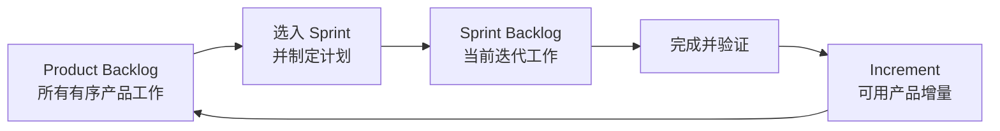

# COMP3039J Agile Processes｜期末复习笔记

## 怎么复习

1. 先记住敏捷的整体框架：

	价值观（values）→ 原则（principles）→ 角色（roles）→ 实践（practices）→ 工件（artifacts）→ 评估（assessment）
	
2. 再掌握常考的对比：Waterfall 与 Agile、Product Owner 与 Scrum Master、Sprint Review 与 Retrospective、User Story 与 Use Case、TDD 与普通测试。
3. 最后用“优点 + 限制 + 适用条件”作答。课程立场不是无条件推崇敏捷，而是分析哪些思想有效、哪些有风险。

---

## COMP3039J Agile Processes-Introduction 课程导论

| 大纲             | 核心问题               |
| -------------- | ------------------ |
| Context（背景）    | 敏捷宣言、方法与价值观从何而来？   |
| Principles（原则） | 支撑敏捷的核心方法思想是什么？    |
| Roles（角色）      | 团队成员与传统经理职责如何变化？   |
| Practices（实践）  | 团队具体怎样协作、开发、测试和发布？ |
| Artifacts（工件）  | 哪些信息载体与工具支持开发？     |
| Assessment（评估） | 哪些敏捷做法有价值、被夸大或有害？  |

### Agile Manifesto 敏捷宣言

敏捷运动于 2001 年因《敏捷宣言》广为人知。宣言强调一组价值取向和原则，回应传统软件开发中变更迟缓、交付过晚、重流程轻软件等问题。

宣言重视：

1. Individuals and interactions（个体与互动）高于 processes and tools（流程与工具）
2. Working software（可工作的软件）高于 comprehensive documentation（详尽文档）
3. Customer collaboration（客户协作）高于 contract negotiation（合同谈判）
4. Responding to change（响应变化）高于 following a plan（遵循计划）

### 敏捷宣言的12条原则

1. 首要任务是通过尽早且持续地交付有价值的软件来满足客户的需求
2. 欢迎改变需求，即使发生在开发后期；敏捷开发善于利用变化，为客户创造竞争优势
3. 频繁地交付可运行的软件，偏好短周期（短至几周，长至几月）
4. 业务人员（Business people）每天与开发者在整个项目中合作
5. 围绕积极有动力的人来构建项目，提供所需的环境和支持，并信任他们能够完成任务
6. 面对面交流是开发团队对内对外最有效的沟通方式
7. 能够正常运行的软件是衡量项目进展（progress）的首要标准
8. 倡导可持续开发。项目发起方（Sponsors），开发者和用户需能长期保持稳定的工作节奏
9. 持续关注技术卓越性（Technical Excellence）和良好的设计，能够提升团队的敏捷性
10. 简洁性至关重要。简洁的艺术在于：最大限度地减少不必要的工作
11. 最优秀的系统架构、需求方案和设计，往往来自自组织团队（Self-organizing Teams）
12. 团队定期反思如何提高自身的工作效率，并据此调整自身

这些原则虽然由 Agile 创始人提出，但还存在些不足：

1. 有些只是 practices，而非 principles
2. 有些只是 assertions（陈述），而非 principles。 ex: 6
3. 内容有重复
4. 缺少部分一些关键方面的内容。 ex: testing

例如，第十条提到的 Simplicity 不等于 Working Less（减少工作）。例如，最初的设计可能非常复杂，为了让它变得真正简洁，反而需要投入更多时间进行思考和优化。

官方原则为我们理解 Agile 提供了良好的起点，但不足以准确解释 Agile 究竟是什么。

### 主要敏捷方法


1. XP — Extreme Programming

	XP 出现在 1990 年代，当时软件工程领域主流开发文化重视 Process, Plan, Diagrams，例如 UML 和 CMMI（能力成熟度模型），而 XP 反其道而行之：认为软件开发最终真正重要的是程序和程序员本身。主要贡献：将程序和编程重新放回软件开发的核心位置。

2. Lean Software 
	
	核心思想来自制造业，尤其借鉴丰田的精益生产模式。它试图将其他工程领域已经证明有效的思想应用到软件开发中。其重视 Eliminate Waste（消除浪费）：开发团队应该识别并消除浪费（费力作用小的任务），把时间和资源集中在真正能够交付给客户的价值上。

3. Crystal

	它是对一系列方法的统称，是 Agile Ideas 和 Traditional Ideas 的结合：尝试在敏捷性与规范化管理之间寻找平衡。不同 Crystal 方法对于开发流程（Process）和管理（Management）的重视程度有所不同。

4. Scrum

	四种方法里，目前应用最广泛、影响力最大的一个。

	-  Less technical：相比 XP，Scrum 没有那么强调具体的编程技术，而是更加关注项目管理。
	- Self-organizing Teams：强调自组织团队，而不是由管理者严格控制每个人的工作。例如，传统开发模式中，Manager 可能会直接给每个开发人员分配任务。而在 Scrum 中，团队成员能够自行协调和分配任务。
	- **Sprints**：Scrum 使用一种称为 Sprint 的短周期迭代机制。团队在一个较短的周期内完成一部分工作，然后交付可工作的软件。
	- Scrum ≠ Agile：Scrum 只是 Agile 思想体系下的一种具体的方法

### Negotiated Scope Contract

Negotiated Scope 在 Agile Methods 中不经常强调，但对理解 Agile 来说很重要。

Negotiated scope contract（协商式范围合同）的思路是固定时间、成本与质量，持续协商具体范围；可以把长期合同拆为短周期合同，降低一次性锁定全部范围带来的风险。

传统的大型长期合同可以拆分成多个较短的合同，其中一部分短合同是可选的，意味着只有在双方达成一致时才执行。该做法可以降低变更请求的成本（Costs for Change Requests），并减少项目初期就必须确定的功能范围。


::: details EXAMPLE

假设你正在开发一款游戏，客户与你签订了开发合同。

传统模式可能是：

- 开发周期：6 个月。
- 合同金额：100 万元。
- 功能：开始前就确定完整的功能清单。
- 后期如果客户想增加功能，需要重新谈判，甚至产生额外费用。
    
而 Negotiated Scope Contract 可以采用这样的思路：

- 开发周期和成本提前确定
- 核心功能优先开发。
- 后续功能根据实际情况与客户持续协商。 
- 某些可选功能可以根据双方的意愿决定是否开发。

这样做的好处是，客户可以根据开发过程中的反馈和市场变化调整需求，同时降低需求变更带来的风险。

:::

### 更精确的 Agile 描述体系

由于 Agile Manifesto 的不足，我们需要一个更精确的体系来描述 Agile，从以下五个维度分析：

1. Agile Values - 敏捷价值观：整个 Agile 方法体系背后的基本理念和哲学
2. Agile Principles - 敏捷原则：将价值观转化为更具体的指导思想
	- Managerial
	- Technical
3. Agile Roles - 敏捷角色：定义软件开发团队中不同成员的角色和职责
4. Agile Practices - 敏捷实践：团队为了贯彻敏捷思想，需要定期执行的具体活动和技术
	- Managerial
	- Technical
5. Agile Artifacts - 敏捷工件：敏捷开发过程中使用的具体工具、材料或信息载体

### 敏捷价值观（Agile values）


五个构成 Agile 底层哲学的价值观：

1. New, reduced role for manager：管理者获得新角色，且其职责被减少
2. No "Big Upfront" steps：不进行大规模的前期准备工作
3. Iterative development：迭代式开发
4. Limited, negotiated scope：有限，可协商的项目范围
5. Focus on quality, achieved through testing：关注软件质量，并通过测试来实现

Agile 非常重视 Technical Excellence（技术卓越性），而软件质量与 Testing（测试）密切相关。其中 Regression Testing（回归测试）特别重要。

## Agile-Principles  敏捷原则：沉重的前期工作与组织原则

**ORGANIZATIONAL PRINCIPLES**

1. Put the customer at the center（以客户为中心）
2. Accept change（接受变化）
3. Let the team self-organize（让团队自组织）
4. Maintain a sustainable pace（保持可持续的开发节奏）
5. Produce minimal software（开发最精简的软件）
	- 5.1 Produce minimal functionality
	- 5.2 Produce only the product requested
	- 5.3 Develop only code and tests
    
**TECHNICAL PRINCIPLES**

6. Develop iteratively（迭代式开发）
	- 6.1 Produce frequent working iterations
	- 6.2 Freeze requirements during iterations
7. Treat tests as a key resource（将测试视为重要资源）
	- 7.1 Do not start any new development until all tests pass
	- 7.2 Test first
8. Express requirements through scenarios（通过场景表达需求）

### Waterfall（瀑布模型）与其局限

生命周期模型（Lifecycle Models）描述的是：

- 软件开发包含哪些过程（Processes）
- 这些过程按照什么顺序执行（Sequencing）

其中，Model 有两种含义：

1. Idealized description of reality：对现实情况的理想化描述
2. Ideal to be followed：理想规范

瀑布模型是一种传统的软件开发生命周期模型，其核心特点是将软件开发划分为多个阶段，并按照一定顺序推进。


瀑布模型由两个主要优点：

1. 瀑布模型中的各个活动都是必要的；
2. 这些活动的顺序是合理的，但部分活动不需要严格分离进行

缺陷：

1. 代码阶段出现得太晚——客户需要等很久才能获取可运行的软件
2. 不支持需求变化——阶段后期如果需求改变需要返回很前面的阶段
3. 对软件维护的支持不足
4. 分工可能妨碍全面质量管理（Total Quality Management）
5. Impedance mismatches：不同开发阶段之间的信息不匹配
6. 高度同步的开发模式——后续工作往往需要依赖前面的阶段完成

**Impedance mismatch（需求/实现错位）**：客户、管理者、分析设计人员、开发者、运维人员等对系统的理解各不同，最后交付物与用户真正需要的不一致。

### 敏捷如何看待需求

- Change criticism（变更批评）：需求会不断变化，最初确定的需求不一定能够一直保持正确
- Waste criticism（浪费批评）：过早编写大量需求文档可能造成浪费，因为它们可能很快就会过时。

三位敏捷领域的重要人物，分别代表 XP、Scrum 和 Lean 对需求管理的看法：

- XP：需求不是一次性理清的，而是在需要时持续补充细节
- Scrum：Scrum 项目没有独立的前期需求分析或设计阶段；所有工作都在重复的 Sprint 中进行。
- Lean：应关注客户描述背后，真正需要解决的问题

### 敏捷原则 1-5

1. **Put the customer at the center（以客户为中心）**：软件开发的最终目的是满足真实客户的需求，因此客户应该真正参与开发过程，而不是仅仅在项目开始时提交一份需求文档。能防止 overproduction 和失去建立真实合作关系的机会。标准测试集无法反映客户真正的验收标准。
	
	- XP 使用 embedded customer（嵌入团队的客户）
	- Scrum 由 Product Owner 代表产品价值和优先级。
	
2. **Accept change（接受变化）**：有效利用 information hiding（隐藏实现具体细节）可以促进可扩展性。
3. **Let the team self-organize（让团队自组织）**：做事的人参与决定如何完成工作。领导者不再逐项微观指挥，而是发挥其他重要作用：

	- Encourage progress：鼓励团队取得进展
	- Help catch errors：帮助发现错误
	- Remove impediments：消除团队面临的障碍
	- Provide support：在困难情况下提供支持
	- Make sure that skepticism does not ruin the team's spirit：避免消极怀疑破坏团队士气

4. **Maintain a sustainable pace（保持可持续节奏）**：避免长期高压的工作，有助于提升工作效率。五种维持 Sustainable Pace 的方法：
	
	- Frequent code-merge：频繁合并代码。减少长期分支带来的集成风险，尽早发现代码冲突和兼容性问题
	- Always maintain executable, test-covered, high-quality code：始终保持代码可执行、具有测试覆盖，并且维持较高质量。避免代码长期处于无法验证的状态
	- Constant refactoring：持续重构。避免技术债务持续积累
	- Collaborative style：协作式开发。鼓励成员合作，避免知识和工作过度集中在少数人身上
	- Constant testing：持续测试。尽早发现问题
	
5. **Produce minimal software（只做必要的软件）**：开发软件时，应当尽可能保持产品精简，避免实现不必要的功能、产品和开发产物。

	- Minimal functionality（最少功能）：只实现已确认需要的能力；YAGNI （“You Aren’t Gonna Need It）”，你不会需要它——始终专注于当前明确需要实现的功能，而不是那些认为未来可能需要的功能。
	- Product only（产品导向）：优先实现能够满足当前需求的最简单方案，不要为了追求所谓的完美、通用和全面，而增加不必要的开发工作。
	- Code and tests only：软件开发应该关注真正能够产生价值的交付成果，任何没有最终转化为可运行、经过测试的代码的工作，都不应该被视为真正的开发成果。开发过程中产生的文档、图表和模型，往往是辅助开发，不受用户关注的中间产物（Intermediate Consumables）。

### Lean 的七类软件开发浪费

| 精益术语                    | 含义/例子                           |
| ----------------------- | ------------------------------- |
| Extra / Unused Features | 未使用或额外功能 - Overproduction（过度生产） |
| Inventory（库存）           | 已做但未发布的部分完成工作                   |
| Extra processing（额外加工）  | 无用的中间产物或无用文档                    |
| Motion（动作/寻找）           | 寻找信息所产生的额外工作                    |
| Defects（缺陷）             | 未被测试或评审发现、逃逸到后续的错误              |
| Waiting（等待）             | 等客户、团队、流程或其他活动                  |
| Transportation（交接/搬运）   | 交接（Handoffs）造成的信息损失、延迟和沟通成本     |

---

###  敏捷原则6-8

#### 6. Develop iteratively（迭代开发）

- Frequent working iterations（频繁的可工作迭代）：每轮都尽可能产生可运行、可验证的部分。水平切片按照技术层次逐步开发，问题是在完成所有层次之前，很难交付一个完整可用的功能。垂直切片（vertical slice）每次迭代都完成一个完整的功能切片（Feature Slice），能尽可能按照完整功能交付，每次迭代都能产生可运行、可验证的成果。


- Freeze Requirements During Iterations：Closed-Window Rule（封闭窗口规则）：在一次迭代中途，不增加新功能；新的想法后续待办。如果非要在中途改变当前 Sprint 的工作范围，可以取消当前 Sprint。
#### 7. Treat tests as a key resource（把测试作为关键资源）

- Do not move on until all tests pass：所有测试通过之前，不应该开启新的开发工作。但其实际应用需要结合实际情况（be reconciled with practical constraints），可以对缺陷进行严重程度分类（Classify Severity）。

- Test first：先写测试。测试集合中包含许多曾经失败过的测试，我们需要确保这些故障不会再次出现。

#### 8. Express requirements through scenarios（用场景表达需求）

##### What is 'User Story'

>Mike Cohn: A user story is simply something a user wants.

简单来说，用户故事就是用户想要实现的某件事情。它可以是一段简短、易于理解的文字，不需要一开始就写成非常复杂的需求规格说明书。

相比冗长的规格说明书，User Story 通常对业务人员来说更容易理解。
##### User Story 标准格式

通常由三部分组成：

1. As a ... [用户角色]
2. I want ... [希望实现的功能]
3. So that ... [原因，功能的价值]

例如：As a customer, I want to see a list of my recent orders, so that I can track my purchases with a company. 

（作为一名客户，我希望查看最近的订单列表，以便跟踪自己在该公司的购买记录）

#### User Stories 的局限性

User Stories 有助于需求获取（Requirements Elicitation），但不是一种完整的基础需求描述技术。原因有四个：

1. Not abstract enough：抽象程度不足
2. Too specific：过于具体
3. Describe current processes：描述的是当前流程
4. Do not support evolution：不利于表达需求的演化

可以理解为，User Stories 对需求的作用，类似于测试对软件规格和设计的作用。其重要的应用场景是 Validating Requirements（验证需求）。

### 特定敏捷方法的原则

> Mary Poppendieck: Everything not adding value to the customer is considered waste.

任何不能为客户创造价值的事情，都可以视为浪费。

Eliminate Waste（消除浪费） 是 Lean Software Development 的核心思想之一。

Value Stream Mapping（价值流图）：是一种识别开发流程中浪费的策略，通过分析整个工作流程，找到不创造价值的环节，再逐步消除它们。

::: details 12 种软件开发中的浪费

| Waste                        | 含义        |
| ---------------------------- | --------- |
| Unnecessary code             | 不必要的代码    |
| Unnecessary functionality    | 不必要的功能    |
| Delay in process             | 流程延迟      |
| Unclear requirements         | 不明确的需求    |
| Insufficient testing         | 测试不足      |
| Avoidable process repetition | 可以避免的重复工作 |
| Bureaucracy                  | 官僚主义、繁琐流程 |
| Slow internal communication  | 内部沟通缓慢    |
| Partially done coding        | 尚未完成的编码工作 |
| Waiting                      | 等待其他工作或团队 |
| Defects, lower quality       | 缺陷和低质量    |
| Managerial overhead          | 过多的管理开销   |

:::

- Lean：Eliminate waste（消除浪费）、Amplify learning（加速学习）、Decide as late as possible（尽可能晚做决定）、Deliver as fast as possible（尽快交付）、Multiple/set-based design（比较多种设计后再承诺）

- Crystal：Focus（聚焦任务与项目方向）、Personal safety（心理安全，允许表达问题，不嘲笑提问者）
- XP：Humanity（承认软件由人开发，关注安全感、成就、归属、成长与亲密协作）。
- Scrum：Minimize dependencies（尽量降低故事间依赖），让团队能根据价值灵活选取工作
#### Lean: Amplify Learning

"Software development is a continuous learning process."

软件开发是一个持续学习的过程。

通过尽早获得反馈，缩短发现错误和验证想法的时间，例如测试和尽早给用户展示界面。

- 代码完成后立即运行测试，尽早发现缺陷
- 通过编写和测试代码验证想法，而不是一味增加文档和计划
- 向最终用户展示界面，获取反馈
- 使用短周期迭代，并包含重构和集成测试
- 与客户定期进行反馈交流

#### Lean: Decide as Late as Possible

"Delay decisions as much as possible until they can be made based on facts, not assumptions."

尽可能推迟决策，直到我们能够依据事实而不是假设作出判断。

#### Crystal: Focus

Crystal 强调 Focus（专注），PPT 将它分成两个方面：

1. Focus on individual task - 关注个人任务的完成
	- 控制工作进度
	- 减少工作中断：
		- 保证连续两小时不受打扰的工作时间
		- 开发人员至少投入开发两天后再切换到其他项目
2. Focus on direction of project - 关注项目整体方向
	- 明确项目目标
	- 对目标进行优先级排序

#### Lean / Scrum: Deliver as Fast as Possible

尽可能快速地交付。

1. 越早交付，就越早获得用户反馈
2. 越早获得反馈，就越早发现产品的问题
3. 这些反馈可以应用到下一次迭代中

Just-in-Time（JIT，准时化生产）：在需要的时候提供所需成果，而不是提前大量生产尚未需要的内容。

#### Lean: Multiple Design

不要在信息不足时过早确定唯一方案。

丰田的 Set-based Design（基于方案集合的设计）：要求三个团队分别设计不同的解决方案，最后比对优化出一套方案。软件设计也可以采用类似方法，从而降低 Big Upfront Design 带来的风险。核心思想：不要在信息不足时过早确定唯一的，沉默成本大的方案。

#### Scrum: Minimize Dependencies

> Jeff Sutherland: It is possible to remove dependencies between user stories.

可以尽可能消除不同 User Stories 之间的依赖关系。这样，团队就能够根据业务价值（Business Value）灵活选择下一项工作，而不必严格按照预先确定的顺序执行。

#### Crystal: Personal Safety

这里的 Personal Safety（个人安全感）主要指团队成员能够放心表达意见，不必担心受到羞辱或不合理的负面评价。

- Encourage free expression of ideas：鼓励自由表达想法
- Do not ridicule anyone because of a question or suggestion：不因为成员提出问题或建议而嘲笑他们
- Build trust within the team：建立团队信任

#### XP: Humanity

Humanity（人性化）：软件开发方法必须考虑人的实际需求。软件开发不仅是技术活动，也是人的协作活动。团队成员的心理需求和人际关系同样重要。

| 需求             | 含义      |
| -------------- | ------- |
| Safety         | 安全感     |
| Accomplishment | 成就感     |
| Belonging      | 归属感     |
| Growth         | 成长      |
| Intimacy       | 深层的人际联系 |

### Additive and Multiplicative Complexity

- Additive Complexity：复杂度主要随着独立功能逐步增加
- Multiplicative Complexity：功能之间的相互作用使整体复杂度迅速增加

多个功能彼此交织会产生意想不到的行为，称为组合效应（feature interaction）。功能越多，功能之间的交互可能越复杂，Bug 和维护成本也可能迅速增加。

---
## Agile Practices Part 1  敏捷实践：会议与开发

### 会议 Meetings

| 会议                                      | 目的与参与                                                                                          | 重点                                                                                       |
| --------------------------------------- | ---------------------------------------------------------------------------------------------- | ---------------------------------------------------------------------------------------- |
| Daily Meeting - Scrum/XP（每日会议）          | 每天早上举行的短会，通常约15分钟，确定当天工作与进展。                                                                   | 所有人参与，回答三问：昨天完成了什么，今天准备做什么，目前有什么障碍                                                       |
| Planning Meetins- Scrum（迭代计划会）          | Sprint 开始时举行，时限最多8小时。团队与 Product Owner选择要做的工作，然后计划产出 Sprint Backlog。                           | Sprint Backlog（迭代待办）：Sprint Backlog，每个任务都有时间估算（Time Estimate）                            |
| Retrospective - Scrum（回顾会）              | 在 Sprint 结束后举行，时限3小时，通常不邀请客户参与。Continuous Process Improvement（持续改进开发流程），两个主要问题：哪些事情做的好，哪些需要改进？ | Preparation -> Set the Stage -> What Went Well? -> What Needs Improvement? -> Next Steps |
| Review Meeting - Scrum                  | 在 Sprint 结束后举行，时限4小时，客户参与。主要内容：检查已经完成，尚未完成的工作，向 stakeholders 展示完成的成果。                          | 未完成的工作不能作为已完成成果进行演示                                                                      |
| Reflective Improvement - Crystal（迭代评审会） | 开发人员应该暂时离开日常开发工作，反思并寻找改进开发流程的方法。<br><br>Iterations 能够提供反馈，帮助团队判断当前的开发流程是否有效。                   |                                                                                          |

**Review vs Retrospective：Review 看产品成果、价值和接下来要适应什么；Retrospective 看团队如何工作、如何改进。**

### 开发实践 Development Practices

- Pair Programming（结对编程，XP）：两名程序员共同使用一台电脑进行开发，一人负责实际编写代码（driver），一人负责观察代码、思考设计、发现问题并提供建议navigator），并轮换。强调 Thinking Out Loud（边思考边表达），让思考过程显性化。主要目标：
	
	1. Make thinking process explicit：使思考过程显性化
	2. Keep each other on task：帮助彼此专注
	3. Brainstorm refinements：共同讨论系统改进方案
	4. Clarify ideas：澄清想法
	5. Reduce frustration：在另一人遇到困难时提供帮助
	6. Hold each other accountable：相互监督，遵守团队实践
	
- Single Code Base（单一代码基线，XP）：保持单一代码库，尽量避免 Branching（分支），即使版本控制系统允许创建分支。XP 倾向于让团队成员在同一个代码库中持续集成和协作，而不是长期在独立分支上开发。

- Shared  Code（共享代码所有权，XP）：Agile 方法反对严格的 Code Ownership（代码所有权），主张整个团队共同承担代码责任。
	
	- 非琐碎的功能通常涉及应用程序的多个层次
	- 代码所有权会在团队成员之间产生不必要的依赖和延迟
	- 真正重要的是功能是否实现，而不是代码属于谁
	- 避免相互推卸责任（Blame Game）
	- 避免过度专业化（Specialization）
	- 降低团队成员离职带来的风险
	
- Leave Optimization till Last（优化留到后面，XP）：将优化留到最后。先完成当 User Story 并通过测试，然后根据实际情况分析，实现优化。
- Simple Design（简单设计）：只采用能解决当前问题的最简单设计。
- Incremental Design（增量设计）：通过小步迭代逐渐完善软件设计。三个步骤：

	1. Start with the simplest design that could possibly work：以能够工作的，最简单设计开始
	2. Incrementally add to it as the needs of the software evolve：随着软件需求变化，逐步增加设计
	3. Continuously improve design：持续反思设计的优缺点并改进

- System Metaphor（系统隐喻，XP）：团队共同认可一个简单的比喻，用来解释项目的目的，并指导软件架构的组织方式。

- Communication：促进沟通，包括客户与开发人员之间的沟通
- Clarify project：帮助理解项目和解释功能
- Simple Design：有助于保持设计简单
- Common Vocabulary：建立共同的术语体系

- Refactoring（重构，XP）：一种有纪律的代码重构技术，通过改变现有代码的内部结构，而不改变其外部行为，来改善代码。在敏捷方法中，Refactoring 可以作为前期设计的一种替代方式。几种 Refactoring Techniques：

| 技术                                       | 含义           |
| ---------------------------------------- | ------------ |
| Encapsulate Attribute                    | 封装属性         |
| Replace Conditional with Dynamic Binding | 使用动态绑定替换条件判断 |
| Extract Routine                          | 提取方法         |
| Rename Routine / Attribute               | 重命名方法或属性     |
| Move Routine / Attribute                 | 将方法或属性移动到其他类 |
| Pull Up / Pull Down                      | 将成员上移或下移继承层次 |

---

## Agile Roles 敏捷角色

### 传统管理者的十项责任

传统 Manager 的职责非常广泛，既负责项目规划，也负责人员管理、客户沟通和进度监督。

- Define goals 制定项目目标
- Define deadlines 制定截止日期
- Assign tasks 分配任务
- Interface with higher management 对接上级管理层
- Interface with customer 对接客户
- Validate requirements 验证需求
- Decide whether goals have been met 判断目标是否完成
- Enforce deadlines 督促团队遵守期限
- Coach, mentor 指导和培养团队成员
- Enforce rules and methodology 确保团队遵守规则和开发方法

### The Agile Approach

Agile 希望管理者更多负责提供经验、指导和帮助，让团队自己找到解决方案。也就是说，管理者不再事事替团队做决定，而是帮助团队自主完成工作。

严格来说，Scrum 中没有传统意义上的 Project Manager 或 Team Leader。传统 Manager 的职责被拆分到了三个角色：Team, Product Owner 和 Scrum Master。

#### Team

Sutherland 对 Scrum Team 的描述：

- Cross-functional：跨职能团队，具备完成目标所需的不同技能。
- 7 ± 2 members：课件给出的团队规模建议为 5–9 人。
- Selects iteration goal and work results：自主选择迭代目标和工作成果。
- Organizes itself and its work：自行组织团队及工作。
- Can do everything within guidelines to reach goal：在既定指导原则内，自主采取实现目标所需的行动。
- Demos work results to Product Owner：向 Product Owner 展示工作成果。

两个术语：

1. Core Participants：真正投入并承诺参与项目的核心成员
2. Fellow Travelers：参与项目但投入程度较低的成员，通常在讨论中旁听，受邀时再发表意见

Pigs and Chickens 是 Scrum 早期使用的一个比喻，用来区分上述在项目承担不同责任的参与者。

#### Product Owner

Product Owner（产品负责人）主要负责产品方向和商业价值。

PPT 列出了七项职责：

1. Defines product features：定义产品功能
2. Decides on release date：决定发布时间
3. Decides on release content：决定发布内容
4. Responsible for product profitability (ROI)：对产品投资回报负责
5. Prioritizes features according to market value：根据市场价值确定功能优先级
6. Can change features and priority over 30 days：可以在 30 天周期内调整功能及其优先级
7. Accepts or rejects work results：验收或拒绝工作成果

#### Scrum Master

Scrum Master 又被称为 Coach，主要负责确保 Scrum 团队能够有效运作。

PPT 列出五项职责：

1. Ensures that the team is functional and productive：确保团队正常、高效运作
2. Enables cooperation across all roles & functions：促进不同角色之间的协作
3. Shields team from external interferences：保护团队免受外部干扰
4. Enforces process：确保团队遵循 Scrum 流程，包括 Daily Meeting, Planning 和 Review
5. Removes impediments：消除团队面临的障碍

Scrum Master 通常不直接参与软件开发。

其中 Impediment 的指的是 "Anything that affects the velocity (progress) of the team"（任何影响团队开发速度或进度的障碍），PPT 给出了五个例子：

1. Hardware limitations：硬件限制
2. Missing requirements：需求缺失
3. Missing supporting software：缺少必要的软件支持
4. Management interference：管理层干预
5. Bureaucratic delays：官僚流程造成的延迟

根据 Lean 的思路，这些障碍会产生 Waste（浪费），Scrum Master 的重要工作之一就是识别并消除这些 Impediments。

### 敏捷方法中的管理者

如果采取敏捷方法的组织中仍然存在 Manager，他应该做什么？]

"Don't play Nanny（不要扮演保姆）"

避免：

- Assign tasks：直接分配任务
- Get status reports：频繁索要进度报告
- Micromanagement：微观管理
    
"Play Guru（扮演导师）"

应该：

- Mentor and coach：指导和培养团队
- Devil's advocate：提出质疑，帮助团队发现问题
- Remove impediments：协助排除障碍
- Solve problems：帮助解决问题

可以采用 Socratic Questioning（苏格拉底式提问）：不直接告诉团队应该怎么做，而是通过提问引导团队自己发现解决方案。

### 其他角色（XP / Crystal）

- Expert User（领域专家用户，Crystal）：对项目所属领域具有专业知识的实际用户，能够回答开发团队的问题并提出解决建议。
	1. 应当是真实用户，而不是开发团队内部的测试人员
	2. 每周至少安排一次两小时的交流
	3. 开发团队应当能够通过电话联系 Expert User
	
- Customer（客户，XP）：在 XP 中，Customer 不只是提出需求，还要持续参与开发决策。
	1. Trust developers' technical decisions：信任开发人员的技术决策
	2. Analyze risk：比较不同 User Stories 的风险
	3. Provide precise stories：提供准确的用户故事，以便团队拆分任务和估算工作量
	4. Choose stories with maximum value：优先选择商业价值最高、能够在下次迭代完成的故事
	5. Work within team：与团队紧密合作，及时提供指导和反馈
	
- Developer（开发者，XP/Scrum）：将客户的 User Stories 转化为可运行的代码。
	- Developer Obligations（开发人员的义务）主要包括：
		- 掌握技术知识，开发并维护不断演进的软件
		- 与客户合作，正确理解 User Stories
		- 决定技术实现方式，并估算工作量
		- 识别功能之间的依赖关系和技术风险
		- 遵守团队规范，只实现必要的功能
		- 与客户保持持续沟通
	- Developer Rights（开发人员的权利）
		- Estimate own work：自己估算工作量
		- Work sensible & predictable schedule：享有合理且可预测的工作安排
		- Produce code that meets customer's needs：通过测试、重构和客户沟通交付符合需求的代码
		- Avoid making business decisions：业务决策应由客户承担，而不是开发人员
	
- Tracker（进度跟踪者，XP）：负责跟踪项目进度，判断当前迭代是否能够按计划完成。
	$${Velocity}=\frac{\text{Estimated Ideal Time}}{\text{Actual Time Spent}}$$
	Tracker 还会关注：
	- Changes in velocity：开发速度的变
	- Amount of overtime worked：加班时间
	- Ratio of passing to failing tests：测试通过与失败的比例

- Coach（教练，XP）：Coach（教练）是一个可选角色（Optional Role）。它的职责包括指导和培养团队、以身作则、必要时进行教学、帮助解决棘手问题，以及担任团队与管理层之间的沟通桥梁。XP 的 Coach 与 Scrum Master 在职责上有较大重合。

---

## Agile Practices Part 2 敏捷实践：发布、测试与管理


### 发布与集成 Release

- One pair integrates at a time（一次由一组结对者集成，XP）：团队共同拥有和维护代码，不同开发任务可以并行进行。但为避免冲突，同一时间只允许一对程序员进行代码集成。
- Continuous Integration, CI（持续集成）：频繁将开发成果集成到系统中，并持续进行构建和测试，始终保持系统处于完整集成状态。优点：

	1. Integration is easier：每次代码变化较少，集成更容易
	2. Team learns more quickly：团队能够更快获得反馈
	3. Unexpected interactions are detected early：更早发现功能之间的意外交互或冲突
	4. Problematic code gets fixed sooner：问题代码更容易被及时发现并修复
	5. Duplication is easier to eliminate：重复代码更容易被发现和消除

- Release early and often（尽早且频繁发布）：符合反对 Big Upfront Design 的思想。避免漫长的前期架构设计阶段，并通过 Refactoring（重构）持续改进系统。
- Small Releases（小规模发布，XP）：两种方法 ↓
	1. 每次迭代都交付软件：每个 Iteration 都交付经过测试、能够运行且具有商业价值的软件。Customer 可以用它评估产品，甚至直接提供给最终用户
	2. 频繁向最终用户正式发布
- Incremental Deployment（渐进式部署）：逐步开放功能，降低部署时一次性大量更新带来的风险。
- Daily Deployment：每天进行部署。
- Ten-Minute Build（十分钟构建）：让自动化构建过程在十分钟以内完成，从而支持频繁集成。自动化构建工作包括：

	- 编译源代码（Compile Source Code）
	- 运行测试（Run Tests）
	- 配置注册表和数据库
	- 配置 Web Server、启动进程
	- 构建安装程序（Build Installers）
    - 部署（Deploy）

	同时，构建过程应明确报告成功或失败。如果整个项目无法在十分钟内完成，PPT 建议拆分子项目，并考虑以单元测试替代部分耗时的端到端功能测试。
    
- Weekly Cycle（周周期，XP）：以一周为单位规划和完成工作。每周开始时：

	1. 回顾上周实际进度与预期进度
	2. Customer 选择本周需要实现的 User Stories
	3. 团队将 Stories 拆分成具体 Tasks
	
- Quarterly Cycle（季度周期，XP）：每季度回顾一次系统的高层结构、目标及优先级。同时也可以反思：

	- 团队当前的工作实践是否合理
	- 是否需要重大流程或工具调整
	- 长期目标是否需要更新

	为什么是三个月？因为它够长，不会过于频繁地干扰日常开发；因为它够短，能让团队频繁地重审长期方向。

### 测试与质量 Testing and Quality

- Coding Standards（编码规范）：团队中的开发者都应遵循的编码约定（conventions）。
- All Code Must Have Unit Tests：不要编写没有相应单元测试（Unit Tests）的代码。
- Test-First Development（测试先行）：先编写测试，再编写实现代码。Ron Jeffries 认为实现一个功能的好方法：

	1. 确定需要实现的一项功能
	2. 为项新能力编写 Unit Test，编写最小实现代码
	3. 运行测试，如果通过，即完成，可以返回步骤一
	4. 如果测试失败，就解决当前问题，再次运行测试

- TDD（Test-Driven Development，测试驱动开发）循环：
	
	```mermaid
	flowchart LR
	    A[写新的测试] --> B[运行所有测试确认无报错]
	    B --> C[为新功能编码]
	    C --> D[运行自动测试]
	    D --> E[重构]
	    E --> A
	```
	
	这个常见循环也称 Red–Green–Refactor：Red（测试失败）、Green（测试通过）、Refactor（重构）。TDD 的预期收益包括：

	- Catch bugs early：尽早发现 Bug
	- Write more tests：增加测试数量
	- Drive program design：利用测试指导软件设计
	- Replace specifications by tests：用测试替代规格说明
	- Use debugger less：减少使用调试器
	- More modular code：使代码更加模块化
	- Better coverage：提高测试覆盖率
	- Improve overall productivity：提升整体生产力

	TDD 值得采用，但测试不能完全替代规格说明。与 User Stories 部分的观点类似：有限数量的测试只能检查特定情况，不能完整定义系统在所有情况下应具有的行为。

- When Bug Found, Create Test Before Fixing It（发现缺陷先补测试）：先写能复现问题的测试，再修复。
- Root-Cause Analysis（根因分析）：修正导致缺陷的原因，而不应该仅仅修复表面症状。
- Acceptance Tests（验收测试）：通过黑盒系统测试（Black-box System Tests）来验证系统是否满足预期的业务需求。
	- 尽可能自动化
	- 向团队公布测试的结果

### 管理与团队实践 Management and Others

> [!INFO]
> 敏捷管理实践的共同目标，是为开发人员提供足够的支持和良好的工作条件，使敏捷原则能够真正落实。

- Scrum of Scrums（Scrum of Scrums，多团队协调会）：用于协调多个 Scrum 团队的会议。通常在各团队完成 Daily Scrum 后举行，由每个团队派出一名代表参加。会议重点是讨论不同团队之间的工作重叠、集成问题和依赖关系。
	1. What has your team done since we last met? —— 自上次会议以来，你们团队完成了什么？
	2. What will your team do before we meet again? —— 下次会议前准备做什么？
	3. Is anything slowing your team down? —— 是否有什么阻碍团队进展？
	4. Are you about to put something in another team's way? —— 你们是否即将阻碍其他团队的工作？
	
- Whole Team（整体团队，XP）：强调所有参与项目的人应当作为一个团队共同工作，包括：
	- Business Representative：业务代表，提供需求、确定优先级
	- Programmers：程序员
	- Testers：测试人员
	- Analysts：分析人员
	- Coach：教练
	- Manager：管理者

	不同职能的人应该作为一个整体协作，而不是各自独立工作、只关心自己的职责。

- Planning Poker（计划扑克）：成员先独立估算工作量，写在一张卡牌上，最后所有人再同时亮牌；根据数字的差异进行讨论，直到达成理解/共识。卡片使用接近 Fibonacci（斐波那契数列）的数字，例如：1, 2, 3, 5, 8, 13, 21
- Open Workspace（**开放式工作空间**）：提高沟通效率，让团队能够更快地解决问题。

	- 围绕 Pair Programming 的工作位置组织空间
	- 提供白板
	- 根据成员需要交流的信息安排座位
	- 为个人物品保留空间
	- 提供能够进行私人谈话的区域

- Osmotic Communication（渗透式沟通，Crystal）：让其他开发者有机会听到其他开发者的谈话，但这样可能会破坏专注。
- Informative Workspace：让团队能够直观地看到项目状态。相关工具：
	
	- Story Board：用户故事看板，任务从 Not Started 移动到 In Progress，再移动到 Done
	- Release Charts：发布计划图
	- Iteration Burndown Charts：迭代燃尽图
	- Automated Test Indicators：自动展示最新单元测试结果的状态指示器
	- Whiteboards / Flipcharts：白板及其他可视化工具
	
- Technical Environment（技术环境，Crystal）：敏捷开发团队需要具备必要的技术环境，包括：Automated Tests 自动化测试，Configuration Management 配置管理，Frequent Integration 频繁集成，Code Repository 代码仓库。
- Team Continuity（团队连续性，XP）：尽可能保持团队成员稳定，不要频繁将成员调到其他团队。
- Shrinking Teams（逐渐缩小团队，XP）：随着团队能力提高，在保持工作量不变的情况下，可以逐渐减少团队成员数量。腾出的成员可以组成其他团队。如果一个团队规模过小，还可以考虑与其他小团队合并。

- Customer Always Available（客户持续可联系，XP）：在整个项目过程中，开发团队都应该能够及时与客户沟通，最好是面对面交流。客户需要参与的工作：

	- 帮助编写 User Stories 并确定优先级
	- 确保用户故事覆盖主要需求
	- 在 Planning Meeting 中协商选择 Stories
	- 协商发布时间
	- 作出影响业务目标的决策
	- 尽早试用系统并提供反馈

- Code and Tests（代码与测试，XP）：只将代码和测试保留为永久性的项目工件（Artifacts）。
- Slack（缓冲空间，XP）：在任何计划中，都应该包含一些可以在进度落后时舍弃的次要任务。目的有：
	1. Establish trust in the team's ability to deliver：对外建立信任，相信团队有能力完交付
	2. Reduce waste：减少浪费

---

## Artifacts 敏捷工件

Artifact（工件） 是软件开发过程中产生、使用或维护的工作成果，用来记录需求、规划工作、展示进度等。例如，User Story、Product Backlog 和 Burndown Chart 都属于 Artifacts。

> [!TIP]
> 敏捷开发既使用虚拟工具，也使用实体工具；实体工具可以直接支持抽象的管理方法与开发实践。Artifacts are virtual and material tools that directly support agile concepts.

例如，Story Board 可以使用实体便利贴，也可以使用软件中的电子看板。

例如，Scrum 的三个核心工件：

1. Product Backlog：产品待办列表
2. Sprint Backlog：迭代待办列表
3. Increment：产品增量

### Scrum 的三个核心工件

#### 1. Product Backlog

Product Backlog（产品待办列表） 是产品未来所有需要完成的功能、需求、改进和缺陷修复的**有序清单**。

PPT 强调它具有以下特点：

- 是产品变更需求的单一来源（Single Source of Requirements）
- 每个条目通常具有 Description、Order、Estimate 和 Value 等属性
- 会随着产品和需求变化而**不断演进（Evolving Artifact）**
- 只要产品存在，Product Backlog 就存在

管理方式：

- Maintained throughout project：整个项目过程中持续维护
- Property of Product Owner：由 Product Owner 负责
- Open and editable by anyone：课件强调对所有人开放并可编辑
- 包含潜在功能的宽泛描述，并按 Business Value 排序
- 包含商业价值（business value）估算，以及由团队提供的开发工作量（development effort）估算


> [!Info]
> Task Board 可用于可视化 Product Backlog

#### 2. Sprint Backlog

Sprint Backlog（Sprint 待办列表） 包含本次 **Sprint 选中的 Product Backlog Items**，以及实现 Sprint Goal 和交付产品 Increment 的**计划**。

因为团队会在开发过程中逐渐发现实际需要完成的工作，Sprint Backlog 在 Sprint 中会不断被更新。

|     | Product Backlog | Sprint Backlog  |
| --- | --------------- | --------------- |
| 范围  | 整个产品            | 当前 Sprint       |
| 内容  | 所有未来可能需要完成的工作   | 本轮选定的工作及其计划     |
| 变化  | 随产品持续演进         | 随 Sprint 开发持续调整 |

#### 3. Increment

Increment（产品增量） 是**一次 Sprint 完成的 Product Backlog items** 与此前所有 increments 的总和。

Increment 有两个重要要求：

1. Sprint 结束时，increment 必须是可运行、可使用的产品（Working / Usable Product）
2. 尽管不同团队对什么能算做一个 increment 的判断差异可能很大，同一团队的成员必须有一个共识。这对于在实现 product Increment 期间评估什么时候工作可以结束很重重要

### User Story 与 Task


User Story 从用户角度，用简短日常的语言描述的一项需求的功能。Task（任务）可以看作是 User Story 的更小工作单元。一项 User Story 的所有 Tasks 都完成后，该 Story 才能视为完成。

User Story 是团队在迭代过程中可交付，可验证的东西，其形成含三个阶段：

1. Description：描述需求
2. Conversations：通过 Backlog Grooming 和 Iteration Planning 中的讨论补充细节
3. Tests：通过测试确认 Story 已经被满足

---

Story Point（故事点）是种武断的测算， Scrum 团队其**估算实现 User Story 所需付出的努力，工作量**。

Story Point 通常有几种衡量方式：

1. 斐波那契数列（更常见）：1, 2, 4, 8, 16...
2. 尺寸：XS, S, M, L, XL

---

**INVEST** 是 Bill Wake 提出的一个标准，用于帮助团队判断 User Story 的质量，其认为一个优秀的 User Story 应该在六个指标中表现出色：


- **I — Independent**：独立，尽量不依赖其他 Story
- **N — Negotiable**：可协商，能够修改或调整
- **V — Valuable**：有价值，对最终用户有意义
- **E — Estimable**：可估算，能够评估工作量
- **S — Small**：足够小，适合开发和管理
- **T — Testable**：可测试，能够验证是否完成

---

User Story 和 Task 还衍生出另外两个工件：

- Story Card（用户故事卡）：将 User Story 记录在卡片上，方便团队讨论和管理
- Task Card（任务卡）：记录实现某个 User Story 所需的具体工作

例如，Story Card 写着“用户能够登录系统”，相关 Task Cards 则可能包括实现登录界面、身份验证和测试。

### Use Case - 不局限于 Agile

Use Case（用例） 描述外部参与者（Actor）如何通过与系统交互，完成某个业务目标或任务。


> After Cockburn: Think of a user story as a use case at 2 bits of precision.

|      | User Story   | Use Case                  |
| ---- | ------------ | ------------------------- |
| 复杂程度 | Very Simple  | More Complex              |
| 编写者  | Customer     | Developer 与 Customer 合作完成 |
| 准确性  | 可能不完整、不准确    | 尽可能完整、准确                  |
| 异常情况 | 通常不处理        | 应当覆盖各种可能情况                |
| 主要作用 | 作为进一步讨论需求的起点 | 尽可能独立回答开发人员对需求的问题         |

### Task Board / Story Board

Task Board（任务看板）用于展示和更新当前 Sprint 中任务的状态。典型状态包括 To Do, In Progress, Done。

使用看板包括八项好处：

- Transparency：透明性
- Collaboration：协作
- Prioritization：优先级管理
- Focus：专注
- Self-organization：自组织
- Empiricism：经验主义，即根据实际观察到的信息作出判断
- Humility：谦逊，正视工作的真实状态
- Morale：团队士气

#### Velocity

Velocity（开发速度）是衡量团队交付进度的指标，衡量在一定周期内交付的工作项数量，可以按 Tasks, User Stories 或 Backlog Items 等衡量。

> [!Info]
> 严格来说，Velocity 是一种 Metric（指标），而不是典型的 Artifact，老师也没细解释这点

#### Burndown Chart

Burndown Chart（燃尽图） 用于显示 Sprint 中剩余的工作量及其变化。

其实是一种折线图，图中：

- 横轴：时间（Days）
- 纵轴：剩余工作量（Remaining Work）
- ideal remaining work 线：剩余工作量，平稳下降，直至零
- actual remaining work 线：团队真实的剩余工作量变化

其中，actual remaining work 通常不增加，但如果通过重新估算发现新的任务，则可能会增加。

### Bullpen

Bullpen 指团队共同使用的单一开放式工作空间（Single, Open Room）。它与前面学习的 Open Workspace, Informative Workspace 有直接联系，目的是促进信息共享和团队沟通。


### Backlog, Sprint 与 Increment 的关系




## Agile Processes - Common Interview Questions _updated 常见面试题

### Q1：Agile、Scrum、Waterfall 如何区分？何时选择？

Agile 是由价值观与原则指导的思维方式；Scrum 是强调经验主义（empiricism）、检查和反馈的迭代框架；Waterfall 更按阶段顺序和计划推进，需求稳定、合同或阶段控制严格时可能合适。选择要看不确定性、风险、反馈需求和治理要求；部分项目适合混合方法。回答时举情境例子，不要宣称某一种永远最好。

### Q2：Sprint Review 与 Sprint Retrospective 有什么区别？

Review：Scrum 团队与利益相关者检查产品结果，并讨论接下来如何调整。Retrospective：Scrum 团队检查协作、流程、工具和质量，并规划团队改进。一个看产品与价值，一个看团队有效性。

### Q3：Refactoring 与修 bug、优化有什么不同？

重构改善内部结构但不改变可观察行为，主要目标是可维护性；修 bug 改正错误行为；优化改善性能。Red–Green–Refactor 是 TDD 循环，不是一种具体重构手法。

### Q4：什么是 TDD？Red–Green–Refactor 如何工作？

先写期望行为的测试并确认失败（Red），写最小代码令其通过（Green），再改进内部结构并确保测试仍通过（Refactor），然后循环。TDD 提供反馈和回归保护，但不能替代设计、规格和其他类型的测试。

### Q5：什么是 Agile spike？Sprint Zero 是正式 Scrum 事件吗？

Spike 是有时间限制的调查或原型实验，用于降低不确定性，例如验证 API 是否可行。Sprint Zero 是非正式的“准备期”说法，不是 Scrum Guide 定义的事件。Sprint 应致力于产生可用价值，避免长时间完全没有交付的独立准备阶段。

### Q6：什么是 Pair Programming？何时适用？

两名开发者一起处理同一份代码：driver 负责编码，navigator 负责检查并提前思考，双方轮换。复杂逻辑、安全敏感改动、调试或知识分享时可能有价值；不是每个任务都必须结对，要权衡协作成本，也可考虑代码评审等做法。

### Q7：Product Owner 在 Sprint 中提出紧急功能，怎么办？

先澄清紧急程度和产品价值，让影响透明；保护 Sprint Goal，由 Developers 与 Product Owner 根据新信息协商 Sprint Backlog 范围。如果目标已无法实现，可重新评估，必要时由 Product Owner 在 Sprint Goal 已过时的情况下取消 Sprint。明确取舍、测试和沟通；重大安全漏洞需快速评估风险与应急措施。

### Q8：团队使用 AI 生成代码，如何保证质量与安全？

把 AI 输出视为未验证的代码；开发者必须理解并对接受的改动负责。进行代码审查、独立测试、安全检查、静态分析和正常 CI 门禁；保护密钥与机密代码；审查依赖、许可和非预期改动。测试通过不等于安全，也不应部署自己无法解释的代码。

---

## 对 Agile 的总评

### The Ugly

比较糟糕的敏捷思想

- 拒绝前期工作（Upfront Tasks），尤其是前期需求分析和架构设计
- 用 User Stories 替代抽象的需求规格说明
- 用 Tests 替代 Specifications
- 以功能为中心开发，却忽略功能之间的依赖
- 将 Scrum Master 这样的流程维护者设置为独立角色
- Test-Driven Development（TDD），但不包括敏捷对测试的整体重视
- 否定传统 Manager 的职责
- 排斥辅助性成果和不可直接交付的软件工件
- 忽视前期对 Extendibility（可扩展性）和 Reusability（可复用性）的考虑

### The Indifferent

没有特别重要、或者优势不够突出的实践


- Pair Programming（结对编程）
- Open-space Working Arrangements（开放式办公）
- Self-organizing Teams（自组织团队）
- Sustainable Pace（可持续工作节奏）
- Minimal Functionality（最小功能）
- Planning Poker（规划扑克）
- Cross-functional Teams（跨职能团队）
- Embedded Customer（客户嵌入开发团队）

### The Good

老师认可的敏捷思想

- Acceptance of Change：接受变化
- Iterative Development：迭代式开发
- Emphasis on Working Code：重视可运行的软件
- Tests as Key Resources：将测试作为项目的重要资源
- Constant Regression Testing：持续进行回归测试
- Velocity：开发速度指标
- No Branching：避免代码分支
- Product Burndown Chart：产品燃尽图
- Daily Meeting：每日会议

老师认可用于跟踪产品工作进度的燃尽图，但明确不认可某些以 User Stories 为基础的燃尽图使用方式。

#### The Brilliant

老师认为最出色的敏捷思想有五项：

|实践|核心价值|
|---|---|
|Short Iterations|通过短迭代迅速获取反馈|
|Closed-window Rule|迭代期间冻结新增功能需求|
|Refactoring|在不改变外部行为的前提下改善代码结构|
|Test for Every Functionality|为每项功能建立相应测试|
|Continuous Integration|持续集成代码并尽早发现问题|

老师高度认可 Refactoring，但不赞成用它完全代替软件设计。

### Final Observations

软件开发很困难，质量至关重要（Quality is Key）。软件工程存在许多有价值的思想，没有理由仅仅因为某种思想属于特定的软件工程流派，就拒绝采用它。尤其是在缺乏可靠实证数据（Credible Empirical Data）的情况下，更不应该作出过于绝对的判断。总的来看，Agile 将在软件工程思想的发展历史中占据重要地位。

## 考前速记：易混概念

| 概念 A | 概念 B | 一句话区分 |
|---|---|---|
| Agile | Scrum | Agile 是原则/思维方式；Scrum 是采用部分敏捷思想的框架。 |
| Product Backlog | Sprint Backlog | 前者是产品长期有序工作清单；后者是当前迭代的选择与执行计划。 |
| Sprint Review | Retrospective | Review 检查产品结果；Retrospective 检查团队工作方式。 |
| User Story | Use Case | 故事是简短业务价值线索；用例更系统地描述参与者与系统交互。 |
| Refactoring | Bug fixing | 重构不改外部行为；修 bug 会改变错误行为。 |
| Refactoring | Optimization | 重构改善结构/可维护性；优化针对性能。 |
| TDD | Testing | TDD 是测试先行的开发循环；测试是更广泛的质量活动。 |
| Velocity | Productivity | Velocity 是团队历史完成量指标，不是个人绩效，也不能简单跨团队比较。 |
| Self-organizing | No management | 自组织意味着团队参与组织工作；仍需要目标、支持、责任与协作。 |
| Frequent delivery | No planning | 频繁交付不等于不规划；敏捷计划会随反馈持续调整。 |

## 术语表（中英对照）

| English | 中文/释义 |
|---|---|
| Agile Manifesto | 敏捷宣言 |
| Iteration / Sprint | 迭代 / Scrum 迭代周期 |
| Backlog | 待办列表 |
| Increment | 产品增量，可用的已完成产品部分 |
| Empiricism | 经验主义；基于观察、检查和适应来决策 |
| Impediment | 障碍，妨碍团队进展的因素 |
| Refactoring | 重构，不改变外部行为地改善代码内部结构 |
| Regression testing | 回归测试，确认已有功能未被新改动破坏 |
| Acceptance test | 验收测试，验证系统是否满足业务/用户预期 |
| Root-cause analysis | 根因分析，寻找并修复问题的根本原因 |
| Sustainable pace | 可持续节奏 |
| Technical excellence | 技术卓越，持续保持高质量工程实践 |
| Big Upfront Design | 大规模前期设计 |
| YAGNI | You Aren’t Gonna Need It；现在不需要就暂不实现 |
| Closed-Window Rule | 迭代期间冻结新增功能的范围保护规则 |
| Stakeholder | 利益相关者 |
| Spike | 限时调查/原型，用于降低技术或业务不确定性 |
| CI (Continuous Integration) | 持续集成 |
| TDD (Test-Driven Development) | 测试驱动开发 |
